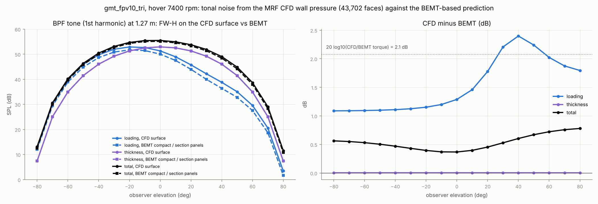
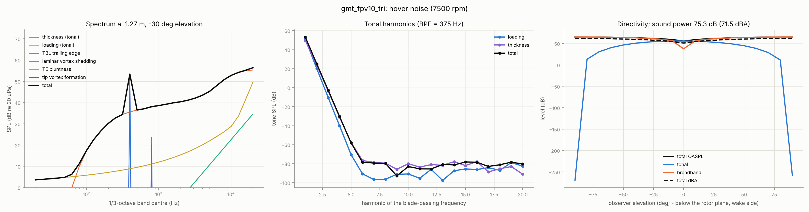
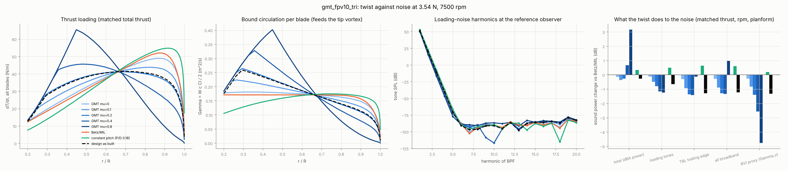
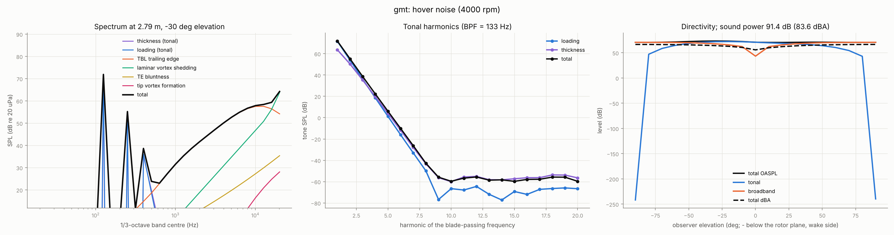
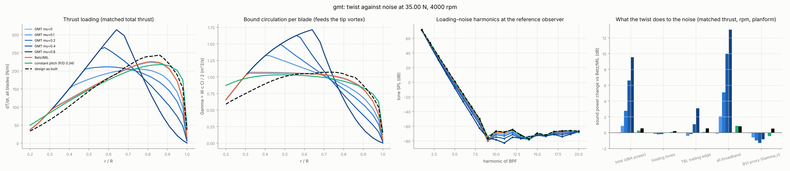
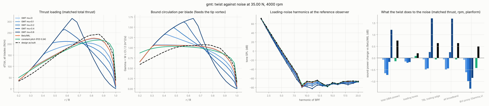

# Aeroacoustics: does a global-minimum-torque twist make the rotor quieter?

The `acoustics` pipeline stage predicts hover noise from the BEMT solution and the as-manufactured
blade surface. It then asks a controlled question: with planform, thrust and rpm held fixed, how
does the twist (Betz/MIL, the GMT bell family μ, constant pitch, as built) change each noise source?

```
prandtl run designs/<case>.yaml --stages acoustics   # spectra, directivity, twist comparison
prandtl noise-cfd designs/<case>.yaml --case <OpenFOAM case> --rpm 7400   # FW-H on the CFD blade surface
```

Outputs per run: `noise.png`, `bands_reference_observer.csv`, `twist_comparison.csv/png` and
`acoustic_summary.json`. Headline metrics are `delta_pwl_A_vs_MIL_dB`,
`delta_loading_pwl_vs_MIL_dB` and `bvi_proxy_delta_vs_MIL_dB`.

## Hypothesis under test

The claim was that a large part of the GMT benefit is a dB reduction from weaker wingtip vortices.
From first principles, a tip vortex can make sound through three separate mechanisms. The model
treats each one separately:

| Mechanism | What sets it | Model here |
|---|---|---|
| Tip-vortex *formation* noise (the vortex rolling up over the tip chord) | tip α, tip chord, tip speed⁵ | BPM tip model (Brooks, Pope & Marcolini, NASA RP-1218 §5.4) |
| Blade-vortex interaction (a blade cutting the previous blade's vortex) | vortex strength Γ_v and miss distance | proxy only: 20 log₁₀(Γ_v / Γ_v,MIL) |
| Tip loading radiating as tones | where the load sits radially | FW-H loading noise (exact for the steady load) |

## Method

**Tonal noise: Ffowcs Williams–Hawkings, Farassat Formulation 1A.**
- Source-time dominant, with exact retarded times for each source.
- Thickness noise is integrated over the closed, as-built blade surface: panels from the
  manufactured sections, with tip and root caps.
- Loading noise uses compact radial loading, with the force on the fluid equal to minus the BEMT
  blade force.
- Rigid rotation makes every derivative analytic: v = Ω×X, v̇ = Ω×v, ṅ = Ω×n, L̇ = Ω×L.
- Only blade 0 is computed. Blade k is the same pressure history delayed by k/B of a revolution,
  which is exact for identical blades.

**Broadband noise: BPM.**
- Ported from the BYU reference implementation, which was compiled and compared case by case.
- One BPM segment per BEMT station, using the local W, c, Re and α − α₀.
- Each segment is swept over 24 azimuths.
- Source frame: x_e chordwise downstream, y_e radial, z_e axial.
- Each azimuth gets a Doppler shift f_src = f_obs(1 − M_r) and the convective amplification
  built into BPM's directivity. The energy is averaged over azimuth and multiplied by B.
- Sources included: turbulent boundary layer trailing edge (TBL-TE, pressure side, suction side
  and separation, with the stall switch), laminar boundary-layer vortex shedding (LBL-VS),
  trailing-edge bluntness (h from the airfoil or manufacturing TE thickness, ψ = 14°), and
  tip-vortex formation (rounded tip, l = 0.008 α_tip c).
- α_tip is the effective tip angle from Γ one tip chord inboard, with Cl = 2πα.

**Metrics.**
- 1/3-octave bands from 20 Hz to 20 kHz, with A-weighting per IEC 61672.
- Observers on a meridian at 10R, from −90° to +90°.
- The reference observer is at −30°, below the rotor plane on the wake side.
- Sound power is the axisymmetric sphere integral of intensity.
- PWL in dB(A) is the single-number figure of merit.

### Assumptions (stated, not hidden)

1. **Isolated rotor, steady axial hover, steady loading in the rotating frame.**
   - Hover tonal noise is then purely the rotating steady load and thickness.
   - Unsteady loading is not modelled: no ingestion turbulence, arm/body interaction or BVI.
   - In a real multirotor, those sources often dominate the tones at low BPF harmonics.
2. **BPM is a 2-D empirical NACA 0012 model applied strip-wise.**
   - Its trend with α and Mach is reliable; its absolute level is ±3 dB on other sections.
3. **Transition state is a run option** (`acoustics.tripped`).
   - Untripped BPM assumes a natural laminar boundary layer. That switches on LBL-VS, which is
     very sensitive to Re and α.
   - Molded CFRP blades with a parting line and surface texture sit somewhere in between.
   - Both states are reported below. Neither is "the answer".
4. **Twist comparisons are at matched thrust, rpm and planform.**
   - Only the loading distribution changes, so the dB deltas isolate the twist.
5. **BVI is absent in isolated steady hover.**
   - The previous blade's vortex convects below the rotor plane. The proxy only ranks how strong
     that vortex would be if a gust, climb-out or descent brought it back.

## Validation

| Check | Result |
|---|---|
| FW-H loading vs closed-form Gutin far field | ≤ 0.2 % on axis to 40°; ≈ 1 % at 60° (`tests/test_acoustics.py`) |
| BPM vs reference Fortran, 8 regression cases | ≤ 1e-6 dB (tip model 1.7e-7 dB) |
| Panel surface closure Σ n dA | ~1e-17 m² |
| Symmetry shortcut + chordwise stride 4 | 111 s → 12 s; thickness noise moves 0.03 dB |
| **CFD-surface FW-H** (10″ hover, 7400 rpm, 43,702 OpenFOAM MRF wall faces) | see below |

The CFD check is independent of the BEMT. Farassat 1A runs directly on the OpenFOAM blade-surface
pressure, using every wall face as a panel with gauge pressure ρ·p.

- **Pressure thrust**: 3.552 N, against 3.543 N from CFD force integration. This confirms the
  sign, normals and density.
- **Thickness noise, CFD surface vs BEMT panels**: within 0.01 dB at every elevation. The
  manufactured-surface panelling is right.
- **Loading noise at BPF1**: CFD is 1.1–2.2 dB higher than BEMT. This matches the known CFD/BEMT
  load difference (CFD torque +27 % → 20 log 1.27 ≈ 2.1 dB on the in-plane, torque-driven lobe;
  thrust +2.7 %).
- **Total at BPF1**: within 0.4–0.7 dB. **At BPF2**: within 0.1–0.7 dB.



## Results: 10″ tri-blade FPV (hover 3.5 N per rotor, 7400 rpm)

Design as built, untripped, at 1.27 m (10R) and −30°:
- OASPL 62.5 dB and **58.5 dBA**.
- Sound power 75.3 dB (71.5 dBA): tonal 65.5 dB, broadband 74.8 dB.
- Source powers: TBL-TE 74.4, bluntness 63.8, thickness 63.0, loading 61.0, LBL-VS 50.2 and
  tip-vortex formation **−9.9 dB**.
- Tripped: 62.4 dBA at the reference observer; PWL_A 75.3 dB.



Twist comparison, untripped, as deltas vs Betz/MIL (dB):

| Case | PWL(A) | loading tones | TBL-TE | BVI proxy | Torque (mN·m) |
|---|---|---|---|---|---|
| GMT μ = 0 | −0.14 | −0.12 | −0.30 | −0.26 | 43.73 |
| GMT μ = 0.1 | **−0.36** | −0.49 | −0.94 | −0.83 | |
| GMT μ = 0.2 | −0.27 | −0.79 | −1.36 | −1.40 | |
| GMT μ = 0.4 | +0.67 | −1.16 | −1.41 | −2.56 | |
| GMT μ = 0.8 | +3.16 | −1.24 | −0.13 | −4.76 | |
| constant pitch | +0.33 | +0.50 | +0.64 | +0.20 | |
| design as built | −0.26 | −0.65 | −1.29 | −1.32 | 44.77 |
| Betz/MIL | 0 | 0 | 0 | 0 | 43.76 |

With tripped boundary layers, the as-built design is −0.50 dB(A) vs MIL.



## Results: 22″ thesis designs (smoke operating point)

GMT vs MIL design (each as built, untripped):

| | GMT | MIL | Δ |
|---|---|---|---|
| PWL(A) | 83.62 | 84.12 | −0.50 |
| dBA at reference | 64.21 | 64.72 | −0.51 |
| tonal PWL | 89.10 | 89.33 | −0.23 |
| broadband PWL | 87.51 | 88.13 | −0.62 |
| tip-vortex formation PWL | 50.8 | 55.0 | −4.2 |
| α_tip effective | 5.6° | 6.8° | |

Tripped: PWL(A) is 89.24 vs 90.34, a gap of **−1.10 dB**; at the reference observer it is 69.91 vs
71.02 dBA.

GMT source powers (untripped): loading 87.3, LBL-VS 84.8, TBL-TE 84.1, thickness 83.4,
bluntness 58.6, tip 50.8 dB.



Twist family at the 22″ GMT planform, Δ PWL(A) vs ideal Betz/MIL:

| Case | untripped | tripped |
|---|---|---|
| GMT μ = 0 | −0.07 | −0.07 |
| GMT μ = 0.1 | +0.85 | −0.65 |
| GMT μ = 0.2 | +2.75 | **−0.72** |
| GMT μ = 0.4 | +6.61 | −0.17 |
| GMT μ = 0.8 | +9.55 | +1.21 |
| constant pitch | +0.26 | −0.14 |
| design as built | +0.54 | +0.75 |

The BVI proxy for μ = 0.1 / 0.2 / 0.4 is −0.61 / −0.99 / −1.31 dB. Note that the thesis MIL design
is itself 1.05 dB louder than the ideal Betz loading at its own planform.

| Untripped | Tripped |
|---|---|
|  |  |

## What this says about the tip-vortex hypothesis

1. **Tip-vortex *formation* noise is not audible on these rotors.**
   - The BPM tip spectrum peaks at St = f l / U_max ≈ 0.5, where l = 0.008 α c_tip is a fraction
     of a millimetre. That puts the peak at roughly **90–300 kHz**.
   - What reaches the audible band is −10 dB (10″) to 51 dB (22″) of power. That is 30–80 dB
     under the total.
   - GMT does cut it, by 4 dB on the 22″, because α_tip drops. But it removes nothing anyone can
     hear.
   - The `acoustics` stage prints a warning saying so.
2. **The audible GMT benefit is real but modest: ≈ 0.3–1.1 dB(A) of sound power.** It comes
   through two mechanisms that do involve the tip:
   - **Loading tones.**
     - The m-th harmonic radiates through J_mB(mBΩ r sinθ / c₀), which grows steeply with r.
     - Moving load inboard (μ > 0) cuts the loading tones by 0.5–1.2 dB at equal thrust.
   - **TBL trailing-edge noise.**
     - TBL-TE scales roughly as M⁵ times a function of α.
     - Unloading the fast outboard sections cuts it by 0.9–1.4 dB.
3. **There is an optimum, and it is not "as little tip load as possible".**
   - At fixed thrust, pushing load inboard raises inboard α. Broadband then rises again: TBL-TE
     suction-side and separation terms first, then the stall switch.
   - Tripped, the optimum is μ ≈ 0.1–0.2 on both rotors.
4. **Untripped, the 22″ inboard sections hit laminar vortex shedding.**
   - These sections run at low Mach and Re ~ 10⁵, and LBL-VS swamps the bell-family gains.
   - The tripped rerun removes the penalty, which isolates the cause.
   - Design implication: a GMT blade should either be tripped or textured inboard, or keep inboard
     α away from the LBL-VS peak. The 10″ (higher inboard Re) shows only a small LBL-VS term.
5. **Weaker tip vortices matter most for BVI, which hover cannot show.**
   - The proxy says GMT twists shed a 1–5 dB weaker trailing vortex.
   - BVI is typically the loudest rotor noise in descent and in multirotor gusts, so this is where
     the hypothesis could hold.
   - Testing it needs the next phase below.

## Next phase

- **Free-wake BVI.**
  - Run a prescribed- or free-vortex wake, with the Γ_v from this stage as the trailed strength.
  - Compute miss distance in descent or forward flight, then the unsteady blade loading.
  - Feed it to the existing FW-H as time-varying L(ψ). The F1A code already accepts a source-time
    history, so only `RotorSources` needs a ψ-dependent load.
- **Unsteady CFD loading** (sliding mesh rather than MRF) through `noise-cfd`. This captures the
  arm interaction on the 10″ quad.
- **Measure:** a single-mic hover test on the printed 10″ GMT and MIL blades at matched thrust,
  to check the ≈ 0.3–0.5 dB(A) prediction.
