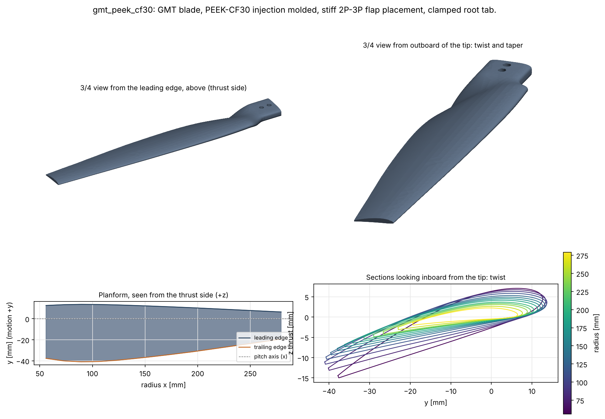
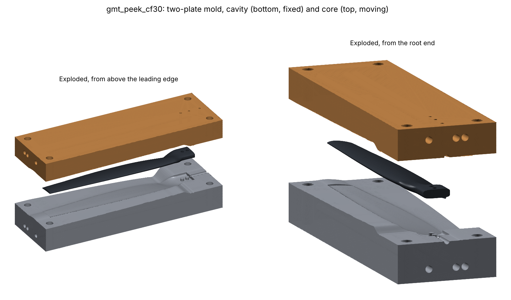

# Designing the Blade for Injection-Molded CFRP

`prandtl optimize-molding` adapts a design for injection molding in short-fibre CFRP. Planform,
twist, and camber lines stay as designed, so the thesis aerodynamic design is preserved. Only the
section thickness distribution and the trailing edge change.

```bash
prandtl optimize-molding designs/gmt.yaml --material peek-cf30 --max-thickness-mm 9
prandtl run runs/gmt/molding_optimisation/gmt_peek_cf30.yaml --stages dfm,fea,modal   # confirm with CalculiX
```

## Assumptions

- **Process.** A solid blade in a two-plate mold, gated at the root, so skin fibres align spanwise
  with the flow. The mold opens perpendicular to the span.
- **Material.** The presets in `src/prandtl_prop/manufacturing/materials.py` use typical datasheet
  values: PA6-CF30 (conditioned) E 15 GPa, UTS 150 MPa; PEEK-CF30 E 24 GPa, UTS 260 MPa. Design
  values apply knockdowns of 0.85 on stiffness (skin-core fibre orientation) and 0.40 on strength
  (high-cycle fatigue, weld lines, process scatter). **Replace them with the chosen grade's datasheet.**
- **Molding rules.** Minimum blunt trailing edge 0.6 mm. Maximum solid section thickness: 6.5 mm by
  default; beyond that, sink, voids, and a cooling time growing with t^2 call for a cored or
  gas-assisted root. Spanwise thickness gradient at most 0.05 m/m. Spanwise flow length at most 150x
  the thinnest section. Draft at least 0.5 deg away from the parting line.
- **Operating envelope.** A multirotor controls thrust through rpm. The default band is 0.9-1.1 x
  design rpm, and every flap mode must stay at least 10% clear of the 1P-4P lines across the band.

## Method

1. **Geometry.** Thickness scales about each airfoil's camber line at four control radii
   (r/R = 0.2, 0.45, 0.7, 1.0), interpolated linearly between them, plus a linear wedge that blunts
   the trailing edge to the minimum thickness.
2. **Undercuts (exact).** The pull direction has no spanwise component, so every pull ray stays in
   one section plane. The blade is undercut-free if and only if every section outline is monotone
   along the pull. The best pull angle is found by scanning.
3. **Frequencies.** A rotating Euler-Bernoulli beam model covers coupled flap and lag through I_yz,
   centrifugal stiffening, and spin softening, using the true section properties. On the GMT blade it
   matches the CalculiX Campbell results to 0.3% for flap modes (lag runs 8% high, since shear
   flexibility is neglected). It runs in milliseconds, so it can sit inside the optimiser; CalculiX
   confirms the result.
4. **Objective.** The extra profile torque from thickening, computed with the Hoerner form factor
   `1 + 2 t/c + 60 (t/c)^4` at BEMT's own station inflow. That is first order: valid for moderate
   thickness changes at fixed camber, and blind to Cl_max and stall-margin changes. The default lower
   bound is therefore 1.0: molding may add thickness, never remove it.
5. **Search.** The constraints are non-smooth (mode identities switch), so gradient-based SLSQP
   fails. Instead: a uniform-scale scan and a 2-D scan of linear root-to-tip profiles find feasible
   starts, multi-start COBYLA polishes them, and the returned design is validated exactly as written.

## The frequency-placement result that drives everything

The first flap frequency rises with rotor speed, f(n)^2 = f0^2 + K n^2, with K of about 1.6 for this
blade. Keeping it 10% clear of both kP and (k+1)P over [n_lo, n_hi] needs
f(n_hi) >= 1.1 k n_hi and f(n_lo) <= 0.9 (k+1) n_lo:

| rpm band | 1P-2P (soft) | 2P-3P (stiff) | 3P-4P |
| --- | --- | --- | --- |
| 0.9-1.1 x design | f0 <= 77 Hz | 132 <= f0 <= 143 Hz | impossible |
| 0.8-1.2 x design | f0 <= 68 Hz | **impossible** | impossible |

This depends only on K, the band, and the margin, not on material. With a +/-20% rpm band, no
material or thickness avoids 2P and 3P together. Every design also crosses some kP lines while
spinning up, because the lines fan out from the origin. A soft blade crosses 2P on the way up; a
stiff blade crosses 3P and 4P (usually weaker excitation).

## Results (smoke inputs: analytic polar, NACA 4410 stand-in sections)

| Option | Thickness scales at r/R 0.2 / 0.45 / 0.7 / 1.0 | Torque penalty | Mass | Flap 1 over band | Stress | Tip deflection | Max thickness |
| --- | --- | --- | --- | --- | --- | --- | --- |
| Baseline (sharp TE), aluminium | 1 / 1 / 1 / 1 | - | 88 g | 147-156 Hz | 45 MPa | 1.8 mm | 5.7 mm |
| **A: PEEK-CF30, stiff 2P-3P** | 1.61 / 1.15 / 1.0 / 1.0 | **+0.30%** | 60 g | 153-163 Hz | 15 MPa | 2.7 mm | 8.9 mm (root) |
| **B: PA6-CF30, soft 1P-2P** | 1.0 / 1.0 / 1.0 / 1.17 | **+0.38%** | 46 g | 107-119 Hz | 29 MPa | 7.6 mm | 5.9 mm |
| PEEK-CF30 with the 6.5 mm cap | - | infeasible | | | | | |
| PA6-CF30, stiff 2P-3P | - | infeasible even with a 10 mm cap (E/rho too low) | | | | | |

Notes:

- Results are with the default 1% model cushion (the optimiser targets an 11% margin; CalculiX must
  confirm at least 10%). Without the cushion, the optima were +0.29% (A) and +0.23% (B), but B then
  fell to 9.6% in CalculiX.
- Uniform thickening to reach 2P-3P in PEEK costs +2.0% torque. Tapering the extra thickness to
  the root (where flap stiffness comes from) while leaving the outboard light reaches the same
  frequency for +0.30%, roughly 7x less.
- A tighter 8.5 mm root cap is still feasible for PEEK (about +0.31% before the cushion).
- Option B lowers the frequency into the soft window by adding tip mass (tip sections 17% thicker)
  instead of removing material. It crosses 2P near 0.75 x design rpm during spin-up and deflects
  7.6 mm at the tip (beam, without centrifugal stiffening).
- All options pass every molding check, including undercut-free release at a pull angle of about
  9 deg from the thrust axis.

### CalculiX confirmation

Solid C3D10 models of the optimised geometry: NLGEOM static under aero plus CENTRIF, and
prestressed Campbell analyses at 0, 0.9, 1.0, and 1.1 x design rpm.

| | A: PEEK-CF30 | B: PA6-CF30 |
| --- | --- | --- |
| First flap at 0 / 3600 / 4000 / 4400 rpm (CalculiX) | 130.6 / 153.8 / 158.7 / 163.9 Hz | 75.9 / 107.2 / 113.2 / 119.4 Hz |
| Smallest separation over the band (CalculiX) | **11.7%** (from 2P at 4400 rpm) | **10.7%** (from 2P at 3600 rpm) |
| Beam model vs CalculiX, first flap | within 1% | within 1% |
| Peak von Mises outside the clamp zone (NLGEOM) | 10.8 MPa (allowable 104) | 10.6 MPa (allowable 60) |
| Tip flap deflection (NLGEOM) | 1.7 mm | 3.1 mm |
| Centrifugal root force, FEA vs beam | 0.999 | 1.000 |
| Molding checks (TE, thickness, gradient, flow, undercut, draft) | all pass, pull 9 deg | all pass, pull 2.5 deg |

Static values come from the first confirmation round; the geometry changed by under 1% in thickness
when the cushion was added. The first round also caught two defects, both now fixed: the molding
check measured margins against the blade frequency instead of the excitation (so 10% read as 9.1%),
and the Campbell check covered only the design speed. Option B sat at 9.6% at the band edge without
the cushion.

## Full blade (option A) with the clamped root

`designs/gmt_peek_cf30.yaml` is option A with `root.enabled: true`. `prandtl run ... --stages cad`
lofts the whole part: a flat superellipse tab (28 x 8.5 mm, r = 14-34 mm) that the hub plates clamp,
two 5.3 mm bolt holes along z at r = 20 and 29 mm, a smoothstep transition (chordwise position,
thickness, and pitch all blend with zero slope at both ends) into the first aero station at
r = 55.9 mm, then the optimised aero sections to the tip. Every outline has the same point count,
correspondence, and 0.6 mm blunt TE, and the DFM stage checks all of them for undercuts (undercut-free
for pulls of 0-9 deg; best 2 deg). Volume 52.7 cm^3, 74 g in PEEK-CF30.

CalculiX on the full blade, with only the tab's top and bottom faces clamped (smoke inputs):

| | Full blade, tab clamp | Earlier confirmation, clamp at first aero station |
| --- | --- | --- |
| Peak von Mises outside the clamp zone (NLGEOM) | 12.7 MPa (MoS 7.2 vs 104 MPa) | 10.8 MPa |
| Tip flap deflection | 2.0 mm | 1.7 mm |
| First flap at 0 / 4000 rpm | 111.8 / 138.8 Hz | 130.6 / 158.7 Hz |
| Smallest separation over 3600-4400 rpm | **2.0% (fails the 10% target)** | 11.7% |

Bolts (all radial force through the bolts, double shear): bolt shear 17.2 MPa, tab bearing 16.8 MPa,
net section 7.9 MPa, shear-out 7.4 MPa; margin 3.4 after knockdowns of 3 on net section (hole stress
concentration) and 2 on shear-out. The inner bolt's edge distance is only 1.13 D. Short-fibre CFRP
practice wants at least 2-3 D, so extend the tab inward (tab_inner_radius_m about 0.009) if the hub allows.

**Superseded by the hub design (`docs/hub.md`).** The bolt figures above count only the radial
load. The hub stage found that a tab centred on the chord midpoint sits 11 mm off the centrifugal load
line, which passes through the rotation axis. That adds a 17 N·m in-plane couple, and 2.1 kN on the
worst bolt. Both designs now centre the tab on the load line (`root.tab_centre_s_m: 0.0021`) and use
flat clamp faces (`root.corner_exponent: 8`). The full-blade CalculiX, mold, and render numbers in
this section are for the earlier tab. The modal finding below does not depend on the change.

**The clamp location moves the first flap frequency by 14%, and option A no longer clears 2P.** The
optimiser's beam model clamped the blade at the first aero station. The hub actually grips the tab
inside r = 34 mm, so the free length grows from 223 to 245 mm (f ~ 1/L^2 predicts 0.83x; CalculiX
gives 0.86x). The beam model now starts at the tab clamp edge and includes the transition outlines
when `root.enabled` is set, and it matches CalculiX to 1.4% (140.7 vs 138.8 Hz). The optimiser
uses a 2% cushion for these designs.

Re-optimising with the root modelled (9 mm thickness cap, 10% margin over 0.9-1.1 x rpm):

- **PEEK-CF30, stiff 2P-3P: infeasible.** The window narrows to f0 = 139-141 Hz, and the thickness cap
  binds at the root. With option A's thickness, moving the hub grip out to r = 48 mm still gives only
  7% from 2P (beam model).
- **PEEK-CF30, soft 1P-2P: feasible**, with the tip sections 37% thicker. Flap 1 is 106-117 Hz over
  the band, at +0.66% torque (a 0.17% share of that is the blunt TE alone), 52 g, 31 MPa, and a 4.9 mm
  tip deflection.
- **PA6-CF30, soft 1P-2P (option C, `designs/gmt_pa6_cf30.yaml`): feasible with no thickening.** The
  root's flexibility moves the as-designed blade into the soft window by itself: flap 1 is 99-111 Hz
  over the band, at +0.17% torque (the 0.6 mm blunt TE only), 46 g, 28.6 MPa (allowable 60 MPa), and
  a 7.5 mm beam tip deflection. It crosses 2P on spin-up, like option B.
  CalculiX on the full blade with the tab clamp confirms flap 1 at 97.9 / 103.7 / 109.8 Hz at
  3600 / 4000 / 4400 rpm (beam within 1.2%, at least 18% from 2P). But **flap mode 2 sits 8.7% from 4P at
  4400 rpm** (319 vs 293 Hz), because the beam read it 3.7% high. The optimiser now gives modes above
  flap 1 a 5% cushion (Euler-Bernoulli neglects shear and rotary inertia, an error that grows with
  mode number). Re-optimised with that cushion, `designs/gmt_pa6_cf30.yaml` makes
  the root 12% thicker (scales 1.12 / 1.0 / 1.0 / 1.0) for +0.18% torque. Its CalculiX confirmation is
  in progress.

So with a realistic root, the stiff design needs one of these:

1. A hub grip reaching about the first aero station, plus a cored or ribbed root thicker than 9 mm.
2. A stiffer material: long-fibre or continuous-fibre overmolded spar, or a higher-modulus grade.
3. Accepting the soft window and a 2P crossing on spin-up, as option B already did.

The mold below is built for option A as specified. The mold stage regenerates it for any of these
choices in one command.

## Two-plate mold

```bash
prandtl run designs/gmt_peek_cf30.yaml --stages cad,mold   # about 30 min; STEP in mm under runs/<design>/mold/<key>/
```





Outputs: `mold_core.step`, `mold_cavity.step`, `part_shrink_compensated.step` (mm, for SolidWorks or
CAM), STL copies in metres, and `mold_render.png`. Settings are under `mold:` in the design file
(`MoldDesign` in `src/prandtl_prop/manufacturing/mold.py`).

- **Opening direction +z (the thrust axis).** The bolt-hole core pins are parallel to the pull, and
  the DFM stage confirms every section is undercut-free at that pull.
- **Parting surface.** Inside each section it follows the mid-line between the upper and lower
  surfaces, which always stays inside the section; a chord-line split exits a cambered section near
  the TE and traps steel. At the LE it leaves through the extreme-y point, where the wall is parallel
  to the pull. On the 0.6 mm blunt TE it leaves through the flat, 20% of the way from the drafted
  corner, which chamfers that corner by at most 0.12 mm. Outside the part it eases to horizontal
  over 3 mm.
- **Construction.** Each half is lofted directly from per-section profiles (parting line, then the
  part's upper or lower surface, then parting line, then the insert face), through the same section
  stations as the part. No boolean against the part is needed. Exact booleans of the lofted part
  against a parting region were tried first and failed silently near the silhouette.
- **Shrinkage.** 0.2% along the flow (span) and 0.8% across (y, z), applied about the rotor axis, so
  section pitch angles are unchanged. Warpage from orientation-dependent shrinkage is not modelled.
- **Features.** Bolt-hole core pins from both halves meeting at the parting surface; a 6 mm
  full-round runner on the parting surface into a 3 mm gate at the tab's inner end (spanwise fill,
  so fibres align with the span); 4 mm ejector pins in the core on the tab and runner (off the aero
  surfaces); 12 mm leader-pin bores; three 8 mm spanwise cooling channels per half.

Checks on the option A mold (smoke inputs):

| Check | Result |
| --- | --- |
| Core and cavity valid solids (OpenCascade) | yes / yes |
| Impression volume / shrink-compensated part volume | 1.0002 |
| Part volume in the cavity half | 50.0% |
| Core blank + cavity blank / insert block | 0.999994 (one shared parting surface) |
| Insert size | 321 x 105 x 72 mm |
| Steel, cooling channel to part / to ejector pins | 8.0 mm / 4.0 mm (>= 3 mm required) |

Before cutting steel, also: add the sprue bushing, the locating ring, and the ejector plate to suit
the press; vent the tip and the TE (last to fill); confirm the gate size and cooling layout with a
fill/pack/warp simulation; and apply its warpage compensation on top of the linear shrink factors.

## Recommendation

**Updated after modelling the clamped root (see "Full blade" above):** a stiff 2P-3P design is no
longer reachable in PEEK-CF30 within the molding limits. Of the root-aware designs, **option C
(PA6-CF30, as-designed thickness, soft 1P-2P)** costs the least: +0.17% torque, 46 g. It passes 2P on
every spin-up, so the airframe and spin-up rate decide whether that is acceptable. The notes below
date from before the root was modelled.

- **Option A (PEEK-CF30, stiff)** is the conservative choice. No 1P/2P crossing inside the band, low
  stress, small deflection, and the GMT aero advantage survives (+0.30% torque against a GMT-MIL
  difference of about 1%). The 8.9 mm root exceeds the 6.5 mm general solid-section guideline: plan
  for a cored or ribbed root under a skin, gas assist, or accept the longer cycle. Ask the molder.
- **Option B (PA6-CF30, soft)** is cheaper and lighter, but it passes 2P on every spin-up and
  absorbs moisture (the conditioned modulus was used). Use it only if spin-up is fast and the
  airframe does not amplify 2P.
- Apply the same treatment to the MIL baseline before comparing torques, so the thesis comparison
  stays like for like.

## Before cutting steel

1. Rerun with the real airfoils and XFOIL polars, *and* regenerate polars for the thickened,
   blunted sections; the form-factor estimate is first order.
2. Insert the real material datasheet (conditioned values for PA).
3. Run a mold-filling and warpage simulation (Moldflow or Moldex3D). Anisotropic shrinkage
   (about 0.2-0.4% along the flow, 0.8-1.2% across) can change twist, the quantity this design
   optimises. Compensate the mold geometry for it.
4. Match the root tab to the real hub. The grip radius sets the first flap frequency (see "Full
   blade" above), and the inner bolt's edge distance should reach 2-3 D.
