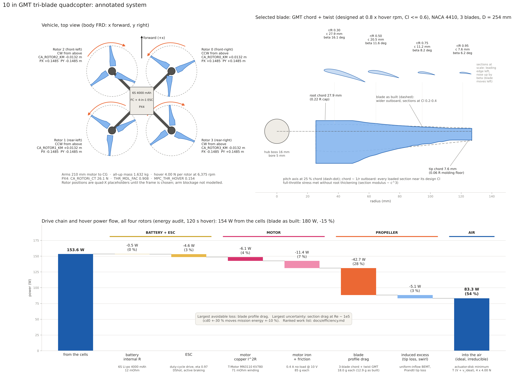
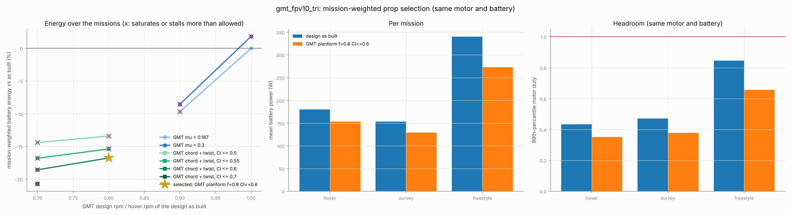
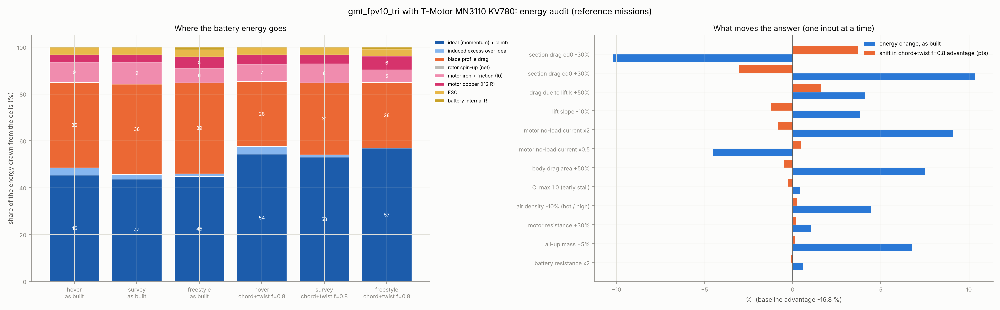

# Efficiency: where the energy goes, what to change, and what to work on next



*Annotated system (regenerate with `python scripts/draw_system.py`; every number is read from the pipeline outputs).*

```
prandtl sitl-audit    designs/gmt_fpv10_tri.yaml --stations "new=outputs/.../stations.csv" --motor "T-Motor MN3110 KV780"
prandtl sitl-optimize designs/gmt_fpv10_tri.yaml --motor "T-Motor MN3110 KV780"     # twist, bell, and chord + twist families
```

This applies to the 10″ tri-blade GMT on a 6S quad with the MN3110 KV780 (docs/sitl.md §4).
Missions are the three reference missions, equally weighted. The method is first principles
throughout: account for every watt, then change what is largest and can be changed.

## 1. Where the battery energy goes (design as built)

`replay.energy_breakdown` splits the energy drawn from the cells into eight terms. The breakdown
closes to under 1% (`test_energy_breakdown_closes`). The "ideal" term is the actuator-disk momentum
minimum for the thrust at this disk area, T(V_axial + v_ideal), including climb work. It is the only
part a better propeller cannot reduce.

| Share of cell energy | hover | survey | freestyle |
| --- | --- | --- | --- |
| ideal (momentum) + climb | 45 % | 44 % | 45 % |
| **blade profile drag** | **36 %** | **38 %** | **39 %** |
| motor iron + friction (no-load current) | 9 % | 9 % | 6 % |
| motor copper | 3 % | 3 % | 5 % |
| induced excess over ideal (tip loss, non-uniform inflow) | 3 % | 2 % | 1 % |
| ESC | 3 % | 3 % | 3 % |
| battery internal resistance | < 1 % | < 1 % | 1 % |

**Hover figure of merit: 0.53.** Profile drag is the one large slice that can be reduced. The
induced excess is already small, because the GMT twist does its job.

**Why profile drag is so large.** The as-built blade's sections run at low Cl outboard, where most of
the power is spent. With cd = cd0 + k Cl², drag per unit lift (cd/Cl) is smallest at
Cl* = √(cd0/k) = 0.78. The as-built blade runs:

| r/R | 0.2 | 0.45 | 0.67 | 0.85 | 0.96 |
| --- | --- | --- | --- | --- | --- |
| Cl | 1.00 | 0.59 | 0.37 | 0.28 | 0.20 |
| cd/Cl (best 0.045) | 0.047 | 0.047 | 0.059 | 0.072 | 0.094 |

The planform was rescaled from the thesis 22″ blade, so the outboard chord is too wide for this rpm.
A twist change alone cannot fix that.

## 2. The change: global minimum torque over chord and twist

`aero.gmt.design_with_chord` extends the separable GMT Lagrangian:
- **Why it still separates.** Each BEMT annulus depends only on its own chord and twist. The
  min-torque problem at fixed thrust therefore still separates per station, over a chord × twist
  grid.
- **What that guarantees.** The result is a global optimum over planform and twist together at the
  given rpm.
- **What it predicts.** Loaded sections run at Cl*, with chord set by the circulation each annulus
  must carry. The test `test_chord_and_twist_gmt_runs_sections_near_best_lift_to_drag` checks this.

Hover shaft power at the same 3.54 N, chord bounds 0.04–0.25 R:

| rpm | 7500 (as built) | 7500 | 6000 | 5250 | 4500 | 3750 |
| --- | --- | --- | --- | --- | --- | --- |
| design | as built | chord + twist | chord + twist | chord + twist | chord + twist | chord + twist |
| shaft power | 34.8 W | 30.9 W | 28.6 W | 27.6 W | 26.8 W | 26.2 W |

Two physical limits then bound the design:

1. **Stall margin in edgewise flight.** Translational lift lowers the induced velocity and raises
   every section's angle of attack. A blade designed at Cl* = 0.78 stalls its outer disk for 56–90%
   of the worst mission. A lower design Cl cap trades profile drag for stall margin (Cl ≤ 0.5–0.7 in
   the search).
2. **Blade stress at full throttle (T/W 4).** This is now checked for every candidate: P/A + M/Z
   against PA6-CF30 at SF 1.5, with the root thickening allowed up to 1.8× t/c.
   - The design as built sits *exactly* at the allowable at r/R ≈ 0.5, where the thickening has
     tapered out.
   - Its bell weight μ = 0.187 was therefore what kept it feasible. Every twist-only design with
     μ = 0, plus Betz/MIL and constant pitch, fails the check.
   - **This supersedes the earlier twist-only pick (GMT f = 0.9, μ = 0, docs/sitl.md §3), which is
     structurally infeasible.**
   - Wider chords fix it: section modulus grows as c·t² ∝ c³.

**Each candidate's mass and inertia.** Every candidate gets its own root thickening, prop mass and
inertia, from the section-area model scaled to the CAD of the design as built. The all-up mass
changes by 4 × the prop mass change, and the traces' wrench scales with it.

## 3. Result



| Blade (MN3110 KV780, same battery) | Mission energy | Hover / survey / freestyle battery power | Worst stall time | Saturated | Prop mass, inertia | Root thickening |
| --- | --- | --- | --- | --- | --- | --- |
| design as built (GMT twist, μ = 0.187) | 20.85 Wh | 180 / 154 / 340 W | 5.6 % | 0.31 % | 12.9 g, 3.6e-5 kg·m² | 1.52 × |
| GMT twist f = 0.9, μ = 0.187 | 18.83 Wh (−9.7 %) | 164 / 140 / 300 W | 36 % ✗ | 0.20 % | 12.8 g | 1.49 × |
| **GMT chord + twist, f = 0.8, Cl ≤ 0.6 (selected)** | **17.36 Wh (−16.8 %)** | **154 / 129 / 273 W** | 4.9 % | 0.20 % | 18.0 g, 4.2e-5 kg·m² | none |
| GMT chord + twist, f = 0.7, Cl ≤ 0.6 | 16.98 Wh (−18.6 %) | 151 / 125 / 270 W | 6.5 % ✗ | 0.46 % ✗ | 22.9 g | none |
| GMT chord + twist, f = 0.7, Cl ≤ 0.7 | 16.53 Wh (−20.7 %) | | 16 % ✗ | 0.17 % | | none |

**The selected blade** is `outputs/sitl/gmt_fpv10_tri/planform/best/stations.csv`. Its tables and
PX4 parameters sit in the same folder.
- **Rpm.** It hovers at about 6000 rpm instead of 7500.
- **Chord.** 27.9 mm at the root (the 0.22 R cap), tapering roughly as 1/r to 7.6 mm at the tip (the
  0.06 R floor).
- **Twist.** 18.8° at the root to 3.0° at the tip.
- **Profile drag.** Hover profile drag falls 35%, from 2.19 to 1.42 Wh in the 120 s hover.
- **Iron loss.** Motor iron loss falls 27%, because the motor turns more slowly.
- **Ideal power.** It rises 2%, from the heavier props.



**Robustness** (one input at a time, `sitl-audit`). The advantage stays between **−13% and −20%**
under every perturbation:
- **Section drag.** Moving cd0 by ±30% shifts it by about 3 points. More drag *increases* the
  saving, because the new blade's gain is a profile-drag reduction.
- **Early stall.** If the real Cl max is only 1.0, which is plausible at Re ≈ 1e5, the selected blade
  stalls 27% of the worst mission.

## 4. What needs the most work, ranked

| # | Item | Why (evidence) | Work |
| --- | --- | --- | --- |
| 1 | **Section polars at the real Reynolds number** | Profile drag is the largest avoidable loss (36–39%) and the largest prediction uncertainty: cd0 ±30% moves mission energy ±10%. The 10″ CFD gave 27% more torque than BEMT. Cl* = √(cd0/k), so the polar also sets the optimal planform, and Cl max sets the stall margin that bounds it. | XFOIL / MSES polars for the molded sections (thickened root, 0.4 mm blunt TE) at Re 0.5–2e5, with transition; calibrate against the existing CFD loop (`prandtl loop`) and a thrust stand; rerun `sitl-optimize`. |
| 2 | **Stall and inflow in edgewise flight** | The stall constraint is now binding. The model uses uniform inflow and a polar with no post-stall drag. | Linear (Pitt–Peters) inflow; post-stall drag; an edgewise CFD point at 10–15 m/s through the mission stage. |
| 3 | **Aero–structure coupling of the thickness** | Mid-span stress bounds the twist. The thickness schedule is fixed (tapering out at r/R 0.5), and candidates keep the as-built drag factors. | Optimise the thickness schedule with the planform: Hoerner drag versus section modulus per station, with FEA confirmation. |
| 4 | **Motor no-load loss** | It is 6–9% of the energy and only datasheet-level: ×2 moves energy by 9%. | Bench spin-down and no-load sweep of the chosen motor; replace the I₀(ω) model. |
| 5 | **Vehicle mass and drag area** | +5% mass gives +7% energy; +50% CdA gives +7.5%. These belong to the frame, not the prop. | Weigh the build, and measure CdA in flight logs (coast-down) once the frame exists. |
| 6 | **Real missions** | The reference missions are kinematic stand-ins. | SITL and flight logs into `sitl-optimize --log`. |

Small and settled: battery resistance, motor resistance and air density each move the decision by
under 0.3 points.
