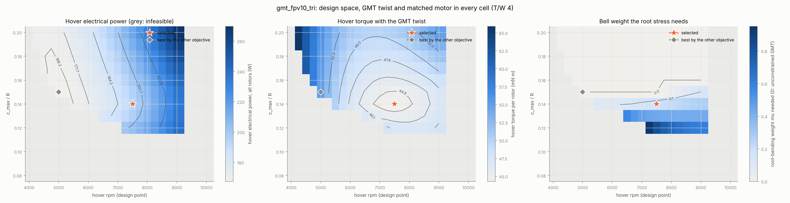
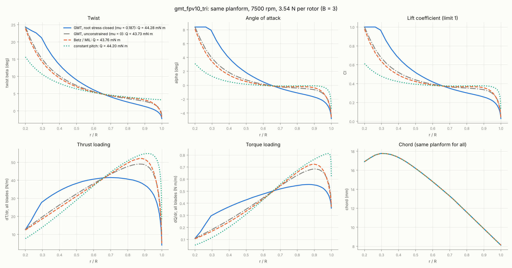
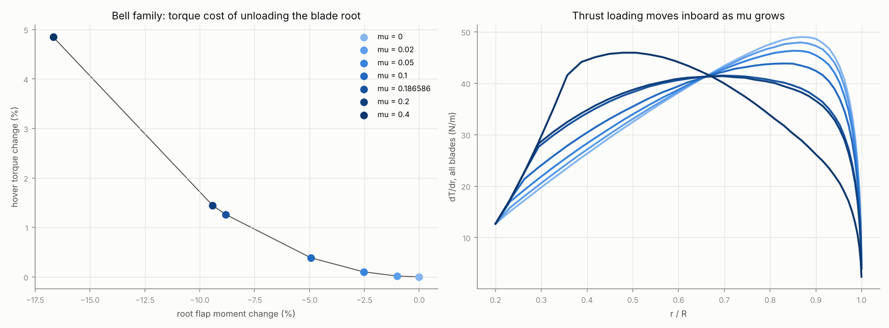
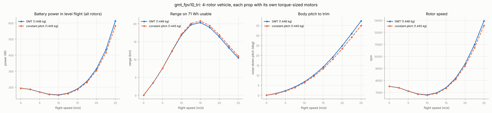
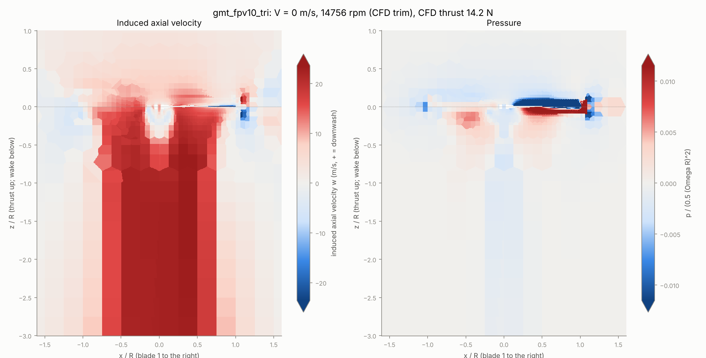
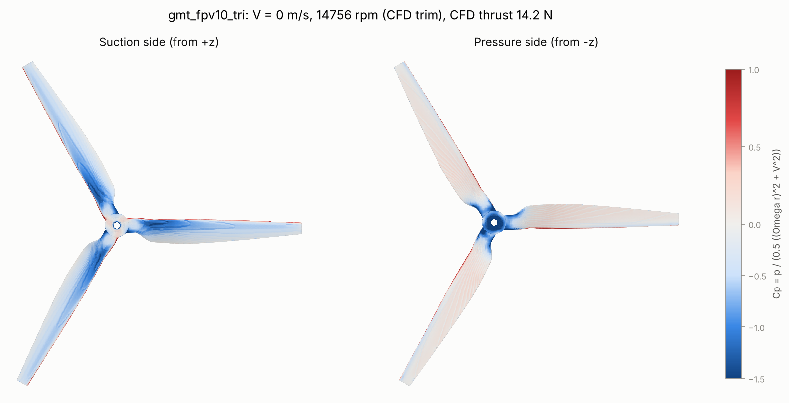
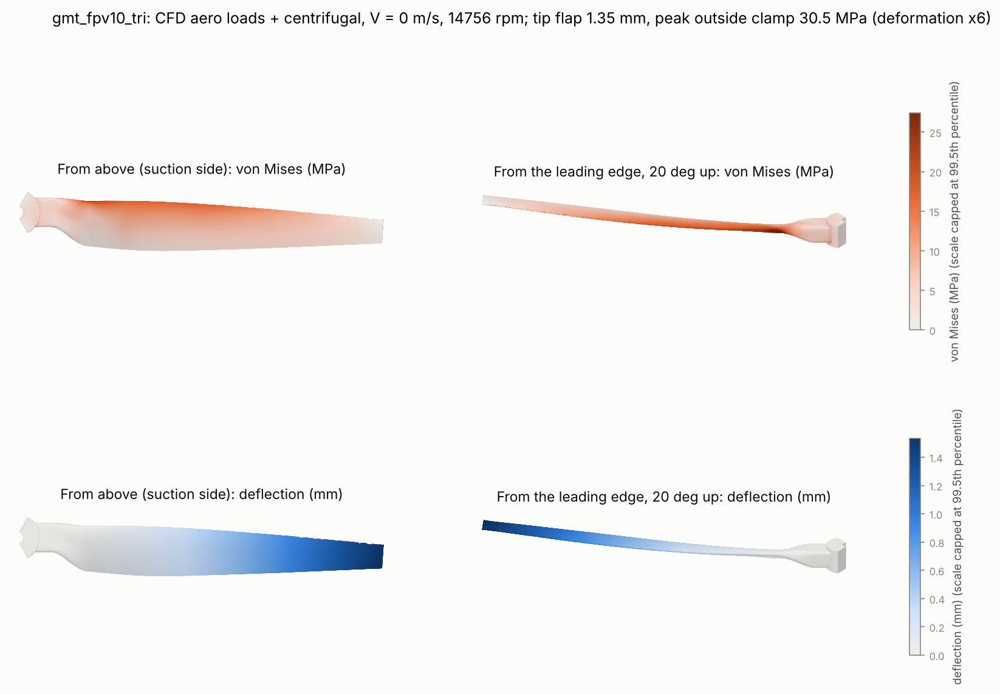

# 10 in Tri-Blade FPV GMT Prop

A global-minimum-torque (GMT) prop for a 10 in long-range FPV quad. Three blades, a one-piece
molded PA6-CF30 part with a 16 mm hub boss and an M5 shaft bore. It is designed by the
pipeline from a vehicle specification, not scaled from the 22 in thesis prop.

```bash
prandtl design-gmt designs/fpv10_tri_spec.yaml --output designs/gmt_fpv10_tri.yaml   # ~4 min
prandtl run designs/gmt_fpv10_tri.yaml --stages aero,sections,dfm,cad,beam,multirotor,modal
prandtl run designs/gmt_fpv10_tri.yaml --stages envelope,mission   # CFD at hover and full throttle, CFD-loaded FEA (~2.5 h)
```

The design report is in `outputs/gmt_fpv10_tri/`. Tests: `tests/test_gmt_multirotor.py`.

## Assumptions

- **Vehicle.** A quad with a 1.22 kg payload: frame, 6S 4000 mAh (88.8 Wh, 80% usable), ESC,
  flight controller, video transmitter, HD camera. Motors and props are added by the sizing loop.
  The requirements are:
  - thrust-to-weight 4 at full throttle;
  - full-throttle tip Mach ≤ 0.70;
  - motor current ≤ 50 A;
  - level flight at 25 m/s without retreating-blade stall (peak loaded Cl ≤ 1.15).
- **Motors.** Brushless DC motors with Kv matched to the full-throttle point at 22.2 V. The series
  resistance is 45 mΩ (motor plus ESC), plus each motor's share of the battery's 12 mΩ. The
  no-load current is 1 A. Motor mass is 15 g + 0.186 kg/(N·m) × peak torque, calibrated to a
  2810-class outrunner (about 80 g at about 0.35 N·m).
- **Aerodynamics.** NACA 4410 at every station (generated from the designation). The polar is the
  analytic one that reproduced this repository's own MRF CFD of a NACA 4410 blade at Re ~ 1e5-2e5
  (`docs/mission.md`):
  - lift slope 4.22/rad, alpha0 -5.19 deg, cd0 0.0178, k 0.029;
  - Cl clamped at 1.2, with a design Cl ceiling of 1.0 for stall margin.

  These are not XFOIL polars. With real polars of the molded sections the numbers change, but the
  method does not.
- **Planform.** The chord shape of the thesis GMT blade, scaled to c_max/R. Stations run from
  0.2R to the tip. The hub boss and root tab (r < 0.2R) are CAD, not aero.
- **Structure.** PA6-CF30 with a design allowable of 60 MPa / 1.5. At full throttle each section
  carries centrifugal tension plus flap bending:
  - for NACA 4410 the section properties are A = 0.682 c t and Z = 0.0782 c t² (computed from the
    coordinates);
  - flap bending about the chord-parallel axis, which is conservative once the section is pitched;
  - no centrifugal relief of bending.

  The root may thicken up to 1.8 × t/c, tapering back to the airfoil by r/R = 0.5.

## Method: what "global minimum torque" means here

1. **Twist: an exact global optimum.** BEMT annuli are independent. So minimising torque at a
   required thrust separates into one-variable problems: each station minimises
   Q'(β) − λ T'(β) over its own twist (`aero/gmt.py`).
   - Each problem is solved globally, by tabulating every station over a 0.1 deg twist grid and
     then refining to 0.02 deg. The multiplier λ is set by bisection to meet the thrust.
   - At the optimum, every unconstrained station has the same marginal torque per newton of
     thrust, dQ'/dT' = λ.
   - The tests check this optimality condition, and that no random smooth twist perturbation,
     re-trimmed to the same thrust, does better.
   - With a drag-free polar the same condition gives Betz/MIL.
2. **Structure: the Prandtl-bell direction.** Adding μ × root flap moment to the objective unloads
   the tip and moves load inboard. This is the rotor version of Prandtl's 1933 bell spanload
   (minimum induced drag for a given root bending moment). In each design cell the designer raises
   μ from 0 until the full-throttle stress fits the root-thickness cap. The result is the minimum
   torque for the allowable stress.
3. **Vehicle closure.** Full throttle follows from hover by static self-similarity. At fixed twist
   with a Re-independent polar, T and Q scale with ω², so this is exact here. Then:
   - Kv is matched so the motor reaches full throttle at full battery voltage;
   - the motor mass follows from the peak torque;
   - the all-up mass, hover thrust, twist and motor mass are iterated to a fixed point;
   - the 25 m/s level-flight trim is checked with the forward-flight rotor model
     (`multirotor.py`). That model uses annular Glauert momentum with azimuth-averaged blade
     elements, and reduces exactly to the axial BEMT without edgewise flow.
4. **Selection.** Hover rpm (4000-10,000) × c_max/R (0.08-0.20) are scanned: 299 cells, 139
   feasible. The objective is **hover torque**: motor torque sets motor size and current, and this
   is the request. The energy-optimal cell is reported alongside.

## Result



| | Global minimum torque (selected) | Energy optimum (for comparison) |
| --- | --- | --- |
| Hover rpm; c_max/R (max chord) | 7500; 0.14 (17.8 mm) | 5000; 0.15 (19.1 mm) |
| Bell weight μ; root thickness scale | 0.187; 1.52 | 0; 1.35 |
| All-up mass (motor; prop each) | 1.446 kg (48 g; 8.5 g) | 1.480 kg (56 g; 9.1 g) |
| Hover torque per rotor | **44.3 mN·m** | 54.9 mN·m |
| Hover battery power; hover endurance | 194 W; 22.0 min | 167 W; 25.5 min |
| Full throttle: rpm, tip Mach, current, motor Kv | 15,000; 0.58; 14.3 A; 719 | 10,000; 0.39; 11.9 A; 474 |
| Peak retreating-blade Cl at 25 m/s | 0.89 | 0.73 |

**The design space** (left to right in the figure: hover power, hover torque, bell weight needed):

- **Lower-left (60 cells).** Slow, narrow props are infeasible: below the design Cl ceiling they
  cannot make the hover thrust.
- **Right edge (18 cells).** Above about 9000 rpm in hover, full throttle (2× hover rpm) passes tip
  Mach 0.70.
- **Lower-right (74 cells).** Fast, slim props are infeasible because of root stress. At 15,000+
  rpm the centrifugal tension alone uses much of the allowable. Thin 10% sections cannot add flap
  bending on top, even thickened to 18%.
- **Bell weight.** In the middle of the space the stress closes only with μ > 0.
- **Torque optimum.** Torque falls with rpm, since Q = P/ω and P rises more slowly than ω. It
  falls with chord until Cl and the root stress bind. The minimum sits where those constraints
  meet: 7500 rpm and c/R 0.14.
- **Energy optimum.** Hover energy prefers slow, wide props. That costs 24% more torque, so heavier
  motors and a heavier vehicle, but 14% less hover power.

### Twist at the selected cell: GMT against MIL and constant pitch



All at the same planform, 7500 rpm and 3.56 N per rotor:

| Twist | Torque | Root moment per blade | Full-throttle stress at the 1.52 root |
| --- | --- | --- | --- |
| **GMT, root stress closed (μ = 0.187)** | 44.28 mN·m | 0.0633 N·m | 40.0 MPa (fits) |
| GMT, unconstrained (μ = 0) | 43.73 mN·m | 0.0694 N·m | 45.7 MPa (exceeds even the 1.8 cap) |
| Betz / MIL | 43.76 mN·m | 0.0705 N·m | 46.7 MPa (exceeds) |
| Constant pitch (P/D 0.16) | 44.20 mN·m | 0.0746 N·m | 50.4 MPa (exceeds) |

- **GMT and MIL nearly coincide.** The unconstrained GMT beats MIL by only 0.07%: with this polar,
  profile drag barely moves the optimal loading off Betz. This agrees with the "modest torque
  reduction" of the 22 in thesis comparison.
- **The bell is what makes the blade feasible.** It cuts the root moment by 9% against the
  unconstrained GMT and 15% against constant pitch, for +1.3% torque.



### Vehicle and multirotor dynamics



The constant-pitch prop is sized with its own motors here, for comparison only: it does not meet
the root stress.

| | GMT (selected) | Constant pitch |
| --- | --- | --- |
| Hover power; hover endurance | 194 W; 22.0 min | 193 W; 22.0 min |
| Best range (at 15 m/s); best endurance (at 10 m/s) | 20.3 km; 28.0 min | 20.8 km; 28.4 min |
| Level flight at 25 m/s: power, pitch, peak retreating-blade Cl | 612 W, 37 deg, 0.90 | 582 W, 35 deg, 0.41 |
| Motor-rotor time constant; thrust bandwidth | 18 ms; 8.7 Hz | 18 ms; 8.7 Hz |
| Yaw torque per newton of differential thrust | 12 mm | 12 mm |
| Peak yaw; peak roll acceleration | 9.8; 191 rad/s² | 9.8; 191 rad/s² |

- **Hover is where the GMT is designed.** There it matches constant pitch.
- **Above 15 m/s it costs up to 5%.** Its load sits inboard, and the edgewise retreating side
  loses dynamic pressure there. At 25 m/s its retreating-blade Cl reaches 0.90, against 0.41 for
  constant pitch. A cruise-weighted objective would move the twist; a single
  operating point cannot serve both.
- **Yaw authority.** A torque-minimised prop has less reaction torque per unit thrust. This is
  inherent to minimising torque: yaw authority comes from torque.
- **Responsiveness.** The motor-rotor time constant is τ = J / (Kt²/R + dQ/dω). Prop
  inertia is 2.9e-5 kg·m² by the designer's span-only estimate, which gives 18 ms. The CAD solid,
  including the root, tabs and hub, gives 3.6e-5 kg·m², which the multirotor stage turns into
  22 ms.

### Pipeline confirmation

From `prandtl run designs/gmt_fpv10_tri.yaml --stages aero,sections,dfm,cad,beam,multirotor,modal`
(smoke inputs):

- **aero:** 3.544 N at 7500 rpm with collective trim 0.001 deg, i.e. the designer's twist
  reproduced. Torque is 44.77 mN·m, 1.1% above the designer: the aero stage adds Hoerner form drag
  for the thickened root, which the designer leaves out.
- **dfm:** passes draft, trailing edge (0.4 mm), flow length, maximum thickness (2.7 mm) and
  thickness gradient (0.033 with the r/R 0.5 taper).
- **dfm frequency:** the beam-model check fails at 7.1% (see Dynamics). CalculiX is the
  arbiter.
- **cad:** valid one-piece tri-blade solid. Blade sector 4.3 g; whole prop 12.9 g. The designer's
  8.5 g estimate leaves out the root tabs and transitions.
- **beam:** margin +4.7 at hover.
- **multirotor:** 194 W hover, 22.0 min, best range 20.1 km, full throttle 14.3 A at Kv 719. This
  reproduces the designer.
- **modal (CalculiX, prestressed C3D10):** see the next section. Flags: minimum element quality
  0.003, and a Southwell fit misfit of 2.9% against the 2% tolerance. A finer `fea.mesh_size_m`
  would tighten both.

## Dynamics: Campbell diagram (CalculiX)

Prestressed modal analysis of the clamped blade sector at 0-16,500 rpm:

| rpm | Flap 1 | Flap 2 | Next mode |
| --- | --- | --- | --- |
| 0 | 144 Hz | 476 Hz | 758 Hz lag |
| 3750 | 165 Hz (2.63/rev) | 493 Hz (7.9/rev) | 763 Hz lag (12.2/rev) |
| **7500 (hover)** | **213 Hz (1.71/rev)** | **541 Hz (4.32/rev)** | 780 Hz lag (6.2/rev) |
| 11,250 | 272 Hz (1.45/rev) | 601 Hz (3.20/rev) | 815 Hz flap (4.35/rev) |
| 15,000 (full throttle) | 335 Hz (1.34/rev) | 654 Hz (2.62/rev) | 876 Hz flap (3.50/rev) |

- **Flap 1** follows Southwell, f² = f0² + K n², with f0 = 148 Hz and K = 1.44. It is
  centrifugally dominated: the per-rev ratio hardly responds to thickness (thinning the outboard
  sections 6% moved it by under 1 Hz).
  - At hover it sits **14.7% below 2P**, clearing the 10% rule. The beam model in the DFM stage,
    at 1.76/rev and 12%, is conservative.
  - It crosses 2P near 5800 rpm, below the lowest cruise rpm (6800 rpm in the power bucket, about
    1.78/rev, 11% clear).
  - It never reaches 1P (lowest 1.31/rev at 16,500 rpm).
- **Flap 2 binds: 8.1% from 4P at hover.** It also passes 3P near 11,000 rpm on the way to full
  throttle, which is transient. For a three-blade rotor in axial flight the blade sees little 4P
  forcing; in forward flight the harmonic content is mostly 1P and 2P.
- **Raising flap 2** about 2% would clear 10%. Stiffening mid-span (around r/R 0.5-0.7) rather than
  the root does it, and costs little torque. That is a one-line change to the thickness schedule
  once XFOIL polars replace the smoke inputs.

## CFD and CFD-loaded FEA (`envelope`, `mission`)

MRF CFD on one shared mesh at hover (3.54 N) and full throttle (14.18 N, T/W 4), each trimmed in rpm
on the CFD thrust; then CalculiX with the CFD wall pressure and shear mapped onto the blade, plus
the centrifugal load at that rpm.

| Point | rpm: BEMT → CFD trim | CFD thrust | CFD / BEMT power at the same rpm | FM | Wall vs far field |
| --- | --- | --- | --- | --- | --- |
| Hover | 7500 → 7400 (1 extra solve) | 3.54 N | 1.27 | 0.44 | 0.17% |
| Full throttle | 15,000 → 14,756 (1 extra solve) | 14.17 N | 1.25 | 0.45 | 0.16% |

- **Thrust transfers; drag does not.** The polar fitted to the 22 in CFD predicts the 10 in thrust
  within 3% (`effective_polar.csv`: lift slope 4.36/rad, alpha0 -5.26 deg against the 4.22 and
  -5.19 the design used). The profile drag the CFD sees is about 60% higher: cd0 0.029 against
  0.018. Plausible causes:
  - lower Reynolds number (about 1e5 at 0.75R in hover);
  - the 1.5× thickened root;
  - the 0.4 mm blunt trailing edge.
- **Hover power is about 25% above the designer's.** So hover is about 240 W rather than 194 W,
  and hover endurance is closer to 17-18 min than 22. Size the battery, motor and ESC on the CFD
  numbers. Re-running `design-gmt` with the CFD-fitted polar is the consistent next iteration (the
  twist barely changes, since torque scales almost uniformly).





| FEA point | Load source | Aero Fz per blade | Peak von Mises outside the clamp | Margin (60 MPa) | Tip flap |
| --- | --- | --- | --- | --- | --- |
| Hover, 7400 rpm | CFD | ~1.18 N (thrust / 3) | 9.1 MPa | +5.6 | 0.91 mm |
| **Full throttle, 14,756 rpm** | **CFD** | **4.79 N** | **30.5 MPa** | **+0.97** | **1.35 mm** |
| Full throttle, 14,756 rpm | BEMT | 4.57 N | 30.3 MPa | +0.98 | 1.18 mm |

- **Full throttle is the structural case.** The peak stays below the 40 MPa design allowable
  (60 MPa / 1.5). The designer's screen put it at exactly 40 MPa; it neglects centrifugal relief
  of bending and is conservative once the section is pitched, so the solid model is 24% lower, as
  expected.
- **Load transfer:** force mapped within 1.0%, torque within 4.0%; median mapping distance 0.2 mm.
- **BEMT strip loads** give nearly the same peak stress, but 12% less tip flap: the CFD puts more
  load outboard.



## Limits

- Smoke inputs (analytic polar, NACA 4410 everywhere): absolute numbers are indicative.
- The forward-flight model is first order: uniform inflow per annulus, no flapping, no wake skew,
  and no rotor-rotor interference. The stall check uses a Cl threshold, because the polar has no
  drag rise.
- The structural screen in the designer uses root-region beam stresses. The pipeline's FEA stages
  are the confirmation.
