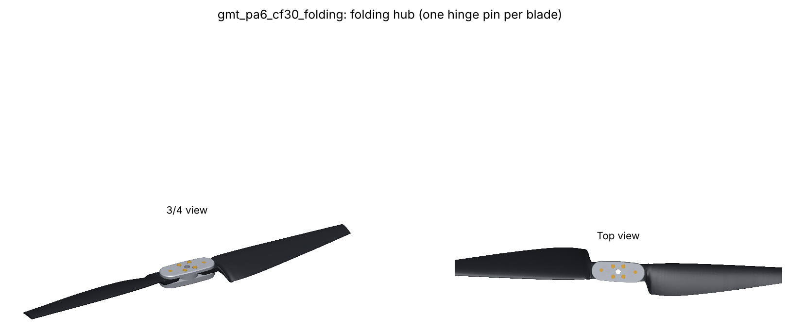
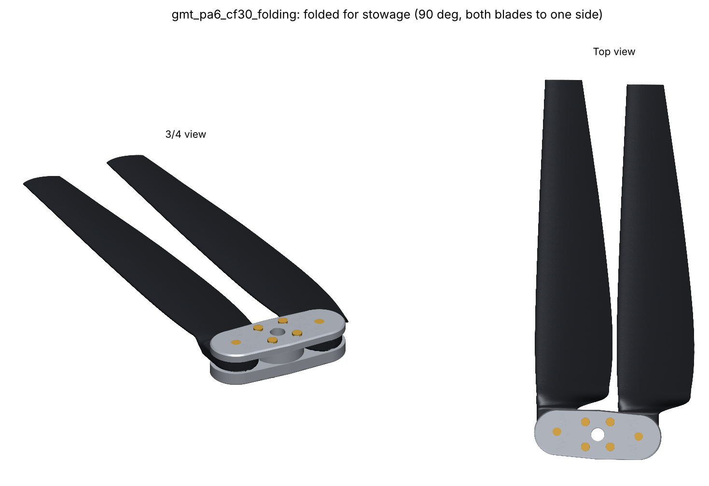
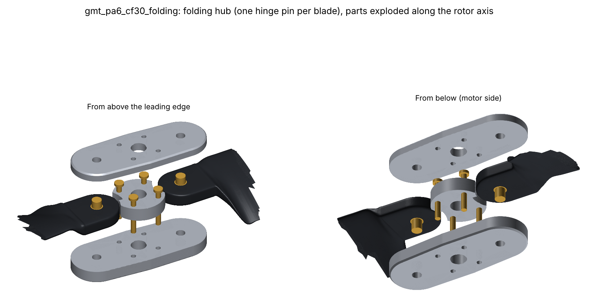
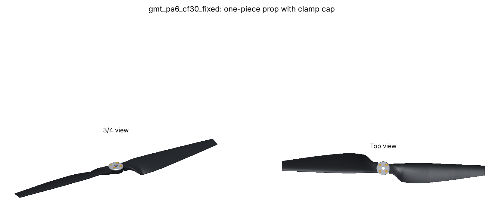
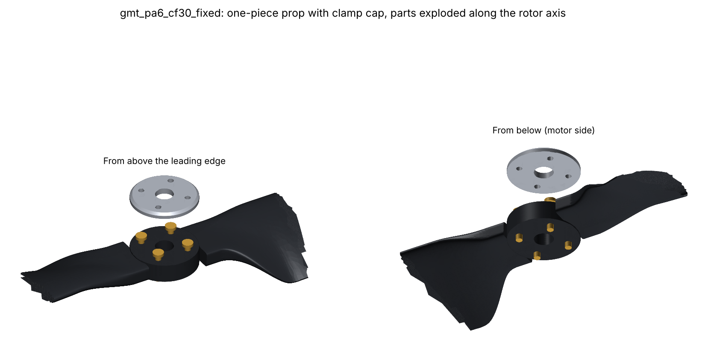

# Center Hub and Prop Variants: Machined Parts and COTS Hardware

There are two variants of the option C blade (PA6-CF30). Each has its own design file:

| Variant | Design | What it is |
| --- | --- | --- |
| **Fixed** | `designs/gmt_pa6_cf30_fixed.yaml` | One-piece molded prop (both blades and a Ø36 mm hub boss), clamped to the motor by a machined cap. |
| **Folding** | `designs/gmt_pa6_cf30_folding.yaml` | Two blades, each on one hinge pin parallel to the motor shaft, in a machined center hub. They fold 90 deg to one side for stowage. |

```bash
prandtl run designs/gmt_pa6_cf30_folding.yaml --stages dfm,hub,mold   # hub ~1 min, mold ~10 min
prandtl run designs/gmt_pa6_cf30_fixed.yaml --stages dfm,hub,mold     # mold ~30 min
```

Outputs, under `runs/<design>/<stage>/<key>/`:

- **hub stage:** STEP (mm) and DXF profiles for every machined part, and `hub_assembly.step` with the
  blades. It also writes the BOM (`hub_bom.csv` and `hub_bom.md`), renders (`hub_render.png`
  exploded, `prop_render.png` assembled, `folded_render.png` stowed), and every check as a metric.
- **mold stage:** core and cavity STEP files. For the one-piece prop, one mold makes the whole part.

`hub.variant: bolted` (the two-bolt fixed hub further down) is still available.

All metal parts are 2.5D (profile, through holes, counterbores, all from one side) in 6061-T6. All
fasteners are stock ISO parts, with lengths chosen automatically from standard sizes. The motor
pattern (4x M3 on a 25 mm circle) is still a placeholder; see the open items below.





## Folding variant



| Part | What it does |
| --- | --- |
| Top plate, 5 mm | Hull-of-circles outline (true arcs and tangent lines), 0.8 mm chamfer on the top outer edge; H7 holes for the hinge pins; motor screws pass through. |
| Core spacer | Centre disc between the plates, 0.02 mm thinner than the tab. The light squeeze removes flap slop (the blade is clamped in flap inside the plate edge) and gives fold friction. Cut-outs clear each tab's sweep over the fold range. |
| Bottom plate, 8 mm | Same outline, chamfered bottom edge. The hinge pins are pressed in 6.5 mm and flush with both faces, so nothing threads near the motor. |
| 2x ISO 8734 6x20 m6 hardened dowels | Hinge pins. |
| 2x 6x8x8 PTFE-lined bushings (DU type) | Pressed into each blade's hinge bore, so the polymer never wears. |
| 4x ISO 7380 M3x25 button heads | Through the whole stack into the motor (3.5 mm engagement). |

**Blade root.** The tab ends in a semicircle (R 14 mm) centred on the hinge at r = 29 mm, the
smallest radius at which the fold sweep clears the motor screws with 1.5 mm of core wall. The plates
end at r = 45 mm, where the blade is clamped in flap. The beam model, the optimizer, and the CalculiX
stages all clamp there.

**Hinge dynamics, from first principles.**

- **Running lag angle.** A free in-plane hinge settles where the centrifugal force (along the line
  from the rotor axis through the blade CG) balances the drag moment about the pin.
  `lag_equilibrium` solves for that angle and `ideal_pin_y` places the pin so it is zero. With the
  tab at `tab_centre_s_m: 0.0017`, the blade runs 0.2 deg behind radial.
- **Rigid lag mode: 0.45/rev.** Centrifugal stiffness about a small hinge offset gives
  nu = sqrt(e m d / I_pin); a point mass gives sqrt(e/d). That is well below 1P, as for any folding
  prop. The fold friction damps it.

| Check (folding, smoke inputs) | Value | Margin |
| --- | --- | --- |
| Centrifugal load per blade | 1229 N | - |
| Hinge pin, double shear | 22 MPa | +11.7 vs 550 MPa / 2 |
| Bushing pressure (static) | 26 MPa | +3.9 vs 250 MPa / 2 |
| Tab bearing behind the bushing | 18 MPa | +2.3 vs 60 MPa (PA6-CF30 design allowable) |
| Tab end shear-out (edge distance 1.75 x OD) | 7.2 MPa | +3.2 vs half the allowable |
| Plate bearing; plate shear-out | - | +5.7; +15.9 |
| Plate centre, tension + bending (fatigue) | 11.7 MPa | +3.1 vs 96 MPa / 2 |
| Running lag angle; rigid lag mode | -0.2 deg; 0.45/rev | - |
| Same-side fold before contact (blade-blade and blade-hub, 3D) | 90 deg | target 90 deg |
| Core wall at the motor screws | 1.7 mm | 1.5 mm minimum |
| Hub mass (with fasteners); span x width x stack | 122 g; 90 x 35 x 21.5 mm | - |
| Beam flap margin over 0.9-1.1 x rpm (DFM, root-aware) | 13.2% | 10% required |
| Thickness change from option C | none (0.6 mm TE only: +0.17% torque) | - |
| Mold: impression / part, split | 0.99997, 50.0% / 50.0% | - |

## Fixed variant (one-piece prop)





| Part | What it does |
| --- | --- |
| Molded one-piece prop | Both blades and a Ø36 x 10 mm hub boss with 1 deg draft each side of its mid-plane (the parting plane). Each 8.5 mm root tab starts inside the 10 mm boss, so no faces coincide and the part is one valid solid. Centre-gated: one sprue feeds the boss and the melt flows out to both tips, aligning the fibres spanwise. Drill the 10 mm bore after degating. |
| Cap, Ø36 x 3 mm | Clamps the boss to the motor face. 6061-T6, chamfered top edge. |
| 4x ISO 7380 M3x16 button heads | Through cap and boss into the motor (3.0 mm engagement). |

**Loads.** The two blades' centrifugal loads (1376 N across the axis) balance inside the part, so
the motor screws carry only thrust (8.8 N each) and torque. The boss carries the centrifugal tension
and the root flap moment across its centre, and the neck where each blade leaves the boss carries
both too.

**Stiffness.** The clamp edge moves in to the boss radius (18 mm), the longest free length of the
layouts. The thickness optimizer, now clamp-aware, thickens the root ×1.48 and mid-span ×1.14 to keep
flap 1 in the soft window. That costs +0.45% torque (8.2 mm maximum thickness, within the 9 mm cap).

| Check (fixed, smoke inputs) | Value | Margin (PA6-CF30 allowable 60 MPa, SF 1.5) |
| --- | --- | --- |
| Boss section at the axis, tension + flap bending | 13.0 MPa | +2.1 |
| Boss section through the motor holes | 13.7 MPa | +1.9 |
| Neck at the boss edge | 15.3 MPa | +1.6 |
| Cap clamp pressure on the boss (1 kN per screw) | 4.4 MPa | +12.5 |
| Torque carried by clamp friction | - | +10.7 (SF 2) |
| Beam flap margin over 0.9-1.1 x rpm (DFM, root-aware) | 12.5% | 10% required |
| Prop mass; cap and screws | 130 g; 12 g | - |
| Mold (one tool, both blades): impression / part, split | 1.0002, 50.0% / 50.0% | - |
| Mold insert size | 610 x 133 x 72 mm | - |

**Choosing between them.**
- **Fixed:** the lightest and simplest assembly, with a single molded part. But it needs one large
  mold (610 mm long) and pays +0.45% torque for stiffness.
- **Folding:**
  - It keeps option C's thickness (+0.17% torque) and uses a 320 mm single-blade mold run twice
    per prop.
  - It folds from a 559 mm disc to a 113 x 267 mm footprint for transport.
  - It weighs 122 g of hub.
  - It adds a hinge, whose rigid lag mode (0.45/rev) needs the fold friction to damp it.


## Bolted hub (two bolts per blade)

## Concept

There are two flat 6061-T6 plates and eleven COTS fasteners (seven line items in the BOM). All
machining is 2.5D: a rectangular profile, through holes, counterbores, and tapped holes, every
feature from one side. No lathe work and no 3D surfacing.

| Part | What it does |
| --- | --- |
| Bottom plate (8 mm) | Sits on the motor. The four M3 motor screws go down into the motor from counterbores on the blade side of the plate, with their heads below its top face, between the tabs. The four blade bolts thread into this plate, so nothing protrudes into the motor. |
| Blade tabs | Clamped between the plates from r = 14 to 34 mm. The plates end exactly at the clamp edge the FEA and modal stages model. |
| Top plate (4 mm) | Clearance holes for the blade bolts, and access holes over the motor screws, so the hub comes off the motor with both blades fitted. |
| 4x M5x20 ISO 4762, class 8.8, with ISO 7089 washers | Blade bolts, through the top plate and tab into the bottom plate (6.5 mm thread engagement = 1.3 d). |
| 4x M3x6 ISO 4762, class 12.9 | Hub to motor, in counterbores 4.5 mm deep. |

Assembly order:

1. Screw the bottom plate to the motor (threadlocker).
2. Lay both blades on it, located by their bolt holes.
3. Fit the top plate.
4. Torque the blade bolts to 3.0 N·m (about 3 kN preload) with threadlocker.
5. Re-check the torque after the first runs, because the polymer tabs creep.

## Load path from first principles

**Centrifugal load (dominant: about 1.25 kN per blade for PA6-CF30, 1.52 kN for PEEK-CF30 at
4000 rpm).** Every mass element pulls radially away from the rotation axis, so the resultant
F_c = m omega^2 (x_cg, y_cg) acts along a line through the axis and the blade CG. If the bolt-group
centroid sits off that line, the bolt pair also carries a couple F_c x offset.

The first root tab was centred on the root chord midpoint, 13.5 mm from the pitch axis, and 11.4 mm
off the load line. That gave 17.3 N·m in-plane, and 2124 N on the worst bolt instead of 760 N. The
clamp friction could not carry it (slip margin −0.43). The CalculiX FEA had not shown this, because
it clamps the tab faces rigidly.

The designs now set `root.tab_centre_s_m` to the hub stage's `ideal_tab_centre_s_m` (2.1 mm aft of
the pitch axis). Moment and bolt load after the change:

| | Tab at the chord midpoint | Tab on the load line |
| --- | --- | --- |
| In-plane moment on the joint | 17.3 N·m | 0.5 N·m |
| Worst bolt shear (PEEK / PA6 blade) | 2124 N / - | 767 N / 633 N |
| Clamp slip margin | −0.43 | +0.56 / +0.90 |

**Two load paths, each checked against the full load:**

1. **Friction (primary).** Two clamped interfaces per blade, mu = 0.2, 3 kN preload per bolt.
2. **Bolts in double shear and bearing (secondary).** This path matters after preload loss: PA6 and
   PEEK tabs creep under clamp.

**Root flap moment.** 2.7 N·m at the clamp edge, from the BEMT station loads. Symmetric thrust makes
the two blades' moments cancel through the hub, so the plates carry it across the centre as beams.
No spacer ties the plates together between the tabs, so the moment is shared in proportion to t^3:
the bottom plate takes 89%.

**Thrust and torque on the motor screws.** 8.8 N of tension and 17 N of shear per screw:
negligible.

**Clamp faces.** The tab is a superellipse. With exponent 4, only 43% of its width lies within
0.05 mm of the crest, so the plates bear on a strip. Exponent 8 gives 72%. The blunt-TE gap term in
the tab outline is now confined to the TE corner; before, it tilted the clamp faces by 0.15 mm.

## Checks (option C, PA6-CF30 blade; smoke inputs)

| Check | Value | Margin (safety factor 2 unless noted) |
| --- | --- | --- |
| Bolt shear, double shear on the stress area | 22 MPa | +6.8 vs 0.6 x proof |
| Tab bearing (blade) | 14 MPa | +3.3 vs the blade allowable (60 MPa, already knocked down) |
| Plate bearing (4 mm top plate) | 16 MPa | +7.7 vs yield |
| Plate shear-out to the plate end (5 mm edge) | 16 MPa | +4.1 |
| Plate centre, bending + tension | 11 MPa | +3.4 vs fatigue (96 MPa endurance) |
| Bottom-plate thread strip under preload | 39 MPa | +1.0 |
| Clamp slip (friction vs worst bolt) | 2.4 kN capacity per bolt | +0.90 (no safety factor) |
| Tab clamp pressure | 15 MPa | +3.1 vs the blade allowable |
| Motor screw access past the tabs | 1.9 mm clearance | - |
| Smallest hole ligament | 4.3 mm | - |
| Plate size; hub mass | 68 x 40.2 mm; 107 g with fasteners | - |

## Assumptions and open items

- **The motor pattern is a placeholder: 4x M3 on a 25 mm circle, with 4 mm of usable thread in the
  bell.** Set `hub.motor_screw`, `hub.motor_bolt_circle_m`, `hub.motor_thread_depth_m`, and
  `hub.center_bore_m` from your motor's drawing, then set `hub.motor_pattern_confirmed: true`. Until
  then the stage warns. The holes sit at 45 deg to the blades, between the tabs, so the access holes
  clear them.
- Screw lengths are chosen automatically:
  - Blade bolts engage at least 1.25 d in the aluminium and stop 0.5 mm short of the motor face.
  - Motor screws engage at least max(0.8 d, 3 pitches) and leave 0.5 mm of the motor's thread
    depth unused. A screw that is too long can reach the stator windings.
  - Always check against the motor maker's screw-length limit.
- The plates are 6061-T6; 7075-T6 or pocketing would cut mass. Break all edges by about 0.3 mm, and
  radius the plate ends where they bear on the tab (the clamp edge) to avoid a hard line on the
  polymer.
- No gyroscopic or 1P imbalance loads are included. The centrifugal load dwarfs both at this size,
  but check them for aggressive manoeuvring.
- The tab material allowables are the knocked-down design values from
  `src/prandtl_prop/manufacturing/materials.py`. Replace them with the grade's datasheet.
- Optional: M5 helical inserts in the bottom plate if the blades will be changed often.
