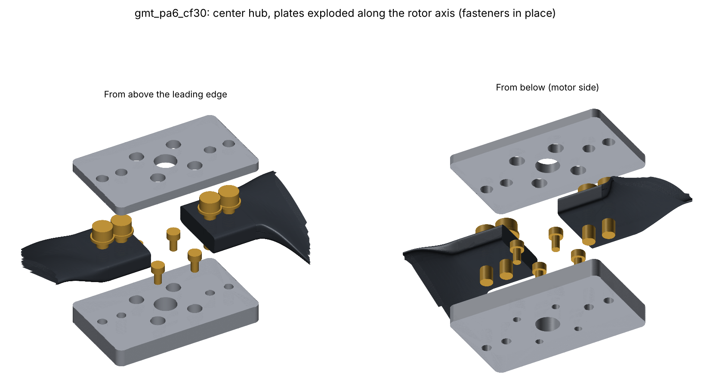

# Center Hub: Machined Plates and COTS Hardware

```bash
prandtl run designs/gmt_pa6_cf30.yaml --stages hub     # about 1 min; outputs under runs/<design>/hub/<key>/
```

The hub stage (`src/prandtl_prop/cad/hub.py`) generates a two-blade hub from the blade's root tab
and the design's `hub:` settings. It writes:

- `hub_top_plate.step` and `hub_bottom_plate.step` (mm), plus DXF profiles of both plates (mm), for
  CNC, waterjet, or a print.
- `hub_assembly.step` (mm): the plates, fasteners, and both blades.
- `hub_bom.csv` and `hub_bom.md`: the bill of materials, with fastener lengths chosen from stock
  ISO 4762 lengths.
- `hub_render.png`: an exploded view.
- Every check as a metric, plus warnings.



## Concept

There are two flat 6061-T6 plates and eleven COTS fasteners (seven line items in the BOM). All
machining is 2.5D: a rectangular profile, through holes, counterbores, and tapped holes, every
feature from one side. No lathe work and no 3D surfacing.

| Part | What it does |
| --- | --- |
| Bottom plate (8 mm) | Sits on the motor. The four M3 motor screws go down into the motor from counterbores on the blade side of the plate, with their heads below its top face, between the tabs. The four blade bolts thread into this plate, so nothing protrudes into the motor. |
| Blade tabs | Clamped between the plates from r = 14 to 34 mm. The plates end exactly at the clamp edge the FEA and modal stages model. |
| Top plate (4 mm) | Clearance holes for the blade bolts, and access holes over the motor screws, so the hub comes off the motor with both blades fitted. |
| 4x M5x20 ISO 4762, class 8.8, with ISO 7089 washers | Blade bolts, through the top plate and tab into the bottom plate (6.5 mm thread engagement = 1.3 d). |
| 4x M3x6 ISO 4762, class 12.9 | Hub to motor, in counterbores 4.5 mm deep. |

Assembly order:

1. Screw the bottom plate to the motor (threadlocker).
2. Lay both blades on it, located by their bolt holes.
3. Fit the top plate.
4. Torque the blade bolts to 3.0 N·m (about 3 kN preload) with threadlocker.
5. Re-check the torque after the first runs, because the polymer tabs creep.

## Load path from first principles

**Centrifugal load (dominant: about 1.25 kN per blade for PA6-CF30, 1.52 kN for PEEK-CF30 at
4000 rpm).** Every mass element pulls radially away from the rotation axis, so the resultant
F_c = m omega^2 (x_cg, y_cg) acts along a line through the axis and the blade CG. If the bolt-group
centroid sits off that line, the bolt pair also carries a couple F_c x offset.

The first root tab was centred on the root chord midpoint, 13.5 mm from the pitch axis, and 11.4 mm
off the load line. That gave 17.3 N·m in-plane, and 2124 N on the worst bolt instead of 760 N. The
clamp friction could not carry it (slip margin −0.43). The CalculiX FEA had not shown this, because
it clamps the tab faces rigidly.

The designs now set `root.tab_centre_s_m` to the hub stage's `ideal_tab_centre_s_m` (2.1 mm aft of
the pitch axis). Moment and bolt load after the change:

| | Tab at the chord midpoint | Tab on the load line |
| --- | --- | --- |
| In-plane moment on the joint | 17.3 N·m | 0.5 N·m |
| Worst bolt shear (PEEK / PA6 blade) | 2124 N / - | 767 N / 633 N |
| Clamp slip margin | −0.43 | +0.56 / +0.90 |

**Two load paths, each checked against the full load:**

1. **Friction (primary).** Two clamped interfaces per blade, mu = 0.2, 3 kN preload per bolt.
2. **Bolts in double shear and bearing (secondary).** This path matters after preload loss: PA6 and
   PEEK tabs creep under clamp.

**Root flap moment.** 2.7 N·m at the clamp edge, from the BEMT station loads. Symmetric thrust makes
the two blades' moments cancel through the hub, so the plates carry it across the centre as beams.
No spacer ties the plates together between the tabs, so the moment is shared in proportion to t^3:
the bottom plate takes 89%.

**Thrust and torque on the motor screws.** 8.8 N of tension and 17 N of shear per screw:
negligible.

**Clamp faces.** The tab is a superellipse. With exponent 4, only 43% of its width lies within
0.05 mm of the crest, so the plates bear on a strip. Exponent 8 gives 72%. The blunt-TE gap term in
the tab outline is now confined to the TE corner; before, it tilted the clamp faces by 0.15 mm.

## Checks (option C, PA6-CF30 blade; smoke inputs)

| Check | Value | Margin (safety factor 2 unless noted) |
| --- | --- | --- |
| Bolt shear, double shear on the stress area | 22 MPa | +6.8 vs 0.6 x proof |
| Tab bearing (blade) | 14 MPa | +3.3 vs the blade allowable (60 MPa, already knocked down) |
| Plate bearing (4 mm top plate) | 16 MPa | +7.7 vs yield |
| Plate shear-out to the plate end (5 mm edge) | 16 MPa | +4.1 |
| Plate centre, bending + tension | 11 MPa | +3.4 vs fatigue (96 MPa endurance) |
| Bottom-plate thread strip under preload | 39 MPa | +1.0 |
| Clamp slip (friction vs worst bolt) | 2.4 kN capacity per bolt | +0.90 (no safety factor) |
| Tab clamp pressure | 15 MPa | +3.1 vs the blade allowable |
| Motor screw access past the tabs | 1.9 mm clearance | - |
| Smallest hole ligament | 4.3 mm | - |
| Plate size; hub mass | 68 x 40.2 mm; 107 g with fasteners | - |

## Assumptions and open items

- **The motor pattern is a placeholder: 4x M3 on a 25 mm circle, with 4 mm of usable thread in the
  bell.** Set `hub.motor_screw`, `hub.motor_bolt_circle_m`, `hub.motor_thread_depth_m`, and
  `hub.center_bore_m` from your motor's drawing, then set `hub.motor_pattern_confirmed: true`. Until
  then the stage warns. The holes sit at 45 deg to the blades, between the tabs, so the access holes
  clear them.
- Screw lengths are chosen automatically:
  - Blade bolts engage at least 1.25 d in the aluminium and stop 0.5 mm short of the motor face.
  - Motor screws engage at least max(0.8 d, 3 pitches) and leave 0.5 mm of the motor's thread
    depth unused. A screw that is too long can reach the stator windings.
  - Always check against the motor maker's screw-length limit.
- The plates are 6061-T6; 7075-T6 or pocketing would cut mass. Break all edges by about 0.3 mm, and
  radius the plate ends where they bear on the tab (the clamp edge) to avoid a hard line on the
  polymer.
- No gyroscopic or 1P imbalance loads are included. The centrifugal load dwarfs both at this size,
  but check them for aggressive manoeuvring.
- The tab material allowables are the knocked-down design values from
  `src/prandtl_prop/manufacturing/materials.py`. Replace them with the grade's datasheet.
- Optional: M5 helical inserts in the bottom plate if the blades will be changed often.
