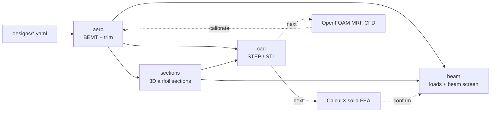

# Iterative Design Workflow: BEMT -> CAD -> FEA/CFD

This is the path from a design file to aero results, CAD geometry, and structural results. It is
built for iteration: change one input, re-run, and only the affected stages recompute.



## Principles

1. **One source of truth.** A design file (`designs/<name>.yaml`) holds the geometry reference,
   operating point, polar source, airfoil source, material, and CAD options. Every stage reads
   from it, so no stage keeps its own copy of a constant.
2. **Stages are functions of their inputs.** Each run lives in
   `runs/<design>/<stage>/<key>/`. The key hashes four things: the design sections the stage
   reads, the bytes of its input files, the source code of the modules it runs, and its upstream
   keys. An unchanged stage is a cache hit. Any change re-runs exactly the downstream stages.
   `manifest.json` records inputs, the git commit, metrics, and warnings.
3. **Trust the core before adding fidelity.** CAD, FEA, and CFD inherit every BEMT error, so the
   solver is verified against closed-form theory first (see Verification).

## Quick start

```bash
pip install -e .[cad,dev]          # CadQuery is only needed for the cad stage

# Pipeline smoke test without thesis data (analytic polar, NACA stand-ins; NOT thesis results)
prandtl run designs/gmt.yaml --set-file designs/smoke_overrides.txt

# Real run, once polars and airfoil coordinates are in data/ (see below)
prandtl run designs/gmt.yaml
prandtl compare designs/mil.yaml designs/gmt.yaml --stages aero,beam

# Iterate: any design value can be overridden; results are cached per variant
prandtl run designs/gmt.yaml --set operating_point.rpm=4200 --set structure.material.E_Pa=45.0e+9
for rpm in 3800 4000 4200; do prandtl run designs/gmt.yaml --stages aero,beam --set operating_point.rpm=$rpm; done
```

## Data you need to add

The thesis inputs below were never committed. Until they are, only the smoke test runs.

| Data | Put it in | Format | Thesis source |
| --- | --- | --- | --- |
| XFOIL polars | `data/xfoil_polars/` | `<AIRFOIL>_Re<N>_polar.csv` with `alpha`, `Cl`, `Cd` (optional `Cm`, `converged`) | `CAD/airfoils_good/generated_polars/` |
| Airfoil coordinates | `data/airfoils/` | `<AIRFOIL>.dat` (Selig) or `<AIRFOIL>_YZ.txt` (`index y/c x/c`) | `CAD/airfoils_good/` |

Airfoils needed: MH115, S4310, A3, A4, A6, A7, A11, A13. A missing airfoil is an error. A
stand-in is used only when the design names one explicitly (`airfoils.substitutes`), and every
stand-in is reported as a warning.

## Conventions shared by all stages

- **Blade frame.** +z is the rotation axis and thrust direction, and the rotor spins about +z.
  +x is the span, and the blade moves toward +y. Sections are placed at their pitch axis (quarter
  chord by default) and pitched nose-up by beta. The upper surface faces +z.
- **Geometry contract.** `sections/<key>/sections.json` holds the 3D outline points per station,
  and `cad/<key>/blade.step` holds the lofted solid. The CAD stations are exactly the BEMT
  stations. The loft volume is checked against the section-area quadrature (agreement to about 0.05%).
- **Twist.** The CAD and the beam use the *trimmed* twist (design twist plus the collective offset
  that meets target thrust), so the built blade is the one the aero stage analysed.
- **Load contract.** `beam/<key>/line_loads.csv` holds per-blade line loads (N/m, N*m/m) about the
  pitch axis. They include thrust, in-plane force, airfoil pitching moment, and centrifugal body
  force with its offset and propeller-moment terms. This is the interface CalculiX and CFD-mapped
  loads will use. Note that BEMT `qz`/`qy` columns are totals over all blades. The mapping divides
  them by the blade count.

## The BEMT core

Per station, the induced velocity is the root of `T'_BE(vi) - 4 pi rho r F(phi) (V + vi) vi = 0`,
solved with Brent's method on a bracket that always changes sign for a positively loaded section.
Collective trim to target thrust is a second Brent solve. No tip-loss floor is used: as F tends to
0 at the tip, the solution drives the section loading toward zero, which is the physical limit.

### Why the locked result needs re-locking

In the archived solver, induced velocity came from a damped fixed-point iteration (80 iterations,
tip-loss floor 0.05). That iteration did not converge at the tip station (r/R = 0.9997) in either
locked case. Checked directly from the locked CSVs, with no assumptions:

| Station | Momentum imbalance (dT_BE vs 4 pi rho F r vi^2 dr) |
| --- | --- |
| All converged stations, both cases | < 4e-6 |
| MIL tip | 9e-5 (harmless by luck) |
| GMT tip | **84%**: tip thrust 0.382 N, about 4x the converged value |

`tests/test_aero_bemt.py::test_locked_data_tip_station_violates_momentum_balance` pins this.

An estimate of the impact: re-solve the tip station with a local S4310 polar fitted to the four
locked S4310 points, then re-trim assuming Q scales as T^1.5. This estimate puts the GMT torque
reduction at about **0.9% instead of the locked 1.50%**. It rests on two assumptions, the 4-point
polar fit and the T^1.5 retrim scaling. Do not cite the 0.9%. Re-lock by running
`prandtl compare designs/mil.yaml designs/gmt.yaml` with the real polars, then update `config.LOCKED_*`.

## Verification

| Test | First-principles check |
| --- | --- |
| Ideal twist, inviscid, no tip loss | Uniform inflow equals the closed form `lambda = sigma a/16 (sqrt(1 + 32 theta_t/(sigma a)) - 1)` within 1% |
| Inviscid, no tip loss | Shaft power equals `sum(dT * vi)` to 1e-10 (exact identity) |
| Every locked-geometry station | Converged with residual < 1e-8 N/m, including the tip |
| Cantilever, beta = 0/35/90 deg | Root moment `qL^2/2`, tip deflection `qL^4/8EI`, unsymmetric coupling present at 35 deg |
| Centrifugal | Root tension `rho A omega^2 (R^2 - r0^2)/2` |
| Sections | Rectangle second moments, closed-TE NACA 0012 area, Selig and YZ readers agree |
| CAD | Valid solid; loft volume matches section quadrature; rotor volume is B times blade volume |
| Cache | Changing E re-runs only `beam` and halves deflection exactly; changing rpm re-runs everything |

## Beam screen assumptions

The screen uses solid isotropic sections and Euler-Bernoulli unsymmetric bending about the
centroid. Torsion uses Saint-Venant's approximation `J = A^4 / (4 pi^2 I_p)`. Centrifugal
stiffening is neglected, so flap deflection is conservative. Use the screen every iteration and
confirm finalists with CalculiX.

## Next steps

1. **CalculiX stage (`fea`).** Mesh `blade.step` (gmsh, C3D10), clamp the root face, apply
   `*DLOAD CENTRIF` plus `line_loads.csv` distributed over each station strip, and run with NLGEOM
   so centrifugal stiffening is captured. Compare root stress and tip deflection with the beam
   screen; the beam tests above give the expected agreement for slender sections.
2. **OpenFOAM stage (`cfd`).** Mesh `rotor.step` with a hub using snappyHexMesh, and solve a
   steady MRF zone with k-omega SST at the design rpm. Extract T and Q, then spanwise dT/dr and
   dQ/dr from radial bands.
3. **Close the loop.** Derive per-station correction factors (CFD over BEMT loading), feed them
   back to the aero stage as a design input, re-trim, and iterate to a fixed point. The cache keys
   keep every iteration traceable.
