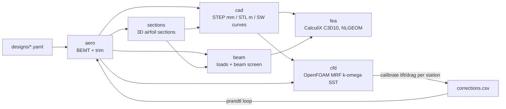

# Iterative Design Workflow: BEMT -> CAD -> FEA/CFD

This is the path from a design file to aero results, CAD geometry, structural results, and CFD.
It is built for iteration: change one input, re-run, and only the affected stages recompute.
`prandtl loop` closes the BEMT -> CAD -> CFD loop automatically.



## Principles

1. **One source of truth.** A design file (`designs/<name>.yaml`) holds the geometry reference,
   operating point, polar source, airfoil source, material, and CAD options. Every stage reads
   from it, so no stage keeps its own copy of a constant.
2. **Stages are functions of their inputs.** Each run lives in
   `runs/<design>/<stage>/<key>/`. The key hashes four things: the design sections the stage
   reads, the bytes of its input files, the source code of the modules it runs, and its upstream
   keys. An unchanged stage is a cache hit. Any change re-runs exactly the downstream stages.
   `manifest.json` records inputs, the git commit, metrics, and warnings.
3. **Trust the core before adding fidelity.** CAD, FEA, and CFD inherit every BEMT error, so the
   solver is verified against closed-form theory first (see Verification).

## Quick start

```bash
pip install -e .[cad,fea,dev]      # CadQuery for cad; gmsh for fea. CalculiX (ccx) and OpenFOAM are system installs.

# Pipeline smoke test without thesis data (analytic polar, NACA stand-ins; NOT thesis results)
prandtl run designs/gmt.yaml --set-file designs/smoke_overrides.txt

# Real run, once polars and airfoil coordinates are in data/ (see below)
prandtl run designs/gmt.yaml
prandtl compare designs/mil.yaml designs/gmt.yaml --stages aero,beam

# Iterate: any design value can be overridden; results are cached per variant
prandtl run designs/gmt.yaml --set operating_point.rpm=4200 --set structure.material.E_Pa=45.0e+9
for rpm in 3800 4000 4200; do prandtl run designs/gmt.yaml --stages aero,beam --set operating_point.rpm=$rpm; done

# Higher fidelity
prandtl run designs/gmt.yaml --stages fea           # CalculiX solid FEA (also runs aero, sections, cad, beam)
prandtl run designs/gmt.yaml --stages cfd           # OpenFOAM hover CFD
prandtl loop designs/gmt.yaml --iterations 4        # BEMT -> CAD -> CFD -> calibrate -> re-trim until CFD hits 35 N

# Plumbing check of the CFD loop in minutes (coarse mesh; numbers are meaningless)
prandtl loop designs/gmt.yaml --set-file designs/smoke_overrides.txt --set-file designs/cfd_smoke_overrides.txt
```

SolidWorks: see [`solidworks_import.md`](solidworks_import.md). STEP files are written in mm at true size.

## Data you need to add

The thesis inputs below were never committed. Until they are, only the smoke test runs.

| Data | Put it in | Format | Thesis source |
| --- | --- | --- | --- |
| XFOIL polars | `data/xfoil_polars/` | `<AIRFOIL>_Re<N>_polar.csv` with `alpha`, `Cl`, `Cd` (optional `Cm`, `converged`) | `CAD/airfoils_good/generated_polars/` |
| Airfoil coordinates | `data/airfoils/` | `<AIRFOIL>.dat` (Selig) or `<AIRFOIL>_YZ.txt` (`index y/c x/c`) | `CAD/airfoils_good/` |

Airfoils needed: MH115, S4310, A3, A4, A6, A7, A11, A13. A missing airfoil is an error. A
stand-in is used only when the design names one explicitly (`airfoils.substitutes`), and every
stand-in is reported as a warning.

## Conventions shared by all stages

- **Blade frame.** +z is the rotation axis and thrust direction, and the rotor spins about +z.
  +x is the span, and the blade moves toward +y. Sections are placed at their pitch axis (quarter
  chord by default) and pitched nose-up by beta. The upper surface faces +z.
- **Geometry contract.** `sections/<key>/sections.json` holds the 3D outline points per station,
  and `cad/<key>/blade.step` holds the lofted solid. The CAD stations are exactly the BEMT
  stations. The loft volume is checked against the section-area quadrature (agreement to about 0.05%).
- **Twist.** The CAD and the beam use the *trimmed* twist (design twist plus the collective offset
  that meets target thrust), so the built blade is the one the aero stage analysed.
- **Load contract.** `beam/<key>/line_loads.csv` holds per-blade line loads (N/m, N*m/m) about the
  pitch axis. They include thrust, in-plane force, airfoil pitching moment, and centrifugal body
  force with its offset and propeller-moment terms. This is the interface CalculiX and CFD-mapped
  loads will use. Note that BEMT `qz`/`qy` columns are totals over all blades. The mapping divides
  them by the blade count.

## The BEMT core

Per station, the induced velocity is the root of `T'_BE(vi) - 4 pi rho r F(phi) (V + vi) vi = 0`,
solved with Brent's method on a bracket that always changes sign for a positively loaded section.
Collective trim to target thrust is a second Brent solve. No tip-loss floor is used: as F tends to
0 at the tip, the solution drives the section loading toward zero, which is the physical limit.

### Why the locked result needs re-locking

In the archived solver, induced velocity came from a damped fixed-point iteration (80 iterations,
tip-loss floor 0.05). That iteration did not converge at the tip station (r/R = 0.9997) in either
locked case. Checked directly from the locked CSVs, with no assumptions:

| Station | Momentum imbalance (dT_BE vs 4 pi rho F r vi^2 dr) |
| --- | --- |
| All converged stations, both cases | < 4e-6 |
| MIL tip | 9e-5 (harmless by luck) |
| GMT tip | **84%**: tip thrust 0.382 N, about 4x the converged value |

`tests/test_aero_bemt.py::test_locked_data_tip_station_violates_momentum_balance` pins this.

An estimate of the impact: re-solve the tip station with a local S4310 polar fitted to the four
locked S4310 points, then re-trim assuming Q scales as T^1.5. This estimate puts the GMT torque
reduction at about **0.9% instead of the locked 1.50%**. It rests on two assumptions, the 4-point
polar fit and the T^1.5 retrim scaling. Do not cite the 0.9%. Re-lock by running
`prandtl compare designs/mil.yaml designs/gmt.yaml` with the real polars, then update `config.LOCKED_*`.

## Verification

| Test | First-principles check |
| --- | --- |
| Ideal twist, inviscid, no tip loss | Uniform inflow equals the closed form `lambda = sigma a/16 (sqrt(1 + 32 theta_t/(sigma a)) - 1)` within 1% |
| Inviscid, no tip loss | Shaft power equals `sum(dT * vi)` to 1e-10 (exact identity) |
| Every locked-geometry station | Converged with residual < 1e-8 N/m, including the tip |
| Cantilever, beta = 0/35/90 deg | Root moment `qL^2/2`, tip deflection `qL^4/8EI`, unsymmetric coupling present at 35 deg |
| Centrifugal | Root tension `rho A omega^2 (R^2 - r0^2)/2` |
| Sections | Rectangle second moments, closed-TE NACA 0012 area, Selig and YZ readers agree |
| CAD | Valid solid; loft volume matches section quadrature; rotor volume is B times blade volume |
| Cache | Changing E re-runs only `beam` and halves deflection exactly; changing rpm re-runs everything |

## Beam screen assumptions

The screen uses solid isotropic sections and Euler-Bernoulli unsymmetric bending about the
centroid. Torsion uses Saint-Venant's approximation `J = A^4 / (4 pi^2 I_p)`. Centrifugal
stiffening is neglected, so flap deflection is conservative. Use the screen every iteration and
confirm finalists with CalculiX.

## CalculiX solid FEA (`fea`)

- gmsh meshes `blade_m.brep` with quadratic tetrahedra (C3D10), single-threaded so identical
  inputs give identical meshes. The pipeline's cache depends on that, and multithreaded meshing
  was observed to give different stiffness on repeated runs.
- The root face is clamped. Centrifugal load is `*DLOAD CENTRIF` (the exact body force, including
  the propeller moment).
- Each station's aero force and moment about the pitch axis go to its strip's surface nodes by the
  minimum-norm distribution that reproduces both exactly (6 equations per strip, the idea behind an
  RBE3 element). Clamped root-face nodes are excluded, so no applied load silently drops out.
- NLGEOM is on by default, so centrifugal stiffening is included.

Evidence: on a prismatic NACA 0012 cantilever, tip deflection is 0.984x Euler-Bernoulli at both 3 mm
and 1.5 mm meshes (converged; the small excess stiffness is the root clamp restraining warping),
and the root reaction matches the applied load to 1e-6. On the GMT blade (smoke inputs), the
centrifugal root force matches the beam screen to 0.04%. Linear FEA gives 0.98x the beam tip
deflection and station stresses within 2-7% inboard. NLGEOM cuts flap deflection to 0.66x: the
stiffening parameter N L^2 / EI is about 14, so a large effect is expected. Peak FEA stress is
reported outside a one-root-chord clamp zone, because the clamp's stress singularity is a modelling
artefact.

CalculiX runs single-threaded by default (`fea.threads`). Its multithreaded SPOOLES factorization
gave 0.4% run-to-run eigenvalue scatter on identical decks, and occasionally a spurious negative
eigenvalue (a false "0 Hz mode"). Single-threaded results are bit-identical.

## Campbell diagram (`modal`)

`prandtl run designs/gmt.yaml --stages modal` runs prestressed modal analyses at
`fea.campbell_rpm_fractions` x design rpm (default 0, 0.5, 1.0, 1.2). Each one is a static NLGEOM
step under CENTRIF, then a `*FREQUENCY` perturbation step with CENTRIF repeated. That captures both
centrifugal stiffening and spin softening; Coriolis coupling is neglected. Modes are classified as
flap, lag, or torsion from the tip motion, and each mode's margin to the nearest 1P..4P line at
design rpm is reported. A warning fires below `fea.frequency_margin` (10%).

Validation on a prismatic NACA 0012 cantilever: non-rotating first flap is within 1% of
`1.8751^2/(2 pi) sqrt(EI / (rho A L^4))`, second flap within 0.6%, and first lag within 0.9%.
Rotating, the Southwell coefficient (f^2 = f0^2 + K n^2) is K_flap = 1.49, the expected value for a
hub offset r0/L = 0.2. The spin softening appears as K_flap - K_lag = 0.99, with about 1 expected.
Each modal run also fits K across its rpm points and warns on a misfit above 2%. That check caught
the multithreading defect above.

Smoke-blade result (aluminium, NACA 4410 stand-ins; re-run with the real airfoils): the first flap
mode is 123.8 Hz at rest and 150.0 Hz at 4000 rpm, with K = 1.61 and a fit error of 0.03%. That is
an 11.1% margin above 2P (133.3 Hz) at design speed. Solving f(n) = 2n puts the **2P crossing at
about 4800 rpm (1.2x design)**, which the 4800 rpm analysis confirms (160.03 Hz vs 160.0 Hz). Check
this against the operating envelope once the real geometry and material are in.

## OpenFOAM hover CFD (`cfd`)

- Steady incompressible `simpleFoam`, k-omega SST with wall functions, and an MRF cylinder zone
  rotating at +omega about +z. The box domain extends 3R to the sides and above, and 6R below
  (the wake). All far-field faces use `totalPressure` p0 = 0 with `pressureInletOutletVelocity`.
- blockMesh background (R/4 cells), then snappyHexMesh: MRF zone level 2, blade surface levels
  5-6, feature edges level 6. All of these are design knobs under `cfd.*`.
- Post-processing reads the written fields directly, so it does not depend on function objects.
  (Ubuntu's packaged OpenFOAM v1912 crashes in every function object; `cfd.function_objects: true`
  adds `forces`/`yPlus` on installations where they work.) Blade loads: face pressure (equal to the
  owner-cell value on the zeroGradient wall) times the area vector, plus the wall-function shear
  rho nu_eff (U_P - U_w)_t / delta. Loads are binned into the BEMT station strips by
  r = sqrt(x^2 + y^2).
- **Independent check:** thrust is also computed from the axial momentum balance over the far
  field, -integral(rho (U_z U.n + p n_z)) dA. The MRF source Omega x U has no z component, so this
  balance is exact, and it shares no code path with the wall integration. On the coarse smoke mesh
  the two agree to 0.4%. A warning fires above 2%.
- Snapshots are written `cfd.snapshots` times, and the change in thrust and torque between the
  last two snapshots is reported as a convergence measure.

`cfd_station_loads.csv` holds BEMT and CFD dT and dQ per station, and `cfd_history.csv` holds the
thrust and torque history.

## Closing the loop (`prandtl loop`)

At each station, BEMT resolves the section force through the inflow angle phi:
`dT = B q c (Cl cos(phi) - Cd sin(phi)) dr` and `dFt = B q c (Cl sin(phi) + Cd cos(phi)) dr`.
Inverting that rotation with the CFD loads gives the effective Cl and Cd at BEMT's own inflow.
The station factors are their ratios to the polar values. Because the factors change the induced
velocity, they are found by a relaxed fixed point in which BEMT re-solves the momentum balance each
pass. A test shows that known factors are recovered to 1e-5 from synthetic loads.

Each outer iteration trims the corrected BEMT to target thrust, which gives a new collective, so
new CAD, so new CFD, so new factors. The loop stops when the CFD thrust is within
`--thrust-tolerance` of the target. `runs/<design>/loop/loop_history.csv` records every iteration
with its aero and cfd run keys. The factors absorb every BEMT-vs-CFD difference (3D relief,
tip/root effects, polar error, and *mesh error*), so they are only as good as the CFD mesh. Run a
mesh study on the final geometry before trusting them.

### Loop demonstration (coarse mesh; plumbing only)

`prandtl loop designs/gmt.yaml --set-file designs/smoke_overrides.txt --set-file designs/cfd_smoke_overrides.txt`
uses an analytic polar, NACA 4410 stand-in sections, and a 41k-cell mesh on which the blade is 1-2
cells thick. It took 11 minutes on 4 cores:

| Iteration | Collective | CFD thrust | Error vs 35 N | CFD torque |
| --- | --- | --- | --- | --- |
| 0 (uncorrected BEMT trim) | -1.31 deg | 27.80 N | -20.6% | 1.090 N*m |
| 1 | +0.95 deg | 34.28 N | -2.1% | 1.564 N*m |
| 2 | +1.17 deg | 34.72 N | -0.80% | 1.599 N*m |
| 3 | +1.26 deg | 34.87 N | **-0.37%** (converged) | 1.620 N*m |

After the first correction, the error falls about 2.5x per iteration. The factors are fitted at one
collective and drift slightly as the blade re-pitches, which gives this linear convergence. Wall and
far-field thrust agreed to 0.4% on every run. The calibrated drag factors (about 4x) and the torque
well above BEMT are the coarse mesh's numerical drag, not physics. On a resolved mesh, expect a far
smaller first correction.

## Next steps

1. Commit the XFOIL polars and airfoil coordinates (see Data), then re-lock MIL and GMT with the
   converged solver: `prandtl compare designs/mil.yaml designs/gmt.yaml --stages aero,beam`.
2. Run `prandtl loop` for MIL and GMT at production CFD resolution on a workstation. Add a mesh
   study (surface levels 5-6 vs 6-7) and boundary-layer prism layers (`addLayers`), then compare
   the CFD-calibrated torque reduction with the BEMT-only one.
3. Feed the calibrated BEMT back into the GMT twist inverse design
   (`archive/legacy_scripts/geometry/operating_point_inverse_design.py`), so the design itself, not
   only the collective, responds to CFD.
4. Re-run `--stages modal` with the real airfoils and material. If the 2P crossing stays near
   1.2x design rpm, consider stiffening the flap direction (thicker inboard sections) or changing
   the material.
