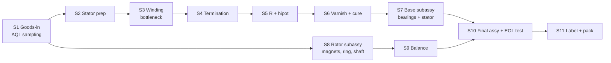
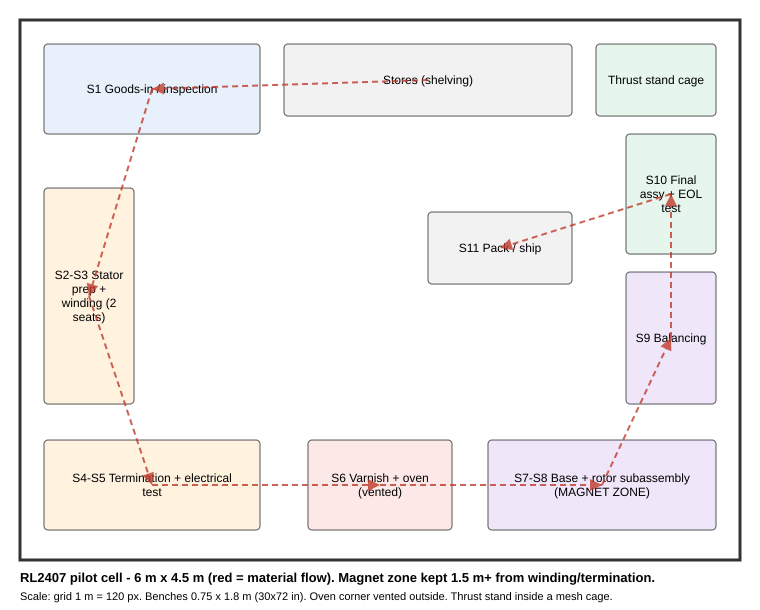

# RL2407 assembly line plan (capital < $15k)

Generated by `bldc-motor production plan` from `bldc_motor.production.assembly_line`. The equipment prices come from the 2026-11-05 research (status per line in `equipment_budget.csv`), and the cycle times are **engineering estimates to replace with a time study during the 50-piece pilot.** The labour rate is an assumption ($25/h fully loaded).

## Strategy: buy precision, make labour + test

| Make in-house (this line) | Buy (outsourced, from drawings) |
| --- | --- |
| Winding, termination, impregnation | Bonded + epoxy-coated stator stacks (DWG-001/002) |
| Base and rotor subassembly (press, bond) | Pre-magnetised arc magnets, -01/-02 matched sets (DWG-004) |
| Rotor balancing | CNC bell, base, ring (DWG-005/006/007), anodised |
| Final assembly, 100 % end-of-line test, 1-in-50 loaded test | Shaft (DWG-008), 684ZZ bearings, e-clips, grubs |

Automatic outrunner needle winders were all found **above the entire budget** ($15-16k QIWEI, $18k Rimy, $25k+ NIDE listings; Vacuz quotes 90-150k RMB). This design was chosen partly for winding simplicity: 6 turns per tooth, single-strand AWG23, slot fill 0.38 and a 2.5 mm needle opening. That makes jig-indexed hand winding realistic, and an open-source CNC winder is budgeted as phase 2.

## Process flow

## Stations

| Station | Labour min/motor | Equipment | Fixtures (3D-printed / turned) | Checks | Cure / soak |
| --- | --- | --- | --- | --- | --- |
| **S1** Goods-in inspection (sampling) | 1.0 | Mitutoyo caliper + micrometer kit 64PKA076B; Mitutoyo 64PKA079B dial indicator + magnetic base; American Weigh AMW-SC-501 500 g x 0.01 g; Gaussmeter / pole checker for magnet incoming + pole order | Go/no-go bore pins Ø12.24, Ø9 H6; magnet thickness nest | AQL 1.0 sampling: stator bore/OD/stack, bell/base critical bores, shaft Ø4/Ø5, magnet thickness + pole marking, bearing spin | - |
| **S2** Stator prep | 0.5 | - | Bore mandrel | Bore free of coating; edge coating visual | - |
| **S3** Winding (hand, jig-indexed) | 10.0 | Hand winding kit: 3D-printed tooth-indexing jig, wire tensioner, spool stand, counters; Open-source CNC needle winder build | Tooth-indexing jig with turn counter; Wire tensioner | 6 turns/tooth, direction per DWG-003, no crossovers in slot, no wire above shoe | - |
| **S4** Termination (star point + leads) | 5.0 | Hakko FX-888DX station + Pinecil V2 + Hakko FA-400 fume extractor; Small solder pot for enamel stripping of AWG23 ends; Desco 16310 ESD mat kit | Lead-dressing comb; Star-point sleeve holder | Joint pull test 10 N (sample); Sleeving complete | - |
| **S5** Electrical test 1 | 1.5 | Tonghui TH2512B+ 4-wire milliohm meter; GW Instek GPT-9801 AC 5 kV hipot; Brymen BM235 multimeter | Kelvin clip nest | R line-line 3 pairs (temp-corrected) within ±6 %, imbalance <= 2 %; Hipot 1.05 kV AC 1 s <= 1 mA | - |
| **S6** Impregnation (dip + cure) | 1.0 | Labnique 30 L forced-air oven, 300 C; Inline fan + duct for oven/varnish corner | Dip rack (12 stators) | Cure log (time/temp); No varnish in bore | 3 h batch |
| **S7** Base subassembly | 3.0 | Grizzly T26414 2-ton arbor press + turned/printed anvils; 983A pneumatic dispenser + small compressor | Bearing press anvil (outer race); Stator-on-tube alignment jig (window W1) | Bearings seated (feeler 0.02); Stator height + lead exit in W1 | 0.5 h batch |
| **S8** Rotor subassembly | 8.5 | Grizzly T26414 2-ton arbor press + turned/printed anvils; 983A pneumatic dispenser + small compressor; Gaussmeter / pole checker for magnet incoming + pole order | 14-pole magnet indexing fixture; Ring-into-bell press anvil; Shaft press anvil + grub torque driver | Pole order N/S alternating (gauss check); Magnet axial position; Shaft runout <= 0.02 at prop thread | 0.5 h batch |
| **S9** Rotor balancing | 4.0 | Vibromera Balanset-1A 2-plane balancer + in-house spindle fixture; American Weigh AMW-SC-501 500 g x 0.01 g; Mitutoyo 64PKA079B dial indicator + magnetic base | Balancing spindle with Ø5 collet | Residual unbalance <= 11 mg·mm (G2.5 @ 36k rpm) | - |
| **S10** Final assembly + end-of-line test | 5.3 | Grizzly T26414 2-ton arbor press + turned/printed anvils; Tonghui TH2512B+ 4-wire milliohm meter; GW Instek GPT-9801 AC 5 kV hipot; Korad KWR103 60 V / 15 A programmable supply; UNI-T UT372 optical tachometer; DER EE DE-5000 LCR meter; Tyto Robotics Series 1585 thrust stand bundle; 6S packs; Desco 16310 ESD mat kit | E-clip tool; EOL test nest with tach window | Axial play 0.02-0.08 mm; R + hipot repeat; No-load Kv at 12 V within ±3 % of 1687 rpm/V; I0 within limit; Vibration/noise vs golden sample; 1 in 50: loaded sweep on Tyto stand vs predicted_stand_curve.csv | - |
| **S11** Label + pack | 1.0 | - | Serial label template | Serial, Kv, R recorded in traveller | - |

**Total labour: 40.8 min per motor.** Bottleneck: S3 Winding (hand, jig-indexed) (10.0 min).

## Capital budget

| Item | Station | Qty | Total | Price status |
| --- | --- | --- | --- | --- |
| [Vibromera Balanset-1A 2-plane balancer + in-house spindle fixture](https://vibromera.eu/) | S9 | 1 | $2,231 | snippet |
| [GW Instek GPT-9801 AC 5 kV hipot](https://www.testequity.com/product/15249-9-GPT-9801) | S5/S10 | 1 | $1,244 | snippet |
| [Tyto Robotics Series 1585 thrust stand bundle (sample loaded test)](https://www.tytorobotics.com/products/series-1580-test-stand-bundle) | S10 | 1 | $1,075 | page |
| [Open-source CNC needle winder build (aotenjo-xyz/winder, MIT) - phase 2](https://github.com/aotenjo-xyz/winder) | S3 | 1 | $1,000 | estimate |
| [Labnique 30 L forced-air oven, 300 C](https://m.reach.dog/shop/labnique/products/digital-bench-top-forced-air-drying-oven-sterilizing-oven-with-over-heat-protection-and-adjustable-fan-speed-30l-1-1-cu-ft-300-c-800w-110v) | S6 | 1 | $998 | snippet |
| [BenchPro RD3072 ESD workbench 30x72 in](https://www.webstaurantstore.com/benchpro-roosevelt-series-30-x-72-lisstat-esd-laminate-top-adjustable-workbench-with-gray-frame-and-round-front-edge-rd3072/595RD3072.html) | all | 2 | $820 | snippet |
| Start-up consumables: Loctite 638/641/648/AA326+7649/243, varnish, 10 lb AWG23, silicone wire, sleeving, solder, IPA | all | 1 | $650 | estimate |
| [Mitutoyo caliper + micrometer kit 64PKA076B](https://walmart.com/c/brand/mitutoyo) | S1 | 1 | $517 | snippet |
| 6S packs (2), charger, ESCs, props, safety cage for loaded test | S10 | 1 | $450 | estimate |
| [Uline H-8407 heavy-duty shelving](https://www.uline.com/Product/Detail/H-8407/Industrial-Steel-Shelving/Heavy-Duty-Boltless-Shelving-48-x-24-x-72) | S1/S11 | 2 | $400 | snippet |
| [Bambu Lab P1S (fixtures, jigs, nests)](https://bambuhub.net/bambu-price-tracking) | all | 1 | $399 | snippet |
| [Mitutoyo 64PKA079B dial indicator + magnetic base (runout)](https://www.riswll.com/products/mitutoyo-64pka079b-mitutoyo-dial-indicator-0-to-1-in-0-100) | S1/S9 | 1 | $303 | snippet |
| Hand winding kit: 3D-printed tooth-indexing jig, wire tensioner, spool stand, counters (2 seats) | S3 | 1 | $300 | estimate |
| [Tonghui TH2512B+ 4-wire milliohm meter (alt. Hioki RM3548 $1,440)](https://lcsc.com/product-detail/Ohmmeter_Tonghui-TH2512B_C34373870.html) | S5/S10 | 1 | $300 | snippet |
| [Korad KWR103 60 V / 15 A programmable supply (no-load EOL test)](https://eleshop.eu/korad-kwr103-power-supply.html) | S10 | 1 | $283 | snippet |
| [Grizzly T26414 2-ton arbor press + turned/printed anvils](https://www.grizzly.com/products/grizzly-2-ton-arbor-press/t26414) | S7/S8 | 1 | $271 | snippet |
| [983A pneumatic dispenser + small compressor](https://www.ebay.de/itm/406152295250) | S7/S8 | 1 | $250 | listing |
| Safety: Z87 glasses, gloves, non-magnetic tweezers/tools, first aid, magnet spacers | all | 1 | $250 | estimate |
| [Hakko FX-888DX station + Pinecil V2 + Hakko FA-400 fume extractor](https://www.sparkfun.com/hakko-fx-888dx-soldering-station.html) | S4 | 1 | $250 | snippet |
| [DER EE DE-5000 LCR meter (phase inductance check)](https://www.ebay.com/p/13011030190) | S10 | 1 | $181 | snippet |
| Inline fan + duct for oven/varnish corner | S6 | 1 | $150 | estimate |
| Gaussmeter / pole checker for magnet incoming + pole order | S1/S8 | 1 | $150 | estimate |
| [Brymen BM235 multimeter](https://www.tme.com/) | S5 | 1 | $117 | snippet |
| [Desco 16310 ESD mat kit](https://mcstaging.testequipmentdepot.com/desco-16310-trustat-b80-vinyl-mat-kit-blue-0080-in-x-24-in-x-36-in.html) | S4/S10 | 2 | $95.24 | snippet |
| [UNI-T UT372 optical tachometer](https://www.ebay.com/itm/385065354507) | S10 | 1 | $72.99 | snippet |
| Small solder pot for enamel stripping of AWG23 ends | S4 | 1 | $60.00 | estimate |
| [American Weigh AMW-SC-501 500 g x 0.01 g (balance weights, mass audit)](https://www.walmart.com/ip/28643541) | S1/S9 | 1 | $25.99 | snippet |
| **Equipment subtotal** | | | **$12,843** | |
| Contingency 15% | | | $1,927 | |
| **Total capital** | | | **$14,770** | within $15,000 (margin $230) |

Biggest capital risks: (1) the Tyto 1585 stand was **sold out** on the research date (an alternative loaded-test rig eats into contingency); (2) the Balanset-1A plus home-made spindle is not proven on a 17 g bell (the fallback UAV balancer listing is $3.8-5.2k, which is above the remaining margin). Run the balancer and spindle trial first, before buying anything else.

Deferred upgrades (not in the budget):

- Automatic outrunner needle winder (4-station): USD 15-16k listing (QIWEI) / 18k (Rimy) / 90-150k RMB (Vacuz article), when hand + CNC winding exceeds ~2 operators (> ~6k motors/yr)
- Purpose-built UAV rotor balancer: USD 3.8-5.2k listing, if Balanset + spindle repeatability is insufficient
- Hioki RM3548 milliohm meter: USD 1,440 (Transcat), temperature-compensated R for EOL traceability
- Ohaus Scout STX422 scale: USD 436.68, calibrated weighing
- Third ESD bench: USD 409.99, third operator

## Capacity (single shift, 7 productive h/day, 230 days/yr)

| Operators | Hand winding (motors/yr) | With CNC winder at 3 min (motors/yr) |
| --- | --- | --- |
| 1 | 2,367 | 2,857 |
| 2 | 4,735 | 5,715 |
| 3 | 7,102 | 8,573 |

One operator builds about 10 motors per day. Shared equipment is far from saturated at these rates (balancing 4 min/rotor, about 100 rotors/day; the oven batches 12 stators per 3 h cure), so the line scales by adding operators and winding seats.

## Unit cost

| Basis | BOM | Labour | Scrap | Capital amortisation (3 yr) | **Total / motor** |
| --- | --- | --- | --- | --- | --- |
| pilot (50 pcs) | $101 | $17.00 | $5.91 | $0.00 | **$124** |
| volume (5000/yr) | $14.59 | $17.00 | $0.63 | $0.98 | **$33.21** |

BOM lines and their basis (pilot / volume):

| Part | Pilot (50) | Volume | Basis |
| --- | --- | --- | --- |
| stator stack, bonded + coated (75 lams) | $15.00 | $1.50 | estimate - QR (Motorneo / YouYou / Precision Micro) |
| magnets 14 pcs (-01/-02 set) | $21.00 | $1.12 | pilot est. K&J custom (QR); volume = Bestway listing upper $0.08/pc |
| bell 7075 CNC + anodize | $25.00 | $4.00 | estimate - QR (Xometry/PCBWay/JLCCNC); benchmark $35-75 unverified |
| base 7075 CNC + anodize | $20.00 | $3.50 | estimate - QR |
| back-iron ring | $6.00 | $0.80 | estimate - QR |
| shaft (turn + harden + grind) | $8.00 | $1.20 | estimate - QR (Misumi custom) |
| bearings 2 x 684ZZ | $4.45 | $1.60 | pilot EZO EUR 1.92 (snippet); volume est. NMB/EZO distributor |
| magnet wire AWG23 (~5 g) | $0.30 | $0.17 | $53-60/lb small spools; $15.5/lb 10 lb spool (BAE) |
| leads 3 x 150 mm 20 AWG silicone | $0.15 | $0.10 | BNTECHGO kit pricing |
| e-clip + grub + shim | $0.40 | $0.10 | e-clip $0.016 (carton); grub/shim est. |
| adhesives + varnish + sleeving | $0.60 | $0.30 | estimate from 50 ml pack prices |
| label + packaging | $0.30 | $0.20 | estimate |

At volume, labour ($17.00 at $25/h) is the largest cost line, so the CNC winder (S3 10 -> 3 min) is worth about $2.98/motor. Most BOM values are estimates until the RFQs in `suppliers.md` come back. Treat the pilot figures as planning numbers, not quotes.

## Ramp plan

| Phase | Output | Goal | Exit criteria |
| --- | --- | --- | --- |
| P0 Prototype | 5-10 motors | Validate drawings, fits, model | Bench fit (`bldc-motor fit`) within spec_sheet acceptance limits; `design calibrate` run |
| P1 Pilot | 50 motors | Time study, fixture refinement, first-pass yield | FPY >= 90 %, cycle time measured, PFMEA updated |
| P2 Low-rate | 100-200/month | Supplier volume pricing, CNC winder online | Cpk >= 1.33 on Kv and R_ll; supplier PPAP-lite |
| P3 | 400+/month | 2-3 operators | Re-quote automatic winder if > ~6k/yr |

## Quality plan (critical characteristics)

| Characteristic | Spec | Where checked | Method | Frequency |
| --- | --- | --- | --- | --- |
| Stator bore / tube OD clearance | 0.02-0.09 mm | S1 | Go/no-go pins | AQL 1.0 |
| Bearing bore Ø9 H6 | 0 / +0.009 | S1 | Bore gauge / go-no-go | AQL 1.0 |
| Magnet thickness / pole marking | 1.70 ±0.02, -01/-02 | S1 | Micrometer, gaussmeter | AQL 1.0 per lot |
| Turns, direction | 6/tooth per DWG-003 | S3 | Jig counter + R balance | 100 % |
| R line-line | 87.7 mΩ ±6 %, imbalance <= 2 % | S5, S10 | 4-wire, temp-corrected | 100 % |
| Insulation | 1.05 kV AC 1 s <= 1 mA | S5, S10 | Hipot | 100 % |
| Pole order | Alternating N/S | S8 | Gaussmeter / compass | 100 % |
| Residual unbalance | <= 11 mg·mm | S9 | Balanset | 100 % |
| Axial play | 0.02-0.08 mm | S10 | Dial indicator | 100 % |
| Kv (no-load, 12 V) | 1687 rpm/V ±3 % | S10 | PSU + tach | 100 % |
| Loaded performance | Within ±5 % of predicted curve | S10 | Tyto 1585 sweep | 1 in 50 |

## Safety

- **Magnets:** N52 arcs pinch and shatter. Keep them in a separate magnet zone at least 1.5 m from winding, use non-magnetic tools and spacers, and wear eye protection.
- **Hipot:** interlocked fixture or two-hand operation, and post a warning sign.
- **Varnish and oven:** solvent vapour, so vent outside. Follow the varnish SDS, and keep the cure-temperature log.
- **Loaded test:** run props only inside the mesh cage, with an E-stop and a LiPo charging bag/box.

## Floor layout

A 6 × 4.5 m U-cell; material flows clockwise from stores to pack.
