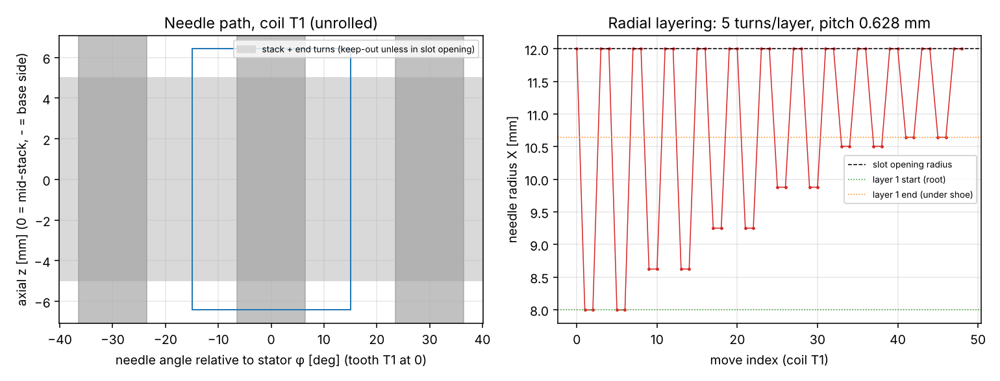

# From-scratch CNC needle winder (RL2407 stator)

Generated by `bldc-motor design winder`. It replaces 10 min of hand winding with about
**3.0 min per stator** (1.32 min machine + 1.7 min operator),
for about **$693** of hardware (4.6 % of the $15k line budget) instead of the $15-25k+ of a commercial winder.

> Status: concept design, rev P1. The kinematics, toolpath, clearances and drive sizing are computed
> and verified in software. The frame is a layout, not a detailed design. Most BOM prices are
> estimates (sources in `winder_bom.csv`). Build it, dry-run without wire, then wind first articles
> and accept them on the electrical tests in DWG-003.

## Why build one (and why not adapt a generic coil winder)

Outrunner stators need **needle (flyer-less) winding**: the wire must go *around each tooth*, not
onto a spinning bobbin. The RL2407 design was optimised for easy winding: 6 turns per tooth,
single-strand AWG23, a 2.5 mm slot opening and 0.38 slot fill. That makes a 3-axis machine
sufficient:

| Axis | Function | Drive | Speed / accel | Resolution |
| --- | --- | --- | --- | --- |
| A | stator rotation (wraps over the tooth end faces) | NEMA17 + 5:1 GT2 belt, 8 mm spindle | 750 motor rpm, 20,000 deg/s² | 0.0225 deg = 4.7 µm at the stator OD |
| Z | axial pass through the slot | NEMA17 + T8 (8 mm lead) on MGN12H | 100 mm/s, 3,000 mm/s² (750 rpm) | 2.5 µm |
| X | radial layer position | NEMA17 + T8 (8 mm lead) on MGN12H | 50 mm/s, 2,000 mm/s² (375 rpm) | 2.5 µm |

A-axis torque at the output is 27.3 mN·m (inertia plus 1.8 N wire tension at the OD),
or 15.4 mN·m at the motor including rotor inertia, 3.4 % of a 0.45 N·m NEMA17. Z force is 2.5 N.
Motor speeds are capped at about 750 rpm, where 24 V NEMA17s keep most of their torque.

## Needle strategy (the key insight)

The needle is an **18RW stainless hypodermic tube** (OD 1.27 / ID 0.84 mm, McMaster 8988K48). It
**never enters the copper region of a slot**:

1. Axial passes (Z) happen with the needle tip centred in the **slot opening** (r = 12.00 mm), where there is
   no copper, leaving 0.61 mm clearance to each shoe tip.
2. Beyond each stack end (|z| = 6.43 mm, 0.80 mm above the end turns), the needle moves in
   to the layer radius and the stator rotates the needle across the tooth end face. The wire wraps the tooth at that radius.
3. Tension pulls the wire in the slot straight between the two end-face wraps, so layering is set by X:
   5 turns per layer at 0.628 mm pitch from r = 7.99 (root) to 10.65 mm (under the shoe).
4. Inter-coil links run on the base side **on the yoke face (r = 6.74 mm)**, never at the OD, where they would
   foul the 0.5 mm magnet overhang. That forces the fixture design: the stator is gripped **by its bore only**,
   on an expanding mandrel (DWG-W01) with a Ø11.61 mm back relief.

## Verified in software

The G-code is decoded by an **independent parser**. The signed winding number of the needle path around every
tooth must equal the winding table, and every segment is checked against the stator keep-out
(the stack plus end turns, except the slot openings):

- turns per tooth: `[6.0, -6.0, -6.0, 6.0, 6.0, -6.0, -6.0, 6.0, 6.0, -6.0, -6.0, 6.0]`
- expected (DWG-003): `[6, -6, -6, 6, 6, -6, -6, 6, 6, -6, -6, 6]` → **MATCH**
- collisions: **0**; a deliberately bad move (needle into a slot at mid-stack) is caught by the test suite.

| Clearance check | Value | Limit | Result |
| --- | --- | --- | --- |
| needle in slot opening: side clearance [mm] | 0.615 | >= 0.3 | OK |
| needle bore / insulated wire | 1.378 | >= 1.25 (wire feeds freely) | OK |
| needle tip -> end turns during A sweep [mm] | 0.800 | >= 0.80 | OK |
| turns fit radially (layers used) | 2.000 | <= 2 for neat layering | OK |
| radial room for layer 1 [mm] | 2.651 | >= 1 wire | OK |
| link wire on yoke face: inside slot bottom, outside bore [mm] | 0.315 | >= 0.2 | OK |
| link wire clear of magnet overhang [mm] | 5.610 | >= 3 (links never at OD) | OK |
| mandrel back relief inside needle link path [mm] | 0.300 | >= 0.3 | OK |
| mandrel relief keeps a wall around the M5 draw screw [mm] | 3.305 | >= 1.5 | OK |

## Bill of materials (≈ $693)

| Item | Qty | Total | Source / status |
| --- | --- | --- | --- |
| Elecrow 6x CNC Controller for FluidNC (ESP32) | 1 | $49.00 | https://www.elecrow.com/6x-cnc-controller-for-fluidnc.html (search result, 2026-11-05) |
| TMC2209 stepper driver modules | 3 | $27.00 | estimate |
| NEMA17 stepper 0.45 N·m (A, Z, X) | 3 | $45.00 | estimate |
| MGN12H linear rail 200 mm + carriage (Z) | 1 | $30.95 | https://www.fruugo.us/mgn12h-miniature-linear-rail-slide-guide-strength-linear-rail-guide-for-cnc-machines-200mm/p-402239549 (search result) |
| MGN12H linear rail 150-200 mm + carriage (X) | 1 | $30.95 | same as above |
| T8 lead screw 8 mm lead, 150 mm + anti-backlash nut + coupler | 2 | $30.00 | estimate |
| A axis: GT2 20T/100T pulleys + 200 mm belt (5:1), 8 mm shaft, 2 x KP08 pillow blocks | 1 | $35.00 | estimate |
| Stator mandrel (turned, DWG-W01) + clamp nut + T1 index pin | 1 | $40.00 | estimate - turn in-house or JLCCNC |
| Needle: 18RW 304 hypodermic tube 0.050 x 0.033 in (McMaster 8988K48), tip polished | 1 | $20.00 | https://www.mcmaster.com/hypodermic-tubing (price not shown - estimate) |
| Needle holder + wire guide eyelet (ceramic) | 1 | $15.00 | estimate |
| Wire tensioner, magnetic, 0.5-1.2 mm range (or DIY dancer + felt brake ~$30) | 1 | $150.00 | https://cncwindingmachine.en.made-in-china.com/product/cmuRLrQOOgkS/ (no price - estimate) |
| Spool holder for 10 lb spool + guide pulleys | 1 | $25.00 | estimate |
| Frame: 2020 extrusion 2 m, 10 mm Al base plate, brackets, T-nuts | 1 | $90.00 | estimate |
| 24 V 6 A power supply, E-stop, foot pedal, 3 limit switches, wiring, enclosure box | 1 | $75.00 | estimate |
| Printed parts (P1S, PETG/CF), fasteners | 1 | $30.00 | estimate |

## Build and commissioning

1. **Frame:** 10 mm aluminium plate with a 2020 bridge. Put the headstock (pillow blocks, spindle, 5:1 belt) on the plate,
   and the Z rail on the bridge with the X slide hanging from the Z carriage. Keep the needle axis radial,
   intersecting the spindle axis within 0.05 mm (shim the X slide).
2. **Electronics:** Elecrow 6x FluidNC board, 3 × TMC2209 at 24 V, limit switches on X/Z, an optical flag on A, the E-stop
   in the feed-hold chain, and a foot pedal on cycle start. Load `fluidnc_config.yaml` (fill in the pins from the board docs).
3. **Zeroing:** A0 = tooth T1 under the needle, set with the loading gauge. Z0 = stack mid-plane and X0 = spindle axis, set with a
   turned zero gauge on the mandrel. The program assumes these work offsets.
4. **Wire path:** spool → magnetic tensioner (set 1.8 N, about 12 % of the AWG23 yield force, to avoid stretching the wire and raising R)
   → ceramic eyelet → needle. Polish the needle exit to a 0.2 mm radius.
5. **Dry run** without wire at 25 % feed override, watching the end-face clearances. Then run at 100 %.
6. **First articles:** wind 5 stators; check turns visually and R line-line within ±6 % with imbalance ≤ 2 %, then hipot.
   Tune tension and X layer pitch (`layer_pitch_factor`) until the layers are tight.

## Operator cycle (per stator)

Load the stator on the mandrel and expand it (gauge sets the axial position and T1), anchor the phase-A start lead on post SA, and press the pedal.
At each pause, cut and anchor the finish lead and the next phase's start (6 pauses in total). Unload.
Machine time 1.32 min; wire laid 1.88 m per stator.

## Files

| File | Content |
| --- | --- |
| `rl2407_winding.gcode` | 720-line program (X, Z, A; M0 pauses with messages) |
| `fluidnc_config.yaml` | Controller config skeleton (steps/mm, limits, homing) |
| `winder_bom.csv` | Hardware BOM with sources |
| `toolpath.png` | Unrolled needle path and radial layering for coil T1 |
| `cad/W-000_winder_layout.step`, `cad/winder_isometric.svg` | Concept layout (stator, mandrel, axes, needle, spool, tensioner) |
| `cad/W-001_mandrel.step`, `cad/DWG-W01_mandrel.svg` | Expanding mandrel, the only custom precision part |

## Risks and mitigations

- **Wire springback at the end-face wraps.** Add a short dwell or a small overtravel in A (a `WinderConfig` change), and validate on first articles.
- **Tension variation:** a magnetic tensioner is needed for repeatable layering. The DIY felt brake is acceptable for pilots only.
- **Needle wear and enamel damage:** polish the exit and inspect it every 500 stators. Hipot at S5 catches enamel nicks.
- **Open-loop steppers** can miss steps without detection. Keep the motors at ≤ 25 % of their torque (they run at about 3 %) and home A every stator.
