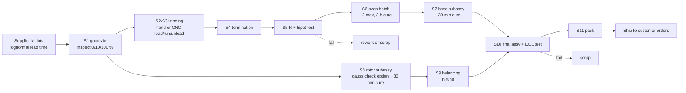

# RL2407 factory simulation and Gym environment

A discrete-event simulation (DES) of the complete manufacturing and assembly line in
`assembly_line_plan.md` (11 stations, < $15k capital), wrapped as a Gymnasium environment for
operations decisions. Code: `src/bldc_motor/production/sim.py` (engine), `sim_physics.py` (per-unit
physics and tests), `sim_env.py` (Gym env, baseline policies, residual-RL wrapper), `sim_report.py`.

```bash
bldc-motor design factory --episodes 20                      # compare baseline policies
bldc-motor design factory --train residual --steps 400000    # train residual PPO, then compare
pytest tests/test_bldc_factory_sim.py
```

```python
from bldc_motor.production.sim import SimConfig
from bldc_motor.production.sim_env import FactoryEnv
env = FactoryEnv(SimConfig(days=20, operators=2))   # standard Gymnasium API
```

## What is simulated



| Element | Model |
| --- | --- |
| Time | Event-driven, minutes; 7 productive hours per 8 paid hours per day; ovens, CNC cycles and deliveries continue overnight |
| Operators | Pool of *n*, each assigned to a zone (stator / oven+base / rotor / final / flex). Within a zone they take the downstream-most feasible task. No task starts unless it can finish before the shift ends |
| Task times | Line-plan station minutes; CNC load/unload/run from the verified winder toolpath. Lognormal, CV 0.2; learning curve ×(1 + 0.5·e^(−n/40)) |
| Pull control | Rotor kanban (2/4/8/16) and stator CONWIP cap (12–48). Without caps the rotor branch starves the stator branch (seen while building this) |
| CNC winder | Weibull wear-out (shape 2, scale 20 run-hours), 90 min repair, optional 30 min preventive maintenance; jams at 0.5 % of cycles (+3 min) |
| Batch oven | 12 stators, 3 h cure; start rule hold / any / half / full, auto-start near shift end |
| Shared machines | Test bench (S5 and S10), balancer |
| Supply | Kit orders 0/25/50/100 at $14.59 + $80 per order, lognormal lead time (mean 5 d, CV 0.3); incoming defect rates per component; inspection removes 90 % of what it inspects |
| Demand | Poisson daily orders of 10–40 motors due in 7 days; $40 per motor; $1 per motor-day late |

### Per-unit physics (why defects escape)

Each motor gets as-built **production tolerances** (airgap, magnet thickness, stack, stator OD, Br lot,
wire resistance). Kv and R come from a finite-difference **Jacobian of the analytical motor model**.
The resulting Kv scatter is σ = 1.84 % (checked against Monte Carlo in the tests), driven by stack
length (Kv ∝ 1/L) and Br.

**Turn-count errors** (hand: 0.4 %/coil, CNC: 0.02 %/coil, assumed) change the phase resistances
(R_ij = R_i + R_j) and the back-EMF phasors.

The tests reproduce the real acceptance specs with instrument noise: R each pair ±6 % and imbalance ≤ 2 %
(σ 0.4 %), hipot (98 % detection), Kv within 3σ (σ 0.5 % measurement), and balance ≤ 11 mg·mm.
Rotor unbalance is Rayleigh with σ = 204 mg·mm (1 % magnet-mass scatter × 14 magnets at r = 13.2 mm,
plus 5 µm bell eccentricity), and each balancing run leaves 3–15 % of the unbalance.

## Validation (tests/test_bldc_factory_sim.py)

| Check | Result |
| --- | --- |
| Deterministic capacity vs the line plan, 1 operator | Hand: matches 420/40.8 = 10.3/day within 4 %. CNC: matches 420/(labour − winding + load/unload) within 4 % |
| Little's law L = λW (60 days, stochastic) | Within 5 % |
| Conservation | Entered = completed + scrapped + WIP, where WIP is counted **independently** by walking buffers, machines and pending events. No negative stock, oven ≤ capacity |
| Kv scatter | Monte Carlo σ(ln Kv) = linearised σ within 3 % |
| R-test detection | Monte Carlo matches the exact range distribution of three normals within 0.01 |
| Common random numbers | Demand is identical across policies for the same seed |
| Gym | `check_env` passes; Σ rewards = Δ profit at the horizon (incl. salvage) |

## Findings

1. **The line plan's ±3 % Kv gate was inconsistent.** Production tolerances alone give Kv σ = 1.84 %, so a
   ±3 % gate would scrap about 10 % of good motors. The spec sheet's 3σ limit (≈ ±5.5–6 %) is the consistent
   one, and the line plan now uses it.
2. **A single missed turn is caught only 74 % of the time.** It shifts two R pairs by 1/48 = 2.1 %, just
   above the 2 % imbalance limit. It is invisible to the Kv test, because no-load Kv follows the strongest
   line pair. Hand winding therefore ships more defects (the test suite confirms CNC escapes fewer).
   Tightening the imbalance limit or verifying turns (as the CNC does) is the fix.
3. **Cross-trained floating operators beat a dedicated winding operator.** Under the WIP cap, a
   dedicated operator idles while downstream work waits.
4. **A pull system is required.** Push dispatch let the rotor branch absorb all labour (0 motors in 20
   days during development).

## RL results (20-day episodes, 2 operators, CNC winder)

Policies compared on the same seeds. The full table, including yields, flow time and utilisation, is in
`factory_sim/policy_comparison.md`; one episode is traced in `factory_sim/episode_trace.png`.

| Policy | Profit incl. salvage | Shipped | Fill rate |
| --- | --- | --- | --- |
| Heuristic, flexible staffing ((s,Q) ordering, half-batch oven, kanban, age-based PM) | **$1,106 ± 1,581** | 370 | 0.85 |
| Heuristic, zoned staffing | −$1,392 ± 678 | 269 | 0.64 |
| Random | −$14,165 ± 705 | 125 | 0.31 |
| PPO from scratch (400k steps, ~85 s) | −$8,043 ± 859 | 29 | 0.07 |
| Residual PPO on the flex heuristic (400k steps) | $1,049 ± 1,473 | 368 | 0.84 |

The ± is the spread across demand scenarios, not uncertainty in the policy comparison. With common random
numbers (60 paired seeds), **residual − heuristic = −$35 ± $30 (s.e.)**, and lateness and quality are
unchanged within error. The honest reading:

- **From-scratch PPO does not learn to run the factory** at this budget. Credit assignment over 140 steps,
  with daily labour charges and multi-day supplier lead times, is hard.
- **Residual RL starts at heuristic performance but found no improvement.** The flex heuristic appears close
  to a local optimum for these decisions.

To push further, try longer training, SB3 (`train_sb3` in `design/ppo.py` works with this env), demand
forecasts in the observation, or a decision interval of a shift instead of an hour.

## Assumptions to replace with pilot data

All defect rates, task-time variability, the learning curve, winder reliability, supplier lead
time and quality, demand and price are **planning assumptions** (see `SimConfig`). The 50-piece pilot
should measure them: per-station times, S5 and EOL failure Paretos, and winder run hours between
failures. Then set the `SimConfig` fields and re-run. The bundled policies were trained under the
default assumptions.
