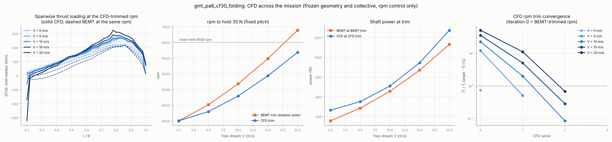
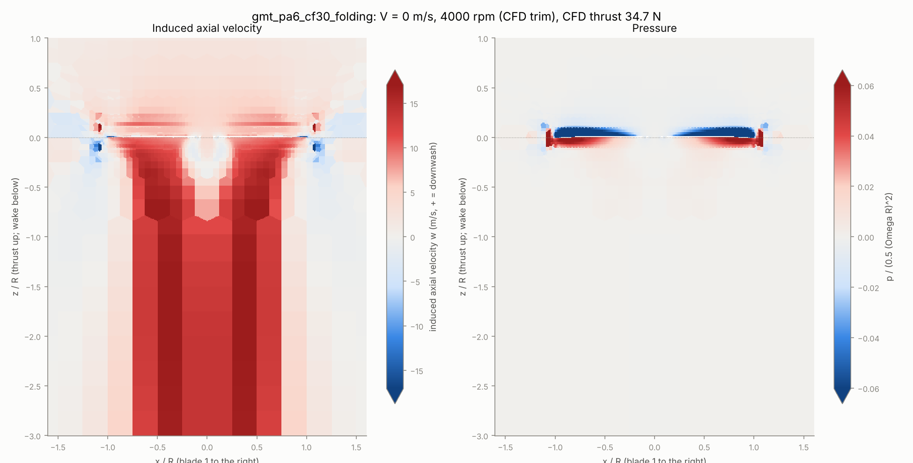
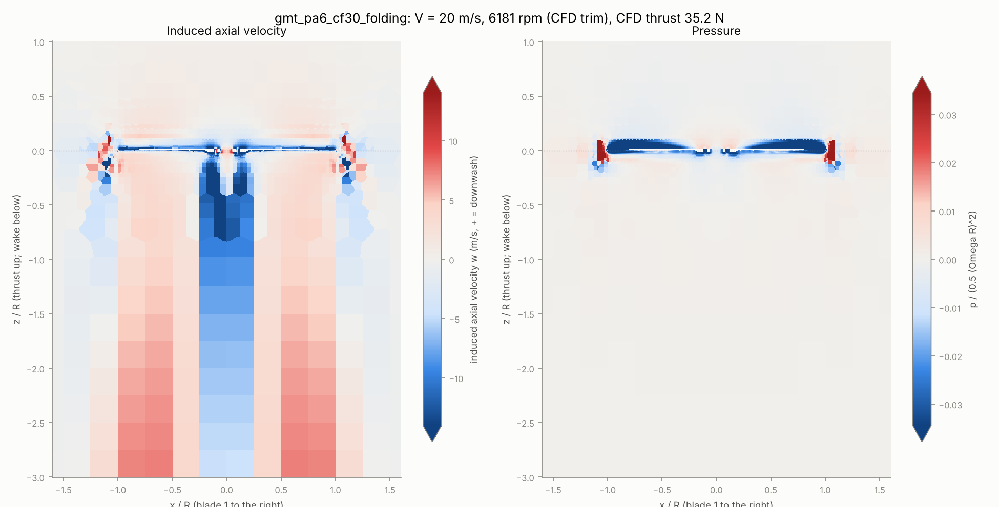
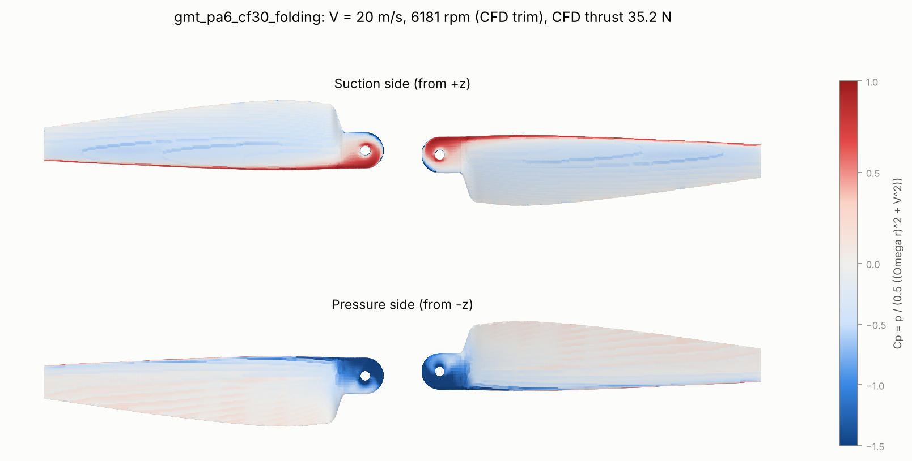
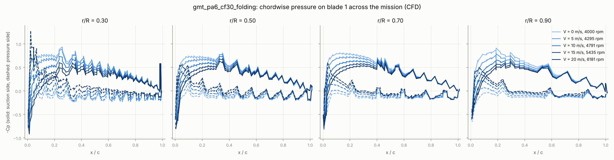
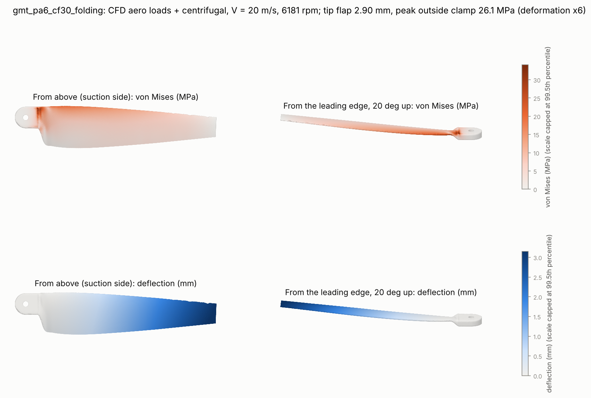
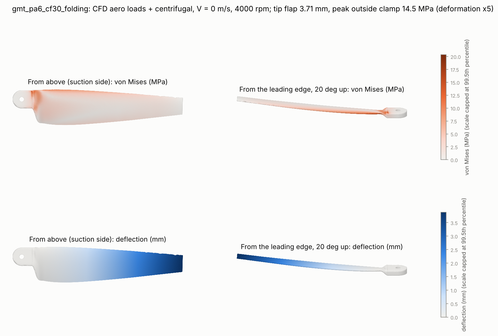

# Mission Envelope: Static to 20 m/s, CFD Trim, and CFD-Loaded FEA

A fixed-pitch prop is designed at one operating point (here 35 N in hover at 4000 rpm) but has
to fly a mission. This page covers the two stages that test the frozen design across the mission:

```bash
prandtl run designs/gmt_pa6_cf30_folding.yaml --stages envelope          # BEMT map, ~10 s
prandtl run designs/gmt_pa6_cf30_folding.yaml --stages mission           # CFD at each point + CFD rpm trim + FEA, ~2.5 h on 4 cores
# Plumbing check in ~20 min (coarse mesh, short solves; the numbers are meaningless)
prandtl run designs/gmt_pa6_cf30_folding.yaml --stages mission --set-file designs/smoke_overrides.txt \
  --set-file designs/cfd_smoke_overrides.txt --set cfd.iterations=300 --set "mission.cfd_points=[0,4]" \
  --set "mission.fea_points=[4]" --set fea.mesh_size_m=0.006 --set mission.cfd_trim_warm_iterations=150
```

All the results below use the smoke inputs (`designs/smoke_overrides.txt`): an analytic polar and a
NACA 4410 stand-in at every station, because the XFOIL polars and airfoil coordinates are not in
this repository. They demonstrate the method and its findings, not final thesis numbers.

## Assumptions

- **Axial flow only.** The free stream V is along the rotor axis: vertical climb, or a tilt-rotor
  or tail-sitter in forward flight. Edgewise flow (multirotor cruise) has a skewed, unsteady wake
  and needs a different model.
- **Fixed pitch.** The geometry and the collective set by the design-point trim are frozen. The
  only control is rpm, so each mission point (V, T) is reached by trimming rpm.
- **Mission points:** V = 0, 5, 10, 15, 20 m/s, each holding the design thrust of 35 N
  (`mission.v_inf_m_s`, `mission.thrust_N`). Motor limit 6500 rpm (`mission.max_rpm`).
- **Steady, incompressible, MRF CFD** (the hover CFD setup in `docs/iterative_workflow.md`), with
  the free stream entering through the top boundary.

## BEMT envelope (`envelope`)

- Momentum: dT = 4 pi rho r F (V + v_i) v_i dr.
- When a section's blade-element thrust at v_i = 0 is already zero or negative (it unloads at high
  advance ratio), BEMT solves on the windmill-brake branch, -V/2 < v_i <= 0, instead of failing.
- The map covers V = 0 to 20 m/s by rpm = 2000 to 6500. Each mission point is trimmed in rpm
  (bracket scan, then Brent).
- Outputs: `envelope_map.csv`, `mission_points.csv`, `stations_<point>.csv`, and `envelope.png`
  (thrust and power maps with the 35 N trim line, efficiency, and angle of attack across the
  span at each point).

What the frozen geometry does as V rises: the inflow angle grows while the pitch stays fixed, so
the angle of attack falls everywhere. The inboard sections reach zero and then negative loading
first. To hold thrust, rpm has to rise.

## CFD at the mission points (`mission`)

1. **One mesh.** snappyHexMesh runs once (`cfd/mesh`). Every solve copies its polyMesh, so all
   the points share the same discretisation error and differ only in V and rpm.
2. **Free-stream boundaries.** U = (0, 0, -V) on the far field (`freestreamVelocity`,
   `freestreamPressure`), with `totalPressure` in hover. The inlet turbulence uses 1% intensity.
3. **Independent thrust check.** The far-field momentum balance uses the perturbation velocity,
   -integral(rho ((U_z + V) U.n + p n_z)) dA. A free stream carries a momentum flux rho V U.n
   through the boundary, and any residual mass imbalance times V would otherwise show up as a
   spurious thrust. On every point, wall and far-field thrust agree within 0.2%.
4. **CFD rpm trim.** The BEMT-trimmed rpm is only a starting point (iteration 0). The loop then:
   - assumes the CFD/BEMT thrust ratio holds near the point and re-trims BEMT to
     35 N / ratio (iteration 1);
   - takes secant steps on the CFD thrust itself;
   - stops once |T / 35 N - 1| is at most `mission.cfd_trim_tolerance` (1%), or after
     `mission.cfd_trim_iterations`.

   Re-solves warm-start from the previous solution's fields (`mission.cfd_trim_warm_iterations`).
   Every solve is recorded in `cfd_solves.csv`.
5. **Model comparison at the same operating point.** BEMT is re-solved at the CFD-trimmed rpm, so
   `cfd_over_bemt_*` and the spanwise loading plots compare the two models at one (V, rpm). Any
   difference is model error, not trim error.

Outputs per point:

- `flow_<point>.png`: meridional slice (y = 0) of the induced axial velocity w = -U_z - V and the
  pressure coefficient p / (0.5 (Omega R)^2). Sampled cell by cell, with the blade interior masked.
- `blade_cp_<point>.png`: blade surface coloured by local Cp = p / (0.5 ((Omega r)^2 + V^2)),
  suction and pressure sides.
- `loads_<point>.csv`: dT and dQ per station, CFD and BEMT.

Across the mission:

- `section_cp.png`: chordwise -Cp at r/R = 0.3, 0.5, 0.7, 0.9, one colour per point.
- `mission_cfd.png`: spanwise loading, rpm to hold 35 N (BEMT trim vs CFD trim, with the motor
  limit), shaft power at trim, and trim convergence.
- `cfd_points.csv`.

### Why CFD and BEMT diverge off design, and what it is not

The first full run solved CFD at the BEMT-trimmed rpm. The default mesh had 26k blade-patch faces
(about 19k on blade 1) and 1500 iterations; snapshots changed thrust by less than 0.04%:

| V (m/s) | rpm (BEMT trim) | BEMT thrust | CFD thrust | CFD / BEMT power |
| --- | --- | --- | --- | --- |
| 0 | 4000 | 35.0 N | 34.7 N | 1.30 |
| 5 | 4512 | 35.0 N | 39.2 N | 1.32 |
| 10 | 5180 | 35.0 N | 42.9 N | 1.39 |
| 15 | 5981 | 35.0 N | 47.3 N | 1.50 |
| 20 | 6885 | 35.0 N | 52.7 N | 1.65 |

The two models agree in hover, and the gap grows steadily with V. Two explanations predict
different things:

- **Momentum theory breaks down off design.** Then the error should depend on V in a way that no
  single section polar can absorb.
- **The CFD sees a different section polar than the analytic one.** Then one polar should fit
  every point.

**Test.** The stage fits a single analytic polar (lift slope a, alpha0, cd0, k) so that BEMT
reproduces the CFD thrust and torque at every solve (`effective_polar.csv`):

| Polar | a (1/rad) | alpha0 | cd0 | k | Worst thrust error | Worst torque error |
| --- | --- | --- | --- | --- | --- | --- |
| Analytic input | 5.80 | -2.5 deg | 0.011 | 0.006 | 43% | 47% |
| Fitted to all 12 solves (5 points + trim iterations, 4000-6885 rpm) | 4.22 | -5.2 deg | 0.018 | 0.029 | 5.2% | 2.0% |
| First run, fitted to 0 and 20 m/s only | 3.79 | -5.6 deg | 0.017 | 0.05 (bound) | 4.6% at the 3 held-out points | 1.5% |

One polar fits every speed and rpm, and a fit to the end points predicts the middle points. So the
gap is a **section-polar mismatch**, not a failure of BEMT off design.

The CFD's effective lift curve is flatter and has a more negative zero-lift angle. It crosses the
analytic curve near the hover angle of attack, which is why the two agree in hover. In climb the
angle of attack falls, and there the CFD section makes more lift. Plausible causes:

- the low Reynolds number (about 1e5);
- the molded blunt trailing edge, which adds effective camber;
- wall functions, with turbulent flow from the leading edge;
- the default mesh not yet being mesh-converged (see the mesh study in `docs/iterative_workflow.md`).

With XFOIL polars for the actual molded sections, the BEMT side of this comparison changes. Re-run
the stage, and use `effective_polar.csv` as the check.

### CFD-trimmed mission (final run)

Every point is trimmed on the CFD thrust to within 1% of 35 N (`cfd_points.csv`):

| V (m/s) | rpm, BEMT trim | rpm, CFD trim | CFD solves | CFD thrust | CFD power | eta = TV/P (FM in hover) | BEMT trim power |
| --- | --- | --- | --- | --- | --- | --- | --- |
| 0 | 4000 | 4000 | 1 | 34.7 N | 464 W | FM 0.57 | 356 W |
| 5 | 4512 | 4295 | 2 | 35.2 N | 550 W | 0.32 | 485 W |
| 10 | 5180 | 4791 | 3 | 35.0 N | 708 W | 0.49 | 655 W |
| 15 | 5981 | 5435 | 3 | 35.1 N | 944 W | 0.56 | 869 W |
| 20 | 6885 | **6181** | 3 | 35.2 N | 1273 W | 0.55 | 1131 W |

- **Motor limit.** With BEMT, 20 m/s needs 6885 rpm, above the 6500 rpm limit. The CFD says the
  frozen prop holds 35 N at 20 m/s at 6181 rpm, which leaves a 5% margin. The motor-limit verdict
  flips.
- **Power.** The CFD needs 8-30% more power than the BEMT-trimmed estimate, because the
  CFD-effective profile drag is higher. Size the battery and ESC on the CFD numbers.
- **Trim convergence.** The ratio-corrected BEMT step lands 0.5-11% from the target: 5 m/s is done in
  one step, and the other points need one secant step to get inside 1%. Each warm-started re-solve takes 700 iterations,
  about half the cost of a cold solve.
- **Check quality.** At every point, wall and far-field thrust agree within 0.2%. The thrust
  change between the last snapshots is 0.06% or less.
- **Where the load goes.** As V rises, the inboard span unloads (the angle of attack there falls
  first) and the load moves outboard. The suction-side leading-edge peak drops at every station.
  The spike at r/R = 0.2 is the exposed root tab, which the hub plates cover in the real
  assembly. The slow central wake comes from the open hub, which is not modelled.











## CFD -> FEA: live aero loads on the CalculiX blade

`prandtl_prop/structures/cfd_coupling.py` maps the CFD wall loads at each `mission.fea_points`
point onto the C3D10 blade, then runs CalculiX with the centrifugal load at that point's rpm:

- **Surface.** The FE surface is the set of element faces used by one element only. Each face is
  oriented outward, away from the element's fourth corner.
- **Traction.** Each FE face takes the traction of the nearest CFD wall face on the same blade:
  pressure p along the inward normal, plus wall shear tau = F_viscous / A. The face force is
  F = (-p n_out + tau) A_FE.
- **Consistent nodal loads.** For a constant traction on a 6-node triangle, the corner nodes get
  zero and each mid-side node gets one third of the face force (the integrals of the quadratic
  shape functions). A uniform pressure integrates to zero net force on the closed surface; this
  is tested.
- **Equilibrium check.** The mapped blade force and torque are compared with the CFD integral
  over the same blade's wall faces. On the default mesh, force is within 0.4-2.8% and torque
  within 0.5-0.7%. The median mapping distance is 0.45 mm.
- **Comparison run.** Each point is also run with BEMT strip loads at the same rpm.

Outputs: `fea_<point>_cfd.png` and `fea_<point>_bemt.png` (von Mises and deflection on the
deformed blade), and `fea_points.csv` (including the mapping diagnostics).

### Results (CFD-trimmed points)

All points run at the CFD-trimmed rpm:

| Point | Load source | Aero Fz per blade | Peak von Mises outside the clamp | Margin (60 MPa / 1.5) | Tip flap |
| --- | --- | --- | --- | --- | --- |
| 0 m/s, 4000 rpm | CFD | 17.4 N | 14.5 MPa | +3.14 | 3.71 mm |
| | BEMT | 17.5 N | 14.2 MPa | +3.22 | 3.54 mm |
| 10 m/s, 4791 rpm | CFD | 17.8 N | 17.6 MPa | +2.42 | 3.27 mm |
| | BEMT | 14.0 N | 16.7 MPa | +2.59 | 2.80 mm |
| 20 m/s, 6181 rpm | CFD | 18.2 N | 26.1 MPa | +1.30 | 2.90 mm |
| | BEMT | 10.1 N | 24.7 MPa | +1.43 | 2.20 mm |

Mapping closure (mapped force / CFD blade force) is 1.004, 1.015 and 1.037; torque is 0.995,
0.993 and 0.994.

- **Stress rises with V because rpm rises.** The centrifugal load scales with Omega^2 (x2.4 from
  hover to 20 m/s), while the aero load per blade stays near 17.5 N. Peak stress sits in the root
  transition just outboard of the clamp at every point.
- **Tip flap falls as V rises,** even with the same aero load, because of centrifugal stiffening.
- **BEMT loads are unconservative off design.** At the CFD rpm, BEMT under-predicts thrust (its
  polar under-predicts lift at low angle of attack), so its strip loads under-predict 20 m/s tip
  flap by 24% and peak stress by 5%. The CFD-loaded case is the one to design to. Its lowest
  margin is +1.30, at 20 m/s.
- **Mapping limit.** The force closure drifts from 1.004 to 1.037 as V rises: nearest-face
  mapping smears the steeper leading-edge pressure gradients. The error is on the conservative
  side; area-weighted interpolation would tighten it.
- **Mesh.** The FE mesh fell back to straight-sided C3D10 (gmsh failed its curved-element quality
  check). That was also the case in the earlier hover confirmation.




