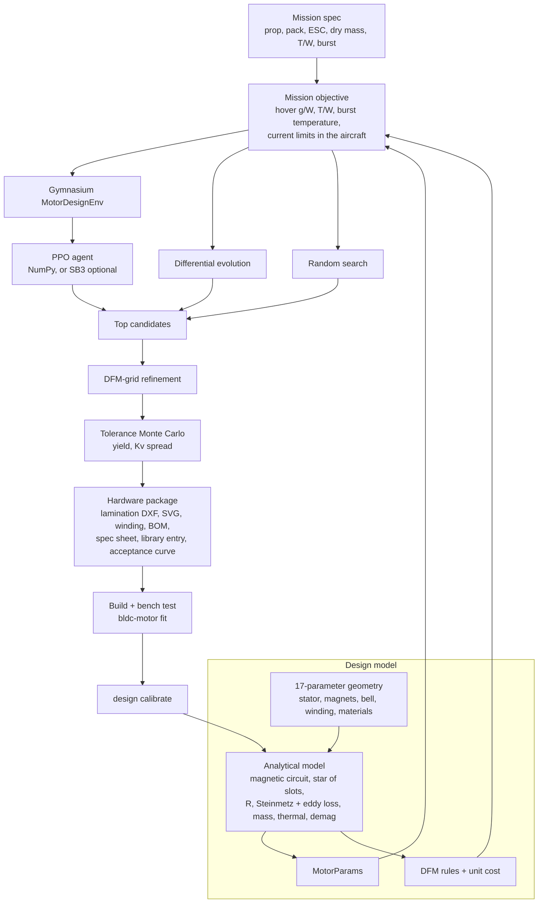

# RL-Driven BLDC Motor Design Pipeline

`src/bldc_motor/design/` turns a mission (prop, pack, frame mass, punch-out requirement) into a
buildable outrunner design and its hardware package. A reinforcement-learning agent explores the
design space in a Gymnasium environment. Differential evolution and random search run on the
same evaluation budget, so the result can be checked against non-RL methods. Every candidate
then goes through DFM-grid refinement and a production-tolerance Monte Carlo before one is
exported.



## Running it

```bash
python -m pip install -e ".[rl]"        # gymnasium; PPO itself is NumPy-only
bldc-motor design missions               # presets: 5in_freestyle_6s, 3in_cinewhoop_4s, 7in_longrange_6s
bldc-motor design run --mission 5in_freestyle_6s --rl-steps 150000 --out outputs/motor/design
bldc-motor design benchmark --train-steps 200000 --missions 9      # amortised RL vs per-mission optimisers
bldc-motor design evaluate outputs/motor/design/design.json --yield-samples 200

# after building and bench-testing a prototype (see docs/motor_development.md):
bldc-motor fit proto.csv --r-ll-mohm <measured> --name proto1 --out outputs/motor/fit
bldc-motor design calibrate --design outputs/motor/design/design.json \
    --measured outputs/motor/fit/fitted_library.json --motor proto1 --calibration outputs/motor/design/calibration.json
bldc-motor design run --calibration outputs/motor/design/calibration.json
```

`python scripts/run_motor_design_pipeline.py` is equivalent to `bldc-motor design run`. With
`OMP_NUM_THREADS=1` the small NumPy networks run faster.

## 1. Design space (`geometry.py`)

| Parameter | Range / choices | Snap |
| --- | --- | --- |
| stator OD | 12–36 mm | 0.5 mm |
| stack length | 3–14 mm | 0.5 mm |
| stator ID / OD | 0.25–0.55 | 0.01 |
| yoke thickness / stator radius | 0.04–0.20 | 0.005 |
| tooth width / slot pitch | 0.30–0.75 | 0.01 |
| slot opening | 0.6–3.0 mm | 0.1 mm |
| airgap | 0.15–0.80 mm | 0.05 mm |
| magnet thickness | 0.6–3.0 mm | 0.1 mm |
| magnet arc / pole pitch | 0.60–0.95 | 0.01 |
| bell back-iron thickness | 0.5–2.5 mm | 0.1 mm |
| slots/poles | 9N12P, 9N8P, 9N10P, 12N10P, 12N14P, 12N16P, 18N16P, 18N20P, 24N22P, 24N28P | — |
| turns per tooth | 1–30 | — |
| wire | AWG 18–33 | — |
| strands in hand | 1–6 | — |
| connection | wye, delta | — |
| magnet grade | N52, N48H, N45SH, N42UH | — |
| lamination | 0.10, 0.20, 0.35 mm Si-steel | — |

Optimisers work on the unit cube `u ∈ [0,1]^17` (discrete parameters are binned), and every
design is snapped to the manufacturable grid before evaluation.

## 2. Analytical motor model (`model.py`, `winding.py`)

First-order sizing physics, all SI:

| Step | Relation |
| --- | --- |
| Carter coefficient | `kc = τs / (τs − γ g)`, `γ = (wso/g)² / (5 + wso/g)` |
| Airgap flux | `Bg0 = k_leak · Br · hm / (hm + μr · kc · g)`, k_leak = 0.93 |
| Saturation | smooth minimum over tooth, yoke and bell limits: `Bg = Bg0 / (1 + Σ(Bi/Bsat,i)^8)^(1/8)` |
| Fundamental | `B1 = (4/π) · Bg · sin(α π / 2)` |
| Winding factor | star of slots, tooth-wound double layer: `kw = kp · kd` (matches literature: 12N14P 0.933, 9N12P 0.866, 24N22P 0.949) |
| Back-EMF | `Ke_ph = kw · N_ph · B1 · D · L`; DC-equivalent `Ke = √3 · Ke_ph` (wye) or `Ke_ph` (delta) |
| Resistance | rounded-rectangle turn `l = 2(L + 2t) + 2(wt + 2t) + π · build`; `R_ll = 2 R_ph` (wye) or `2/3 R_ph` (delta) |
| Iron loss | Steinmetz `kh f B²` + classical eddy `π² t² f² B² / (6 ρe ρm)` × excess factor 3, on tooth and yoke mass |
| No-load current | `I0(ω) = (c_h + T_friction)/Ke + (c_e/Ke) ω` |
| Thermal | `C` from part masses; `G_ws` through the 0.2 mm coat over the slot perimeter; `G_sa = h(v) · A` with `h ∝ v^0.8` |
| Demagnetisation | `|H_no-load| + F1/(hm + μr g_eff) < 0.8 Hcj(T_max)`, `F1 = (3/π) kw N_ph I_pk / p` |

The tests check the scaling laws and identities exactly: Kv ∝ 1/N and 1/L; delta has √3 the Kv
and the same Km as wye; eddy loss ∝ t²; mass bookkeeping closes; the closed-form burst
temperature matches the time integrator. Absolute accuracy is about ±10–20 % before
calibration. In particular, the no-load loss of real FPV motors includes PWM ripple and rotor
eddy losses, which the excess factor only approximates.

## 3. "Easy to manufacture" (`manufacturing.py`)

DFM rules for the usual small-outrunner process: laser-cut or stamped laminations, epoxy coat,
needle winding of tooth coils, bonded arc magnets, machined bell. Each rule returns a penalty
(0 = OK, 0–1 = WARN, ≥ 1 = FAIL). Manufacturability = `exp(−Σ penalties)`.

| Rule | Comfortable | Fail |
| --- | --- | --- |
| slot fill (bare copper) | ≤ 0.38 | ≥ 0.50 |
| needle access: slot opening ≥ bundle + 0.6 mm | met | 0.3 mm short |
| wire diameter | 0.20–0.64 mm | < 0.15 or > 0.8 mm |
| strands in hand | ≤ 3 | +0.25 per extra strand |
| turns per coil | ≥ 3 (Kv granularity) | 1 |
| airgap | ≥ 0.25 mm (runout + bearing play + coat) | ≤ 0.17 mm |
| magnet thickness | ≥ 1.0 mm (chipping) | ≤ 0.65 mm |
| tooth / yoke / shoe | ≥ 1.2 / 0.8 / 0.25 mm | 0.8 / 0.5 / 0 mm |
| unbalanced magnetic pull | gcd(Q, 2p) ≥ 2 | 0.5 penalty |
| delta connection | wye | 0.15 penalty (3rd-harmonic circulating current) |

A unit-cost model (magnets by grade, laminations by gauge with sheet utilisation and stamping,
copper, winding labour per turn and coil, bell, bearings, assembly) is part of the objective.
**Cost coefficients are illustrative.** Thresholds live in `DFM_LIMITS` and `materials.COST` so
they can be set to a specific factory's values.

Production tolerances (airgap ±0.03 mm, magnet ±0.03 mm, stack ±0.08 mm, Br ±1.5 %, R ±2 %, all
1σ) feed a Monte Carlo yield. Designs that sit on a constraint edge lose yield and are rejected
in favour of robust ones (default: yield ≥ 90 %).

## 4. Objective, evaluated in the aircraft (`mission.py`)

The motor is installed in the mission's quad. The all-up weight includes 4 × the motor's own
mass. Hover is solved at its steady-state temperature using a new exact closed-form inverse
solver (`Powertrain.solve_for_thrust_direct`), and the punch-out burst starts from the hover
temperature using a closed-form two-node thermal response (matrix exponential). Each evaluation
takes about 0.6 ms.

```
J = w_eff · (hover g/W) / ref + w_mfg · manufacturability − w_cost · cost / ref − penalties
penalties: T/W shortfall, winding/magnet over-temperature, demag and ESC current, size, mass, hover throttle > 0.5
```

## 5. Reinforcement learning (`env.py`, `ppo.py`)

**Environment.** `MotorDesignEnv` follows the standard Gymnasium API and passes
`gymnasium.utils.env_checker`.

* *Observation:* the design (17), normalised feedback on the current design (score, g/W, T/W,
  burst temperatures, fill, DFM score, cost, feasible), the mission context (6) and progress.
* *Action:* `Box(−1, 1, 17)`, a bounded edit `u ← clip(u + 0.08·a)` (sequential refinement), or
  `action_mode="absolute"` for one-shot design.
* *Reward:* potential-based, `r = φ(J_{t+1}) − φ(J_t)`. The return telescopes to
  `φ(J_final) − φ(J_0)`, so maximising return is maximising the final design (tested). φ is the
  identity for J ≥ 0 and `−log(1 − J)` below. It is monotone (same optimum) and compresses the
  huge penalties of badly infeasible designs.
* `mission_sampler` randomises the mission per episode, so the policy learns a design rule rather
  than a single design.

**Trainer.** PPO (clipped surrogate, GAE λ = 0.95, γ = 0.995, Adam, KL early stop, running
observation normalisation) with hand-derived gradients, checked against finite differences to
1e-6 in the tests. PyTorch is not required. `train_sb3()` runs the same environment with
Stable-Baselines3 when that is installed.

## 6. Results so far (uncalibrated model, illustrative library prop/packs)

These runs used seed 0 and `OMP_NUM_THREADS=1` on one CPU core. They are model predictions, not measurements.

**Fixed mission `5in_freestyle_6s`, about 158k design evaluations per method**
(`bldc-motor design run --rl-steps 150000`; the PPO training took about 2.5 min):

| Method | Best raw score | After DFM-grid refinement | Best tolerance yield |
| --- | --- | --- | --- |
| PPO agent | +1.720 | +1.747 | **100 %** |
| Differential evolution | **+1.779** | **+1.779** | 72 % |
| Random search | +1.568 | +1.679 | 87 % |

DE found the highest nominal score, but its designs sit on constraint edges: only 72 % of as-built
copies meet spec. The robust winner (yield ≥ 90 %) was PPO's design. It is a 24 × 7.5 mm, 12N14P
wye stator with 6 turns of single-strand AWG23, a 0.35 mm airgap, 1.7 mm N52 magnets and 0.10 mm
laminations. The model predicts Kv 1687 rpm/V (±1.9 % over the tolerance Monte Carlo), R_ll 88 mΩ,
41 g, 5.79 g/W at hover, T/W 8.5, and 123 °C winding after a 10 s punch-out. Manufacturability
is 1.00 (no DFM warnings) and the illustrative unit cost is $4.71. That is essentially the
configuration commercial 5" motors converged on, which is a useful sanity check on the
objective. On a single mission, the honest reading is that DE is the stronger raw optimiser.

**Amortised design, 9 held-out missions, 200 evaluations each**
(`bldc-motor design benchmark --train-steps 200000 --missions 9`; the policy was trained once on
missions sampled ±15 % around the presets):

| Method | Missions with a feasible design | Mean best feasible score | Wins |
| --- | --- | --- | --- |
| Mission-conditioned PPO policy | **9 / 9** | **1.89** | **9** |
| Differential evolution | 3 / 9 | 1.71 | 0 |
| Random search | 2 / 9 | 1.72 | 0 |

This is where RL earns its place. Once trained, the policy reaches feasible designs for a new
requirement within about 8 rollouts, while per-mission optimisers starting from scratch mostly
do not. Two caveats: DE is budget-starved at 200 evaluations (2 generations at population 85),
which is precisely the regime being tested; and the 9 random held-out draws happened to be 3"
and 7" variants only.

## 7. Hardware package (`export.py`)

| File | Use |
| --- | --- |
| `lamination.dxf` | stator lamination outline (mm, R12 LINE/CIRCLE) for laser cutting, wire EDM or a die quote |
| `cross_section.svg` | stator, magnets, bell and per-tooth phase labels |
| `winding.csv` | tooth-by-tooth phase, direction, turns, strands, gauge |
| `bom.csv` | laminations, wire length, magnet dimensions and grade, ring, bell, cost |
| `spec_sheet.md` | design table, predicted performance, DFM table, yield, acceptance limits, method comparison |
| `library.json` | the designed motor for `bldc-motor point/match/thermal --library` |
| `predicted_stand_curve.csv` | the model's expected thrust-stand sweep (labelled `SYNTHETIC`/`PREDICTED`) |
| `design.json`, `design_policy.npz`, `training_log.csv`, `convergence.png` | provenance |

## 8. Calibration loop (`calibration.py`)

After bench-testing a prototype, `design calibrate` computes measured / uncalibrated-prediction
ratios for Kv, R, eddy loss, the friction-plus-hysteresis remainder and, optionally, convection.
Each factor is the geometric mean over all prototypes so far (systematic-error assumption).
Re-running the pipeline with `--calibration` optimises against the corrected model. The test
`test_calibration_recovers_known_factors` shows the procedure recovers injected model errors
exactly.

## Limitations

* The first-order magnetic model has no FEA. It does not model slot leakage, armature-reaction
  saturation under load, cogging torque magnitude, or rotor and magnet eddy losses (beyond the
  lumped excess factor). Before tooling up, verify the selected design with 2-D FEA (e.g. FEMM).
* No winding inductance or current-ripple model, so high-eRPM behaviour is optimistic.
* The cost and DFM thresholds are rules of thumb, and the bundled props, packs and missions are
  illustrative.
* The RL agent's advantage is amortisation across missions. On a single mission, use the
  pipeline's comparison: it keeps whichever method's design is best.
