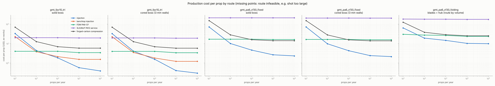
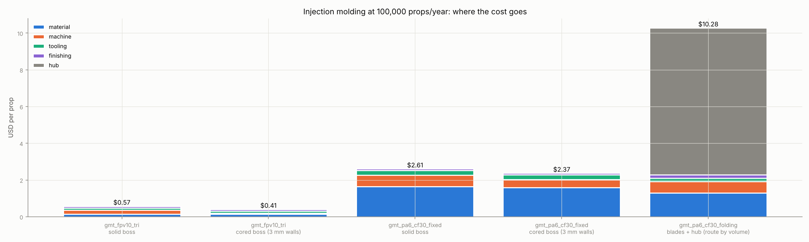

# Production: Hardware Stack and Cheap Routes

This page plans how to make the props this repository designs, from the first ten to a million a
year:

- the 10 in tri-blade FPV prop (one-piece);
- the 22 in fixed prop (one-piece);
- the 22 in folding prop (two blades plus a machined hub).

```bash
prandtl cost designs/gmt_fpv10_tri.yaml designs/gmt_pa6_cf30_fixed.yaml designs/gmt_pa6_cf30_folding.yaml \
  --set-file designs/smoke_overrides.txt            # --labor-usd-h 6 for an Asian contract molder
```

- **Model:** `src/prandtl_prop/manufacturing/cost.py`. Every rate is in `CostAssumptions`, with its
  basis.
- **Parts:** taken from each design's cad and dfm runs: volume, projected area (from the STL), and
  the thickest wall.
- **Tests:** `tests/test_cost.py`.
- **Numbers:** ex-works costs in USD, not prices. Treat them as ±30% and as relative rankings.
  Several inputs are public ranges, not quotes (sources at the end). Real quotes for the actual
  STEP files are the next step.
- **Geometry inputs:** the 22 in designs use the repository's smoke inputs (NACA stand-in sections).
  Their volumes are within a few percent of what the real sections would give.

## The parts, as production sees them

| Part (per prop) | Volume | Projected area | Thickest wall | Cooling time of that wall |
| --- | --- | --- | --- | --- |
| 10 in tri, one piece, solid 8 mm boss | 10.1 cm³ | 51 cm² | 8.0 mm (boss) | 46 s |
| 10 in tri, one piece, cored boss | 9.8 cm³ | 51 cm² | 3.0 mm | 6.5 s |
| 22 in fixed, one piece, solid 10 mm boss | 112 cm³ | 236 cm² | 10 mm (boss) | 72 s |
| 22 in fixed, one piece, cored boss | 108 cm³ | 236 cm² | 8.2 mm (blade root) | 49 s |
| 22 in folding, 2 blades | 2 × 44 cm³ | 110 cm² each | 8.5 mm (root tab) | 52 s |

**Cooling sets the injection cycle.** For a molded wall of thickness s,
t = s²/(π²α)·ln[(4/π)(T_melt − T_mold)/(T_eject − T_mold)], here with PA6-CF30 at 280 °C melt,
85 °C mold and 170 °C ejection, α = 1.5e-7 m²/s.

- Cooling time grows with the wall squared. A solid hub boss costs seven times the cycle of the
  blade itself.
- **The cheapest single change is to core the hub.** Ribbed walls of about 3 mm, as commercial FPV
  props have, replace the solid boss. It cuts the 10 in prop's machine cost by 4× (machine time
  $0.22 → $0.05 at 100k/yr).
- For the 22 in props, the 8.2-8.5 mm blade root sets the wall instead. Coring the boss helps
  less, and a cored root (ribbed or with a foamed core) would be the next step.

## Cost per prop



US labor ($25/h), cheapest sensible tooling for each volume:

| Props per year | 10 in tri (cored boss) | 22 in fixed (cored boss) | 22 in folding (hub route by volume) |
| --- | --- | --- | --- |
| 100 | FDM **$4.01** (injection $33) | FDM **$16.5** (injection $72) | FDM **$30.3** (injection $65) |
| 1,000 | benchtop injection **$3.53** (FDM $4.01, injection $4.13) | injection **$9.87** | injection **$19.3** |
| 10,000 | injection **$1.57**, aluminum (benchtop $1.82) | injection **$4.33** | injection **$14.7** |
| 100,000 | injection **$0.41**, P20 2-cavity | injection **$2.43** | injection **$10.3** |
| 1,000,000 | injection **$0.31**, hardened multi-cavity | injection **$2.16** | injection **$10.0** |

Asian contract labor ($6/h) changes the high-volume numbers little: $0.37, $2.38 and $9.28 at
100k/yr. At volume, material and press time dominate, not labor. Labor matters at low volume,
where it is the manual balancing and handling: FDM drops to $2.2 per 10 in prop.



What the model says, from first principles:

- **Below about 1,000 a year, avoid tooling.** A $3-8k aluminum tool over a few hundred parts costs
  more than printing. FDM PA6-CF is the cheapest route for every prop here, with the quality
  caveats under Cheap routes.
- **From about 1,000 to 20,000 a year,** aluminum tooling wins. It has to be replaced every ~5,000
  shots, because carbon fiber is abrasive. For the 10 in prop a benchtop press in-house is on par
  with outsourced molding.
- **From 100,000 a year,** steel multi-cavity tools win. Cost per prop is then mostly material:
  - 10 in: $0.14 of resin in $0.41;
  - 22 in fixed: $1.59 in $2.43.
- **Resin price is the volume lever.** At $5/kg instead of $10/kg, the 22 in fixed prop drops by
  about $0.80.
- **The folding prop's hub dominates.** The blades cost $2.3 per prop at 100k/yr; the hub costs
  $8.0, of which plates are $2.75 (die-cast A380 + tap), COTS hardware $4 and assembly $1.25.
  Cheaper hub *designs* are the lever:
  - a molded or die-cast single-piece hub carrying the pin bores;
  - fewer fasteners;
  - pins molded in.
- **SLS/MJF PA12** costs $20 for a 10 in prop and $200 for a 22 in one. It is not a production
  route. PA12's modulus (~1.7 GPa against 12.75 GPa for PA6-CF30) would also fail the blades'
  frequency and deflection requirements, so it is for fit checks only.
- **Forged-carbon compression molding** costs 3-14× more than injection, at $5.9 per 10 in prop and
  $14 per 22 in fixed prop at volume. In return the material is 2-3× stiffer and stronger, which
  allows thinner, lower-drag blades. That is a premium-product route; it needs its own pass of the
  pipeline (new material, new thickness schedule).

## End-to-end hardware stack

The stack is the same in every tier; what changes is the equipment.

```
design (this pipeline) -> tooling -> material prep -> molding -> post-mold -> balance -> QC -> pack
STEP, mold STEP          mold       dry PA6         press      degate,      static/    mass, dims,
DFM checks, FEA/CFD      CNC/EDM    <0.12% H2O      + TCU      condition    CG match   thrust, spin
```

### Tier 0: prototype (≤ 500 props a year), about $5k of capital

| Step | Hardware | Notes |
| --- | --- | --- |
| Parts | Enclosed FDM printer with a hardened nozzle, plus a filament dryer | PA6-CF filament $35-85/kg. Print the blade flat, so the fibers run spanwise. Layers are weak in shear, and a 0.4 mm trailing edge is one nozzle width. Fine for flight tests, not for certification. |
| Fit checks | SLS/MJF service | Hub and boss fit, motor interface. |
| Balance | Magnetic static balancer, 0.01 g scale | Sand the heavy blade, or add mass to the light one. |
| QC | Thrust stand with rpm, torque and current; overspeed spin box (polycarbonate enclosure) | Validate thrust, torque and FM against the pipeline's BEMT and CFD. Spin to 120% of max rpm. |

### Tier 1: pilot (1,000-20,000 a year), the cheap production setup, about $30-70k

| Step | Hardware | Notes |
| --- | --- | --- |
| Tooling | Aluminum 7075 molds, from the pipeline's `mold` stage STEP: outsourced at about $1.5-5k per single-cavity tool, or cut in-house on a small CNC mill (about $20-26k new; a $5.5k desktop machine is light duty for aluminum) | Carbon fiber wears aluminum. Budget a new tool every ~5,000 shots, or hard-anodize or nickel-coat the cavity. 3D-printed high-temperature resin inserts last hundreds of shots in easy plastics and fewer in nylon: a bridge for first articles only. |
| Molding, 10 in | Electric benchtop press, about $13.5k, 30 cm³ shot, 315 °C | The 10 in prop (11 cm³ with runner) fits; 22 in parts do not (44-112 cm³). A cheaper manual benchtop press (about $3.5k) exists, but check its temperature against PA6-CF30's 250-300 °C melt. |
| Molding, 22 in | Used 50-150 t press (a 55 t Arburg listed at $43.5k), or a contract molder | The fixed prop needs about 145 t of clamp (236 cm² × 50 MPa × 1.2). A folding blade needs about 70 t. |
| Material prep | Desiccant dryer at 80 °C to below 0.12% moisture (2-8 h) | Wet PA6 hydrolyses in the barrel: brittle blades. |
| Mold temperature | Water or oil controller to 80-100 °C | A hot mold gives the crystallinity the structure was designed for. A cold mold gives weak, warped parts. |
| Post-mold | Degating fixture; humidity conditioning (the design allowable is for *conditioned* PA6-CF30) | Ream the shaft bore if the 5 mm bore needs H7. |
| Balance and QC | Static balancer plus a scale, mass-binning of blades; thrust stand sampling (1 per 50); spin test per lot | Folding blades: match pairs by mass and CG instead of correcting each one. |

### Tier 2: volume (≥ 100,000 a year), contract molder or a production cell

| Step | Hardware |
| --- | --- |
| Tooling | Hardened steel (H13, or a stainless mold steel), 2-8 cavities, hot runner (cuts the 15% runner scrap to about 2%), wear-resistant gate inserts for carbon fiber. Tools from about $10k to over $100k. |
| Molding | 60-150 t servo-hydraulic or electric press with a dryer-loader, mold temperature controller and sprue/part picker robot. Contract molders quote about $9-35/h for 25-100 t presses. |
| Post-mold | Automated degating, inline conditioning, laser marking (CW/CCW, lot code). |
| Balance | Automated weigh plus CG measurement: reject or bin, rather than correct. A consistent multi-cavity tool makes parts that need no correction. Use cavity-matched sets for the folding blades. |
| QC | SPC on part mass (it tracks fill and moisture), vision on the trailing edge and gate, CMM or scanner on samples (pitch at 0.75R, chord, thickness), a sampled thrust test, overspeed and fatigue sampling per resin lot. |
| Pack | Sets of 4 (2 CW, 2 CCW) for FPV. Hub hardware kitted for the folding prop. |

### Which tier for which prop

- **10 in tri-blade.** The cheapest credible path is Tier 1 in-house: a benchtop press, aluminum
  molds and a static balancer. That gives about $1.8-3.5 per prop at 1-10k a year, then a
  contract molder with a P20 2-cavity tool at $0.41.
  - For scale, a commercial 10×5×3 FPV pair retails at about $20, so about $10 a prop. The ex-works
    cost leaves room for distribution and margin from about 1,000 a year.
  - A 10 in prop for a CW/CCW set needs two mirrored tools (or a family tool with both hands),
    which doubles tooling.
- **22 in fixed.** Its clamp force rules out benchtop presses. Use a contract molder from about
  1,000 a year: $9.9 → $2.4 per prop.
- **22 in folding.** Molded blades plus a die-cast or laser-cut hub. The hub design is the next
  cost target.

## Cheap routes in detail: what works and what to watch

| Route | Where it wins | Watch out for |
| --- | --- | --- |
| FDM PA6-CF | < 1k a year, iteration | Interlayer strength; trailing-edge fidelity; dimensional creep when wet. Re-run the FEA with printed properties before flying near the limits. |
| Benchtop injection + aluminum mold | 1-10k a year, small parts only | Shot size and clamp; long CF30 flow paths in thin trailing edges (short shots); tool wear. |
| Contract molder, aluminum to P20 | 1k-100k a year | Mold ownership and steel-safe changes; get the gate on the hub, not on a blade; specify drying and mold temperature. |
| 3D-printed resin mold inserts | First articles | Fewer shots with nylon; CF abrasion; holding a mold temperature near the resin's limits. |
| Forged-carbon compression | Premium, stiffer blades | Material cost; charge placement repeatability (balance); needs a redesign to exploit it. |
| Glass-fiber PA6 instead of carbon | Price-driven FPV | Lower stiffness (re-run the frequency and deflection checks); it is the FPV industry's usual material, along with polycarbonate. |

## Design changes that cut cost, in order

1. **Core the one-piece hubs** to about 3 mm walls: −29% at 100k a year for the 10 in prop ($0.58 → $0.41).
2. **Gate at the hub** (center or ring gate). Fiber orientation then runs radially along the blades,
   matching the design stiffness, and weld lines stay off the blades.
3. **Design the folding hub as one molded or cast part** with pressed pins: its COTS and assembly
   cost exceeds the blades'.
4. **Thin the 22 in blade roots** with ribs or a cored root, since they now set the wall (49-52 s).
5. **Bin by mass instead of correcting:** a multi-cavity steel tool, checked by SPC, makes
   balanced sets.

## Sources

- Benchtop presses (manual press ~$3.5k with 16/38 cm³ shots; electric press ~$13.5k, 30 cm³, 315 °C): [All3DP](https://all3dp.com/1/best-desktop-injection-molding-machines/); materials caution: [filament2print](https://filament2print.com/de/peripheriegeraete-fdm/1911-benchtop-injection-molding-machine.html)
- Aluminum vs steel tooling (aluminum from $1.5k; aluminum about 1/4-1/2 of steel; steel $10k-100k+): [Protolabs](https://www.protolabs.com/resources/blog/aluminum-vs-steel-tooling/), [Prototek](https://prototek.com/?p=46010), [Fictiv](https://www.fictiv.com/?p=8185)
- Molder hourly rates ($9-35/h for 25-100 t): [PlasticsToday](https://www.plasticstoday.com/resin-pricing/pricing-your-work-the-machine-rate-enigma)
- Used press listing (55 t Arburg, $43.5k): [Surplus Record](https://surplusrecord.com/listing/55-ton-1-oz-arburg-allrounder-375v-500-100-vertical-injection-molding-machine-19-68-x-16-73-platen-9-84-clamp-stroke-21-65-dl-selogica-controller-2011-736125/)
- PA6-CF filament and pellet prices: [3DJake](https://www.3djake.ch/en-CH/sunlu/pa6-cf-black-1), [Polymaker via 3DJake](https://www.3djake.com/polymaker/fiberon-pa6-cf20-black?sai=28002); pellet listings via B2B marketplaces (unverified)
- PA6 processing (drying 80 °C to ≤0.12%, melt 250-300 °C, mold 80-90 °C): [MOCOM WIC via Knowde](https://knowde.com/stores/mocom/brands/wic-30b6a1db-6b6f-48c1-b028-7df004292850), [Protolabs Gebamid GF30 datasheet](https://protolabs.com/media/t2oprfav/gebamid_pa-6-b-gf30_en.pdf), [IMTech PA6 guide](https://www.imtechdesign.com/advice_materials_pa_06.php)
- Cooling-time formula: [Fictiv](https://www.fictiv.com/articles/injection-molding-cycle-time), [RJG](https://rjginc.com/injection-molding-cooling-time-a-breakdown/)
- SLS pricing (~EUR 1.5-2.0 per cm³): [HNU SLS guide](https://hnu.de/fileadmin/user_upload/3_Forschung/Forschungsinstitute__Kompetenzzentren/Institut_fuer_Logistics__Risks-_and_Resourcemanagement/3d_sls.pdf)
- Forged molding compound (cure 40-120 s at 130-150 °C): [CompositesWorld](https://www.compositesworld.com/articles/forged-molding-compound-extending-smc-capabilities)
- 3D-printed mold inserts (hundreds to thousands of shots; fewer with PA/PC): [Formlabs](https://formlabs.com/white-papers/low-volume-rapid-injection-molding-with-3d-printed-molds/)
- CNC mills: [Tormach 1100MX](https://www.tormach.com/1100mx/), [Makera Carvera](https://reach.dog/shop/makera/products/carvera)
- Prop balancing: [Tyto Robotics](https://www.tytorobotics.com/blogs/articles/how-to-balance-drone-propellers), [Unmanned Systems Technology](https://www.unmannedsystemstechnology.com/feature/two-methods-for-balancing-drone-propellers-to-boost-uav-performance/)
- FPV prop materials (glass-fiber nylon, polycarbonate): [GetFPV / Master Airscrew](https://www.getfpv.com/master-airscrew-rs-fpv-5x4-5-prop-set-x4-white.html), [GetFPV / HQProp](https://www.getfpv.com/propellers/mini-quad-propellers/hqprop-dp6x3x3-polycarbonate-3-blade-propeller-set-of-4.html); retail 10×5×3 pair: [Walmart](https://www.walmart.com/c/brand/hqprop)
