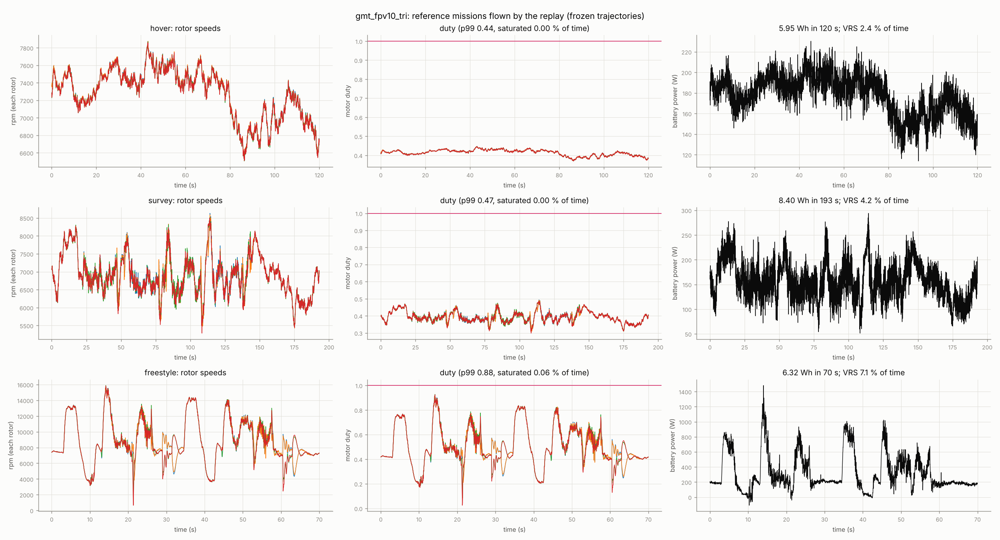
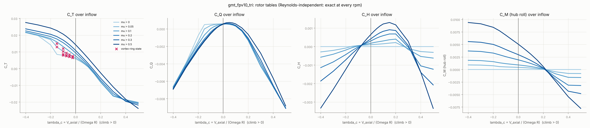
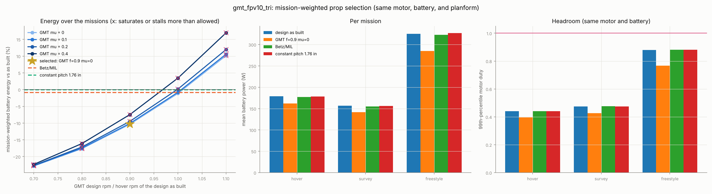
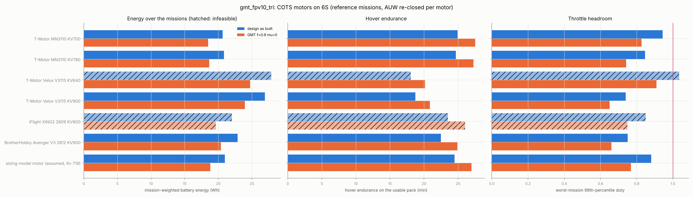

# SITL bridge: fly the prop in your simulator, then let the missions pick the prop

The propeller pipeline designs a blade at one point: diameter, rpm, free stream and thrust. A
multirotor flies a whole envelope, and its controller, motors and battery decide which part of that
envelope the prop actually works in. This bridge closes the loop with a custom simulator running
PX4:

```
design  ──►  prandtl run --stages sitl  ──►  rotor tables + motor/battery card + PX4 params  ──►  your sim + PX4 SITL
   ▲                                                                                                │
   │                                                                                    ULog / truth-CSV logs
   │                                                                                                ▼
   └────── best twist (stations.csv, tables, params)  ◄──  prandtl sitl-optimize --log ...  ◄── mission replay
```

```
prandtl run designs/gmt_fpv10_tri.yaml --stages sitl                    # export for the simulator
prandtl sitl-replay   designs/gmt_fpv10_tri.yaml --log flight1.ulg --log survey.csv
prandtl sitl-optimize designs/gmt_fpv10_tri.yaml --log flight1.ulg --log survey.csv --weights 3,1
```

With no `--log`, both commands use three built-in reference missions (hover, survey, freestyle),
which stand in for SITL logs until real ones exist.

Arm blockage is deliberately left out. The frame is not chosen yet, and the estimate below shows it
is a ~2% thrust correction that hardly moves the twist optimum. Add it as a CFD-derived factor once
the frame CAD exists.

## 1. What the sim gets (`sitl` stage)

| File | Contents |
| --- | --- |
| `rotor_table.json` | C_T, C_Q, C_H, C_M over (λ_c, μ) (plus rpm for a Reynolds-dependent polar), definitions, VRS flags |
| `rotor_tables.hpp` + `prandtl_rotor.hpp` | the same table as `constexpr` arrays and a header-only C++17 evaluator, wrench, motor, battery |
| `sitl_model.json` | motor (Kv, R, I₀, J), battery (cells, Ah, R, OCV curve), mass, inertia, rotor layout, frames, assumptions |
| `px4_params.txt` | `CA_ROTORi_CT/KM/PX/PY`, `THR_MDL_FAC`, `MPC_THR_HOVER`, `BAT1_*` fitted to the model |
| `mission_*.csv` | reference missions in the truth-log format: the template for your sim's logger |
| `rotor_tables.png`, `missions.png`, `reference_missions.csv`, `operating_histogram.csv` | checks and the replay of the design as built |

### Rotor tables, from first principles

With the blade fixed, the forward-flight BEMT (`multirotor.rotor_forward`) depends on the rotor speed
Ω and on the hub's inflow. The inflow has an axial part V_axial along the thrust axis (climb > 0)
and an edgewise part V_edge in the disk plane. With a Reynolds-independent polar, dimensional
analysis collapses this to

```
λ_c = V_axial / ΩR,   μ = V_edge / ΩR
T = ρA(ΩR)² C_T,  Q = ρA(ΩR)² R C_Q,  H = ρA(ΩR)² C_H,  M_roll = ρA(ΩR)² R C_M
```

So one (λ_c, μ) table is **exact at every rpm**. The test checks this against the BEMT to 1e-9. A
table polar adds an rpm axis.

The tables cover:
- **Descent.** λ_c from −0.4 (descent) to +0.5 (climb or windmilling).
- **Edgewise flow.** μ from 0 to 0.6.
- **Clamping.** Inflow beyond the grid is clamped, and every load still goes to zero with (ΩR)²
  as Ω → 0.
- **Accuracy.** Interpolation between nodes is within 0.3% on the 10″ design.

The hub roll moment C_M is new in `rotor_forward`. It is the azimuth average of r·dT·sin ψ: the
advancing blade's extra lift on a rigid, unhinged prop.

**Vortex-ring state** is flagged, not modelled. The flag is evaluated from the interpolated thrust,
using the boundaries of Wolkovitch and Johnson (NASA TP-2005-213477):

```
−2 < V_axial / v_h < −0.3   and   V_edge / v_h < 1,   with v_h = ΩR √(C_T / 2)
```

### Per-step use in the simulator (FRD body frame, rotors thrust along z_r = −z_b)

```
v_rel   = v_air,b + ω_b × p_i                        hub velocity relative to the air
V_axial = −v_rel,z;  V_edge = |v_rel,xy|;  e_f = v_rel,xy / V_edge
loads   = evaluate(table, rpm_i, V_axial, V_edge)
force   = T z_r − H e_f
moment  = p_i × force − s_i M_roll e_f + s_i Q z_b    (s = +1 counter-clockwise from above)
```

The sign rules:
- **Advancing side.** It lies at s(e_f × z_r), so a counter-clockwise rotor moving forward has its
  advancing side on the right and rolls the body left.
- **Reaction torque.** It yaws the body by +s·Q, the same sign as PX4's `KM > 0` for counter-clockwise
  rotors.
- **Tested.** `test_wrench_signs` pins both signs, and the C++ header is compiled and compared with
  Python in `test_cpp_header_matches_python`.

### Motor, ESC and battery

```
ESC      motor sees u·V_bus (u = PX4 normalised motor command); bus current u·I/η_esc
motor    I = (u V_bus − ω/Kv)/R_m;  Q_m = Kt (I − I₀);  J dω/dt = Q_m − Q_aero
braking  synchronous rectification (BLHeli_32 / AM32 under DShot): I < 0 regenerates; off → I ≥ 0
battery  V_bus = V_oc(SoC) − R_b Σ I_bus   (closed form: V_bus = (V_oc + g Σ u e)/(1 + g Σ u²), g = R_b/(R_m η))
```

V_oc(SoC) is a typical LiPo rest curve: 4.20 to 3.27 V per cell. The parameters are the same ones
the `multirotor` stage uses.

The bus is shared and scaled by each duty cycle. That is why the hover battery power, 178.6 W, is
below the multirotor stage's 193.6 W: that stage charges every motor with n·R_b at full current. It
is also why the motor time constant is 11 ms here against 22 ms there.

`test_motor_forward_dynamics_track_the_replay` integrates this ODE with the replay's duty and bus
voltage. The rotor speeds come back within 1%.

### PX4 parameters

Each parameter comes from the model's static thrust curve: J dω/dt = 0 at each command, at the
mid-charge bus voltage.

| Parameter | 10″ GMT tri | How |
| --- | --- | --- |
| `CA_ROTORi_CT` | 16.19 N | thrust at u = 1 (PX4: T = CT u²) |
| `THR_MDL_FAC` | 0.974 | least-squares fit of T(u)/T(1) to f u² + (1 − f) u |
| `CA_ROTORi_KM` | ±0.01263 m | Q/T at hover, + for counter-clockwise rotors |
| `MPC_THR_HOVER` | 0.219 | T_hover / CT |
| `CA_ROTORi_PX/PY` | ±0.1485 m | quad-X layout from `multirotor.arm_length_m` (placeholder until the frame) |
| `BAT1_*` | 6S, 4000 mAh, 12 mΩ | from `multirotor` |

Check the names against your PX4 version. `CA_ROTORi_KM` carries the GMT trade: a torque-minimised
prop has a small Q/T, and that is exactly the yaw authority PX4 will see.

## 2. Logs and replay

**What a log becomes.** Each log becomes a `Trace`: the body air velocity and rates, plus the wrench
[total thrust, L, M, N] the rotors had to produce.

**Supported sources:**
- **Truth CSV (preferred).** Columns `t_s, vx_b, vy_b, vz_b` (air-relative, FRD), optionally
  `p, q, r, v_bus`, then either `rpm_0..rpm_{n−1}` or `thrust_total, L, M, N`. Log this from the sim,
  which knows the true airspeed and rpm. The stage's `mission_*.csv` files are examples.
- **PX4 ULog.** Topics used:
  - `actuator_motors` sets the time base;
  - `vehicle_attitude`, `vehicle_local_position`, `vehicle_angular_velocity` and `battery_status`
    give attitude, velocity, rates and bus voltage;
  - `wind` is subtracted when present;
  - `esc_status` rpm is used when reported. Otherwise rpm is solved from the command and bus voltage
    through the motor model, which assumes the sim runs this same model.
  - `test_ulog_ingest_reconstructs_rpm` writes a minimal ULog and reads it back.

**Replaying a candidate prop.** A candidate must deliver the same wrench from the same inflow.

1. **Rotor speeds.** Damped Newton on the n rotor speeds solves wrench4(rpm) = W. Each rotor's loads
   depend only on its own speed, so one perturbed evaluation gives the Jacobian. The full nonlinear
   rotor enters, including torque, hub roll moment and H-force. A prop with less torque per thrust
   therefore needs a larger thrust split for the same yaw moment, so yaw authority is priced in. An
   earlier proportional-allocation scheme oscillated in fast banked turns, which is why it was
   replaced.
2. **Motor.** Q_m = Q_aero + J dω/dt gives the current and terminal voltage. The shared-bus voltage
   comes from SoC and R_b, and duty is u = V_term / V_bus.
3. **Battery.** SoC and the cell energy ∫V_oc I_bus dt are integrated over time.

A sample counts as **saturated** when any of these holds:
- some motor needs u > `sitl.max_throttle`;
- the wrench is unreachable inside the speed limits;
- the battery cannot supply the power;
- a non-braking ESC would need negative current.

Separately, a sample counts as **stalled** when any rotor's peak section Cl exceeds
`multirotor.forward_cl_limit` (1.15, under the polar's 1.2 clamp). The peak is taken over the
thrust-carrying disk: azimuth points with at least 25% of the tip dynamic pressure. Root sections
inside that boundary are excluded. GMT twists load the root hard (Cl ≈ 0.97 at r/R 0.29 on the 10″),
so the root clamps at walking pace in edgewise flow, but it carries little thrust.

The test round trip recovers logged rpm to 1e-4.

**Frozen trajectory.** This is the one big assumption: the candidate flies the same path. It holds
while the controller tracks, and saturation shows where it would not. The real check is to fly the
candidate's exported tables in SITL, which is the loop.

### Reference missions

These are quasi-steady rigid-body traces, not a controller:
- **Velocity.** The velocity follows segment targets through a triple-pole critically damped
  filter, so jerk is continuous.
- **Thrust.** The thrust vector is m(a − g) − D, low-passed at 25 rad/s as an attitude-loop
  bandwidth. Unfiltered turbulence would mean unbounded angular acceleration.
- **Attitude and moments.** Attitude comes from the thrust direction and heading, and the moments
  are I ω̇ + ω × Iω.
- **Wind.** A mean plus one-pole turbulence with a 30 m length scale.

| Mission | Content |
| --- | --- |
| hover | 120 s in 3 m/s wind, 1.5 m/s gusts |
| survey | climb to ~40 m, four 300 m legs at 12 m/s with 180° turns, loiter, descend; 5 m/s cross-wind |
| freestyle | twice: 15 m/s punch-out, 10 m/s dive through the wake, 25 m/s straight, ~2.6 g banked turn, 6 rad/s yaw spin |

Replay of the 10″ GMT tri as built:

| Mission | Energy | Mean battery power | p99 duty | Saturated | Vortex-ring state |
| --- | --- | --- | --- | --- | --- |
| hover | 5.95 Wh / 120 s | 178.6 W | 0.44 | 0 % | 2.4 % (vertical gusts) |
| survey | 8.40 Wh / 193 s | 156.7 W | 0.47 | 0 % | 4.2 % (descent) |
| freestyle | 6.32 Wh / 70 s | 325.3 W | 0.88 | 0.06 % | 7.1 % (dives) |





## 3. Mission-weighted selection (`sitl-optimize`)

**The candidate family.**
- **Planform.** The design's own planform, optionally chord-scaled with `sitl.chord_scales`.
- **GMT twists.** The global-minimum-torque twist for the vehicle's hover thrust, designed at
  f × (hover rpm as built) and bell weight μ.
- **References.** The design as built, Betz/MIL and constant pitch.

**Evaluation.** Every candidate gets its own tables and replays every mission on the **same motor
and battery**: the hardware you buy, with Kv as matched for the design as built. Then:
- the objective is Σ w_m E_m, the weighted battery energy over the missions;
- a candidate is feasible if, on every mission, saturation plus time over the current limit stays
  within the larger of `sitl.allowed_saturation_fraction` and the as-built value.

**What `best/` holds:** `stations.csv` (the twist, ready for a design file), the tables, the C++
header and `px4_params.txt`. Load those into the sim, fly, and log; the next iteration starts there.

### Result on the 10″ GMT tri (reference missions, equal weights, motor Kv 719 fixed)



There are 27 candidates:
- GMT at f = 0.6–1.1 × 4 bell weights (f = 0.6 cannot reach hover thrust under `gmt.cl_limit`);
- the design as built, Betz/MIL and constant pitch.

| Candidate | Weighted energy | vs as built | hover / survey / freestyle power | freestyle p99 duty | worst stall time | feasible |
| --- | --- | --- | --- | --- | --- | --- |
| design as built (GMT, 7500 rpm, μ = 0.187) | 20.68 Wh | — | 178.6 / 156.6 / 325.2 W | 0.88 | 6.7 % | (reference) |
| **GMT f = 0.9, μ = 0 (selected)** | **18.54 Wh** | **−10.3 %** | 162.1 / 141.7 / 284.8 W | 0.77 | 6.4 % | yes |
| GMT f = 0.8, μ = 0 | 17.03 Wh | −17.6 % | 150.2 / 131.3 / 256.2 W | | 53 % | no: stalls |
| GMT f = 0.7, μ = 0 | 15.96 Wh | −22.8 % | 141.8 / 123.6 / 236.7 W | | 85 % | no: stalls |
| GMT f = 1.0, μ = 0 | 20.44 Wh | −1.1 % | 176.8 / 154.7 / 321.5 W | | 4.0 % | yes |
| GMT f = 1.1, μ = 0 | 22.77 Wh | +10.1 % | 194.7 / 170.1 / 368.3 W | | 2.2 % | no: saturates 0.8 % |
| Betz/MIL | 20.50 Wh | −0.9 % | 177.2 / 155.0 / 322.9 W | | 3.8 % | yes |
| constant pitch | 20.67 Wh | −0.0 % | 178.4 / 156.2 / 326.5 W | | 2.9 % | yes |

What the missions say:

1. **The current prop was picked for the wrong objective for endurance.** `design-gmt` chose hover
   *torque* (motor size). Over the missions, the same planform with a GMT twist designed for about
   10% lower rpm (steeper pitch) uses 10% less battery on the same motor. It also has *more* duty
   headroom: freestyle p99 duty drops from 0.88 to 0.77, because lower rpm means less back-EMF per
   newton.
2. **Stall in cruise is the binding constraint, not saturation.**
   - Slower designs run every section at higher Cl.
   - In edgewise flight the induced velocity falls (translational lift), which raises every
     section's angle of attack.
   - At f ≤ 0.8 the thrust-carrying disk sits at the Cl clamp for over half of some missions. The
     polar has no stall drag rise, so their energy is optimistic, and they are rejected.
   - The single-point check in `design-gmt` (at 25 m/s only) never saw this. At 25 m/s the steep
     body pitch puts flow *through* the disk and relieves the blade. The stall bites at 5–15 m/s.
3. **The bell weight costs energy and stall margin over a mission.**
   - μ > 0 moves load inboard and raises the root Cl.
   - At f = 0.9, μ = 0.1 already stalls 21% of a mission.
   - The structural reason for μ (root stress) has to be re-checked for the selected twist: run
     `prandtl design-gmt` / FEA on `best/stations.csv` before molding.
4. **Yaw authority is unchanged.** `CA_ROTOR_KM` is 0.01269 against 0.01263 m. CT rises from 16.2 to
   19.7 N and `MPC_THR_HOVER` falls from 0.219 to 0.180.

**Next step:**
1. Load `outputs/sitl/gmt_fpv10_tri/best/` (tables and `px4_params.txt`) into the simulator.
2. Fly the real missions.
3. Run `prandtl sitl-optimize ... --log <those logs>`.
4. If the selection holds on real logs, close the structure and the mold for it with the existing
   stages.


## 4. COTS motor selection (`sitl-motors`)

```
prandtl sitl-motors designs/gmt_fpv10_tri.yaml --prop "GMT f=0.9 mu=0=outputs/sitl/gmt_fpv10_tri/best/rotor_table.json"
```

**What the motor must deliver** (selected prop, static, 6S). These figures come from the rotor
tables; Kv is matched with `multirotor.matched_kv`.

| | Hover (3.54 N) | T/W 4 (14.2 N) |
| --- | --- | --- |
| rpm | 6750 | 13,500 |
| torque | 45 mN·m | 180 mN·m |
| shaft power | 32 W | 254 W |
| Kv to reach T/W 4 | | 643 at 22.2 V, 685 at a sagged 21 V |

That is a low-Kv, high-torque motor, not a typical 1300 Kv 10″ FPV motor.

**What decides between motors.** From first principles:
- **No-load loss at hover.** I₀(ω)·V is 3–12 W per motor against 32 W of shaft power.
- **All-up mass.** Hover power scales as AUW^1.5.
- **Copper loss.** It is (Q/K_m)² with K_m = K_t/√R, under 2 W at hover for every candidate.
- **Kv.** It sets T/W on an empty pack and the share of time saturated.

Each motor in `data/motors/cots_6s_10in.yaml` (sources and confidence per entry) is flown with both
props through the reference missions:
- **Mass and inertia.** AUW is re-closed per motor as payload plus 4 × (motor + 12.9 g CAD prop),
  and the motor's mass adds to the roll and yaw inertia.
- **No-load current.** I₀ is scaled from the datasheet test point as (ω/ω_test)^0.5.
- **Bell inertia.** 0.4 m (D_stator/2 + 3 mm)².
- **Ratings.** RMS and peak current are checked against the published ratings.



Results with the selected prop (GMT f = 0.9, μ = 0):

| Motor (6S-rated) | Flying mass | AUW | Mission energy | Hover power, endurance | Static T/W empty–full pack | Freestyle p99 duty | Data |
| --- | --- | --- | --- | --- | --- | --- | --- |
| **T-Motor MN3110 KV700** | 85 g | 1.612 kg | **18.48 Wh** | 161.5 W, **27.5 min** | 3.39–4.85 | 0.83 | mixed |
| **T-Motor MN3110 KV780** | 85 g | 1.612 kg | 18.65 Wh | 163.1 W, 27.2 min | **4.07–5.84** | 0.74 | datasheet |
| iFlight XING2 2809 KV800 | 61 g | 1.517 kg | 19.63 Wh | 170.8 W, 26.0 min | 4.32–6.04 | 0.75 | I₀ estimated; 28 A spikes > 25.6 A peak |
| BrotherHobby Avenger V3 2812 KV900 | 77 g | 1.578 kg | 20.40 Wh | 178.5 W, 24.9 min | 5.08–7.19 | 0.66 | R, I₀ scaled from 1115 KV |
| T-Motor Velox V3115 KV900 | 113 g | 1.724 kg | 23.95 Wh | 213.0 W, 20.9 min | 4.78–6.97 | 0.65 | mixed |
| T-Motor Velox V3115 KV640 | 113 g | 1.725 kg | 24.73 Wh | 220.4 W, 20.2 min | 2.64–3.85 | 0.91 | datasheet |
| *sizing-model motor (assumed)* | *48 g* | *1.463 kg* | *18.80 Wh* | *164.8 W, 27.0 min* | *3.63–5.38* | *0.77* | *model* |

**Recommendation: T-Motor MN3110 KV780** (the Navigator series).
- **Endurance.** Within 1% of the most efficient candidate.
- **Thrust.** It is the only motor that keeps the design's T/W 4 even on an empty pack.
- **Data.** Its data is the best supported: 71 mΩ, 0.4 A at 10 V, 26 A continuous.
- **When to take the KV700 instead.** If endurance matters more than end-of-pack punch, the KV700 is
  0.9% better but falls to T/W 3.4 when the pack is empty.

**Why the heavier MN3110 beats the lighter FPV motors.** Its no-load current is three to five times
lower (0.3–0.4 A against 0.9–1.6 A at 10 V). At hover that iron loss is a larger share of the
power than the 24–37 g mass difference costs. The 3115 cinelifter motors have the best K_m, but
they lose on both mass and no-load loss at this hover point.

**Yaw.** Heavier motors at the arm tips add yaw inertia (+36% I_zz with 85 g motors). Combined with
the GMT prop's low K_M, that left the yaw spin briefly at the rotors' yaw limit. The replay now
desaturates the way PX4 does: it gives up yaw first and counts that time as yaw-limited (≈ 0% for
the MN3110 here), not as saturated.

**Fit-up.**
- The MN3110 has a 4 mm shaft with an M6 prop adapter (or a bolt-on pattern for T-Motor CF props).
  The molded hub's 5 mm bore needs `hub.center_bore_m: 0.006`, or the bolt-on hub variant.
- Retailer listings disagree on the bell hole pattern, so check it against the T-Motor drawing
  before cutting the mold.
- Replace the catalogue figures with thrust-stand data (T, Q, I and rpm against throttle) once the
  motors are in hand.

## Assumptions and limits

- **Rotor aerodynamics.** BEMT with uniform induced velocity per annulus and Glauert momentum
  edgewise. Reverse flow carries no load, wake skew is ignored, and the hub is rigid (no flapping
  relief of the roll moment).
- **No interference.** Rotor–rotor and rotor–arm interference are not modelled; arm blockage waits
  for the frame.
- **Blockage estimate.** For an arm of width w under one disk radius:
  - the arm covers w/(πR) of the disk, about 3% for a 12 mm arm on a 10″ prop;
  - the force on the arm ÷ thrust ≈ C_d × q_wake/(T/A) × w/(πR) ≈ 1.2 × 0.5 × 0.03 ≈ 2%;
  - that acts as a uniform factor on vehicle thrust. Its once-per-blade-pass part matters for
    vibration and noise, not for energy or navigation.
- **Vortex-ring state** is flagged only. Descent-heavy missions need an empirical VRS model in the
  sim before the replay's descent energy can be trusted.
- **Missions are not a controller.** Use real SITL logs for decisions; the reference missions exist
  to exercise the pipeline.
- **Electrical model.** Ideal DC machine; an open-loop duty ESC; a generic LiPo curve. Replace these
  with bench data (thrust stand: T, Q, I and rpm against command) when the motor is bought. That
  bench test also validates the tables directly.
