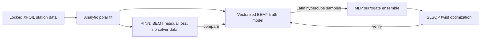

# Surrogate Model and Physics-Informed ML

This is an optional extension to the thesis workflow. It does not change the locked MIL/GMT results.

```bash
python -m pip install torch            # or: python -m pip install -e ".[ml]"
python scripts/run_surrogate_piml_study.py          # full study, a few minutes on CPU
python scripts/run_surrogate_piml_study.py --quick  # smoke run, about 30 s
pytest tests/test_surrogate_piml.py
```

Outputs: `outputs/reports/surrogate_piml_report.md`, `outputs/tables/piml_*.csv`, `outputs/figures/fig_piml_*.png|pdf`.



## Truth model (`src/prandtl_prop/bemt_solver.py`)

It uses the same physics as the locked solver: hover, stationwise annular momentum with Prandtl tip loss (floor 0.05), no swirl. The residual is solved by bisection for every station of every design at once, which takes about 0.3 ms per design.

Assumptions and limits:

- **Polar.** The XFOIL polar CSVs are not in this repository. Cl and Cd come from a least-squares fit to the 74 Cl/Cd/alpha/Re values recorded in the locked station CSVs, with a per-airfoil Cl offset and a shared lift slope, Reynolds term, and quadratic drag model. The fit only covers alpha 1.0-8.2 deg and Re 88k-237k. Outside that range the soft stall (Cl_max = 1.15) and the post-stall drag rise are assumptions.
- **Agreement with the locked results.** Both designs are trimmed to 35 N with a small collective offset (+0.10 deg MIL, -0.02 deg GMT). The torque then matches the locked values within 0.5%. The GMT torque reduction is 1.77% here versus 1.50% locked. The difference comes from the polar fit and from the tip station (below).
- **Tip station.** The station at r/R = 0.9997 is dominated by the tip-loss floor, so its inflow is not physical. It stays in the load integrals, as in the locked solver, but it is excluded from the angle-of-attack validity statistics (`ALPHA_STATS_MAX_MU`).

## Design space (`src/prandtl_prop/surrogate.py`)

| Variable | Range | Meaning |
| --- | --- | --- |
| `rpm` | 3200-4800 | rotor speed |
| `gmt_blend` | -0.5 to 1.5 | fraction of the locked (GMT - MIL) twist difference (0 = MIL, 1 = GMT) |
| `twist_0_deg` | +/-2.5 | collective twist |
| `twist_1_deg` | +/-2.5 | linear twist mode, x = (r/R - 0.6) / 0.4 |
| `twist_2_deg` | +/-1.5 | quadratic twist mode, P2(x) |
| `chord_scale` | 0.85-1.15 | uniform chord multiplier |

## Surrogate

The surrogate is an ensemble of 3 MLPs (3 x 64 SiLU). The ensemble spread gives a cheap uncertainty estimate. Two target encodings are compared:

- `black_box` predicts thrust, torque, and root bending moment directly.
- `physics` predicts the rotor coefficients CT, CQ, and CM. Dimensional analysis supplies the n^2 rpm scaling exactly, so the network only has to learn the weak residual effects of Reynolds number and tip loss.

The optimizer is SLSQP with autograd gradients through the surrogate. It minimizes torque at 4000 rpm with fixed chord, subject to T = 35 N, alpha in [0, 9] deg, and an optional cap on the root bending moment. Sweeping that cap gives a torque vs root-moment Pareto front, which is the trade Prandtl's 1933 bell spanload is about. Each surrogate optimum is re-checked on the BEMT model and compared with an SLSQP run directly on BEMT.

## PINN (`src/prandtl_prop/pinn.py`)

The network maps (r/R, local zero-lift Cl, design vector) to the induced velocity vi. Its loss is the normalized BEMT closure residual, momentum dT/dr minus blade-element dT/dr. This is the same differentiable function (`station_physics`) that the bisection solver drives to zero, and the test suite checks that the two agree. No solver samples are used in training. Once trained, a single forward pass gives the inflow, thrust, and torque for any design in the box, and the result is differentiable with respect to the design.

## Why use a surrogate when BEMT is already fast?

This BEMT is already cheap, so here the surrogate's job is to demonstrate the method against an exact truth model. The same pipeline pays off when the truth model is expensive, for example CFD, a coupled aero-structural solve, or thrust-stand data. In that case the physics-structured encoding and residual-trained models reduce how many expensive samples are needed. All results here compare one model with another; none of them is experimental validation.
