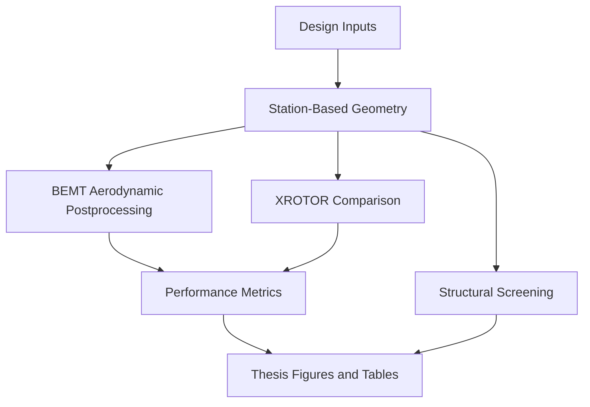

# Reproducibility Workflow

The clean public workflow uses locked geometry and BEMT postprocessing data copied into `data/`. Historical implementation attempts are preserved under `archive/` for traceability, but they are not part of the final reproducible thesis workflow.



## Fully Python-Reproducible From This Repo

```bash
python scripts/run_geometry_generation.py
python scripts/run_aero_postprocessing.py
python scripts/run_xrotor_headless.py
python scripts/run_matlab_fea.py
python scripts/make_thesis_figures.py
pytest
```

These commands read the locked CSV/JSON data and regenerate clean outputs under `outputs/`.

Archived scripts and notebooks are intentionally excluded from this command list.

## Interactive GUIs

Interactive tools live under `scripts/gui/`:

```bash
python scripts/gui/start_streamlit_aero_ui.py
python scripts/gui/start_matlab_fea_ui.py
```

These launchers start the archived Streamlit aero-solver UI and MATLAB propeller beam viewer for inspection. They are not part of the locked thesis quick-start workflow and should not be cited as final methodology.

## External Software Context

- XFOIL: used historically to generate airfoil polar CSVs. Existing locked station data are used by the clean BEMT result.
- XROTOR: optional comparison artifacts are present, but this is not experimental validation.
- MATLAB: required for the legacy 3D beam/frame structural workflow and interactive FEA viewer.
- Abaqus: required for native `.cae`, `.odb`, and related structural solver files.
- OpenVSP and PSU-WOPWOP: exploratory aeroacoustic tooling is present but is not a locked validation basis.
