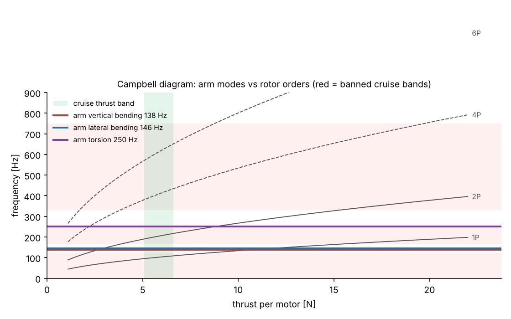
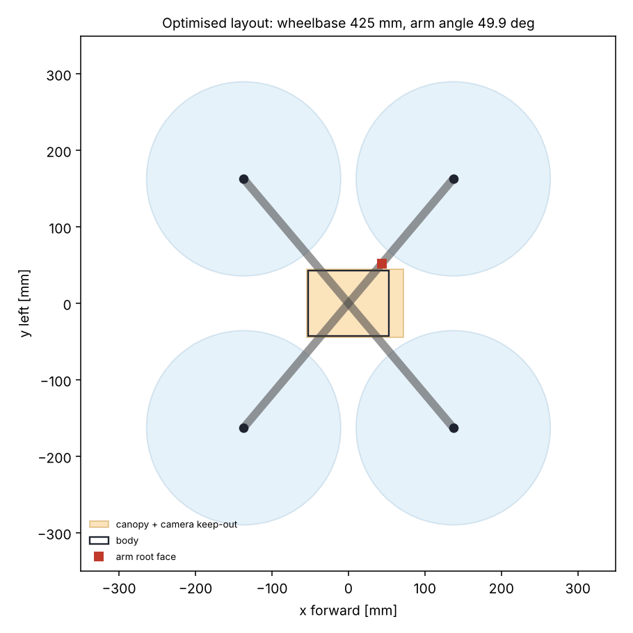
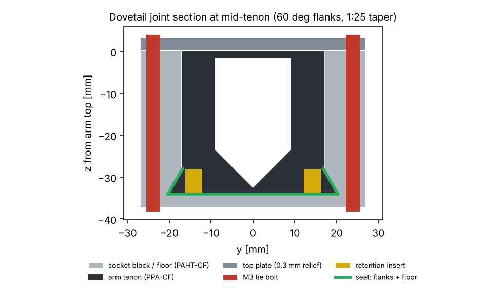
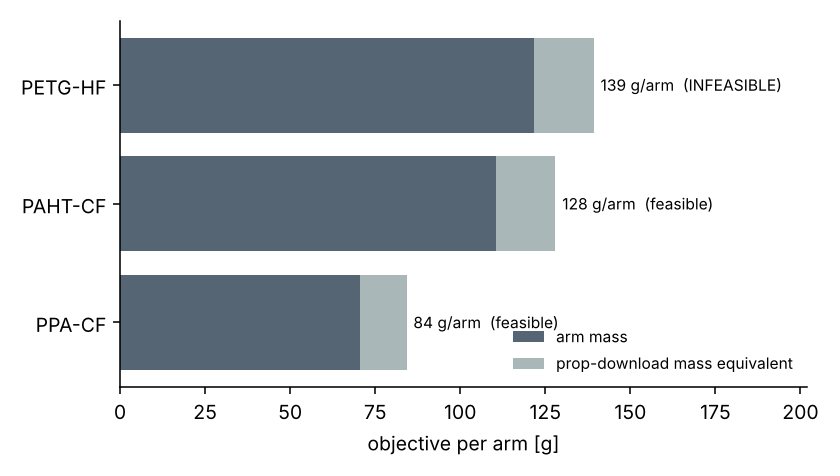
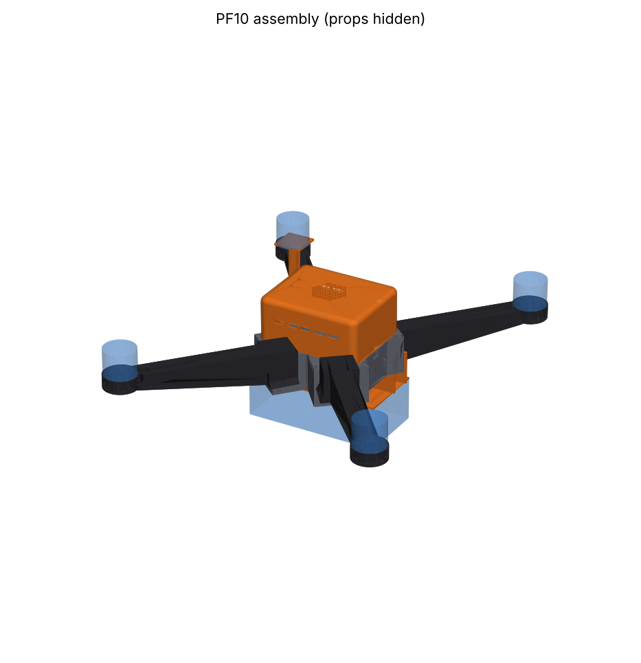
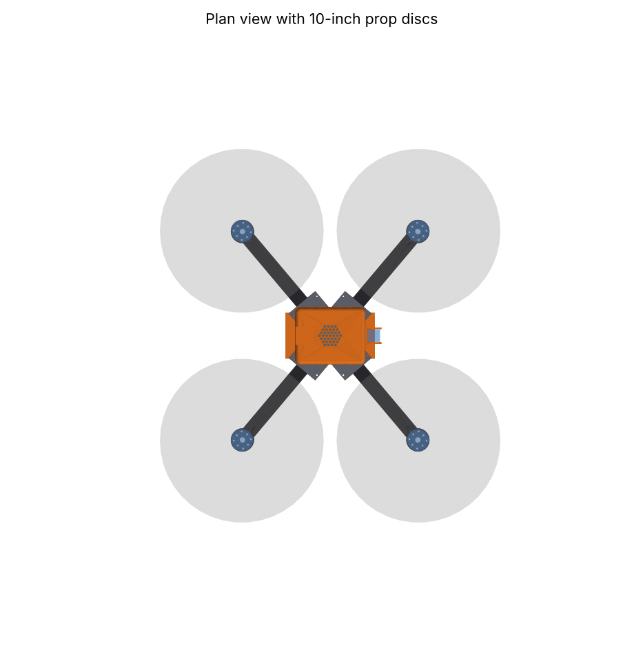
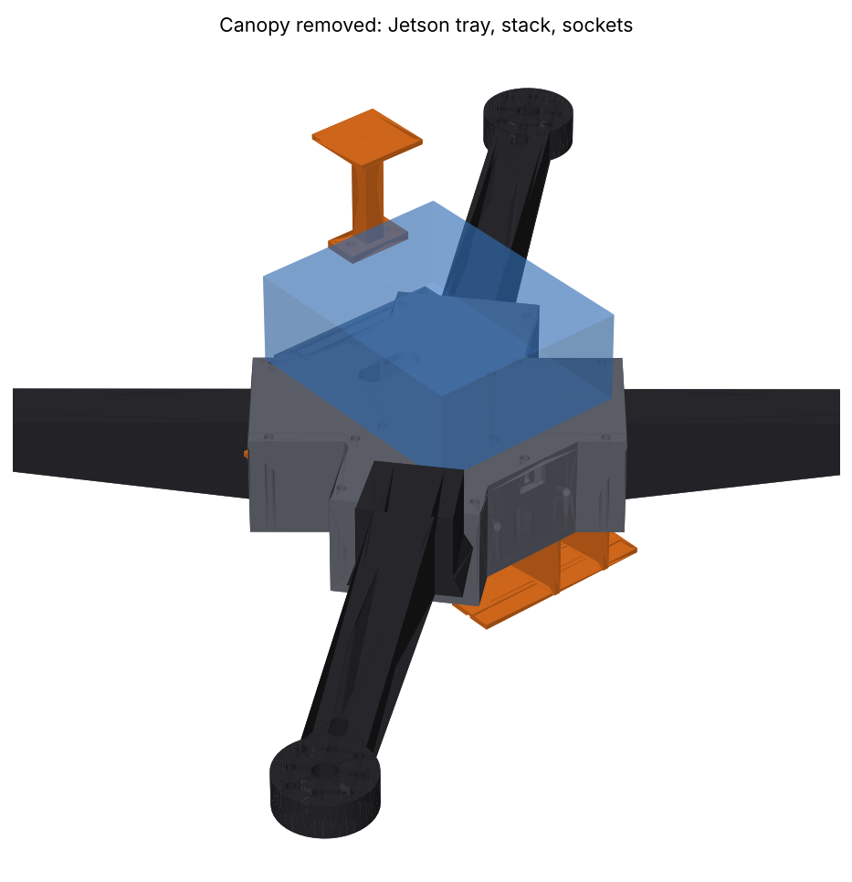
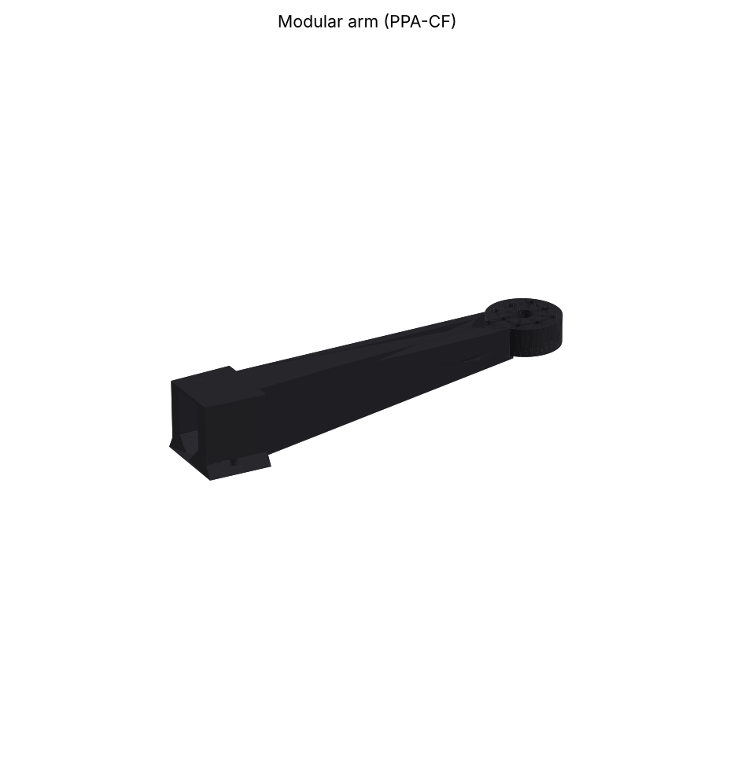
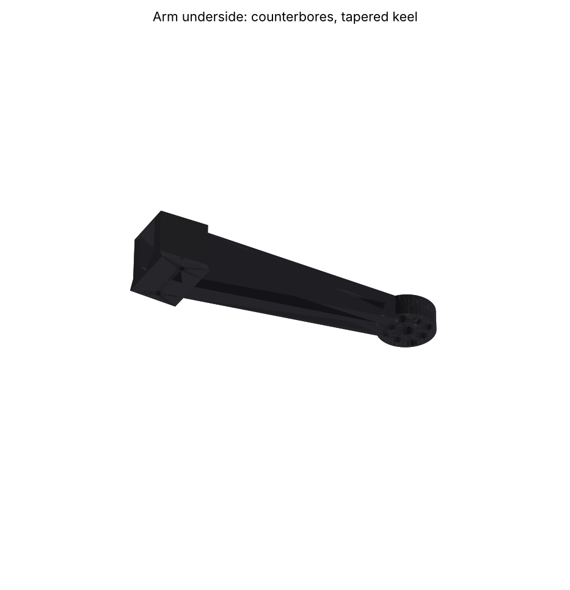

# PF10 design report

Generated by `run_pipeline.py`; every number traces to `config/frame.yaml` and `config/materials.yaml`.
Items marked ASSUMPTION in the config are placeholders until measured (see `docs/test_plan.md`).

## Summary

| quantity | value |
| --- | --- |
| all-up weight | 2074 g |
| printed frame (no legs) | 538 g (CAD) |
| arm (each, PPA-CF) | 70.5 g |
| thrust/weight | 4.33 |
| hover | 5.09 N/motor, 5713 rpm (1P 95 Hz) |
| wheelbase (motor-motor diagonal) | 425.4 mm |
| arm modes vert / lat / torsion | 138 / 146 / 250 Hz |
| allowed modal windows | 125-166, 250-331, >749 Hz |
| tip deflection / slope at limit load | 0.36 mm / 0.19 deg |
| arm joint | tapered sliding dovetail (60 deg, 1:25 taper), see section 3b |
| joint crash capacity / crash moment | 50 / 32 N m (tie_bolts governs) |
| fuse ratio (joint / arm root strength, reported) | 0.32 |

## 1. Operating point and excitation

Static rotor model T = CT rho n^2 D^4 (CT 0.11, CP 0.045). Limit load = max thrust 22.0 N x 1.25 = 27.5 N; ultimate = limit x 1.5.

A printed arm of this length cannot be stiff enough to sit above hover blade-pass (~190 Hz) at reasonable mass. The optimum PPA-CF arm with the frequency floor at 1.15x blade-pass was infeasible inside the bounds. So the requirement is placement: every mode must sit outside the cruise bands of orders [1, 2, 4, 6] x 1P (cruise = hover..1.3x hover thrust, +/-15 %). Transient sweeps during punch-outs are left to the RPM filter.

## 2. Layout optimisation

Arm stiffness goes as 1/L^3 and mass as L, so the shortest legal arm wins. For each arm angle the minimum motor radius is solved exactly from the prop-prop, prop-canopy and symmetry constraints. The free length R - r_root is then minimised over a 0.05 deg scan, which gives the global optimum.

| arm angle | motor radius | root radius | free length | front gap | side gap | canopy gap | binding |
| --- | --- | --- | --- | --- | --- | --- | --- |
| 49.90 deg | 212.7 | 68.0 | 144.7 | 71.4 | 20.0 | 8.0 | side prop-prop clearance, prop-canopy clearance |

## 3. Arm section optimisation

Mixed-integer differential evolution. Variables: width, root height, taper, wall loops, skin layers. Thicknesses are integer multiples of line width and layer height, so every candidate is printable as sliced. The objective is arm mass plus the mass equivalent of prop download on the arm.

| b | h_root | h_tip | web | flange | channel at tip (w x h) |
| --- | --- | --- | --- | --- | --- |
| 21.86 | 33.99 | 13.63 | 1.86 (3 loops) | 1.44 (6 layers) | 18.1 x 10.7 |

Constraint margins (>= 0 satisfied):

| constraint | margin |
| --- | --- |
| f_tor | +0.000 |
| f_vert | +0.096 |
| f_lat | +0.136 |
| tip_height | +0.363 |
| joint_crash | +0.557 |
| dovetail_fits | +0.739 |
| channel_h | +0.791 |
| channel_w | +1.268 |
| tip_slope | +4.278 |
| interlaminar | +13.680 |
| static_strength | +22.357 |
| fatigue_goodman | +46.179 |

Mass: span 37.8 g + tenon 23.8 g + pad 8.9 g; prop download 0.135 N (= 13.7 g). Ultimate stress 4.0 MPa vs allowable 92.8 MPa; Goodman 0.014. Stiffness drives the design, not strength.

### 3b. Arm joint: tapered sliding dovetail

60 deg dovetail foot (6.0 mm deep, flanks 30.0 deg from vertical), plan taper 0.04 per side, 3.0 mm seat travel, flanks + floor line-on-line, straight sides +0.3 mm, top-plate relief 0.3 mm. Design rationale and the swap procedure are in `docs/dovetail_joint.md`.

| quantity | value |
| --- | --- |
| joint rotational stiffness vert / lat / torsion | 22.7 / 36.8 / 287.4 kN m/rad |
| self-locking ratio (mu / taper) | 6.2 (>1 self-locks) |
| tolerance absorbed by seat travel | +/-0.24 mm of width |
| capacity: flank bearing | 86 N m |
| capacity: tie bolts | 50 N m |
| capacity: body box | 324 N m |
| crash case (crash_factor x limit root moment) | 32 N m |
| arm root static capacity | 156 N m |
| fuse ratio | 0.32 |
| CAD: slide-out path (2-35 mm) clear | True |
| CAD: arm pushed 0.5 mm deeper interferes (wedge seats) | True (6.6 mm3) |

The fuse ratio is below 1 on purpose, and it is reported rather than constrained. The stiffness-sized arm is about 39x stronger than the limit load in quasi-static bending, and no printed socket with M3 hardware can be stronger than that. The joint is instead sized for the crash case, and the load path keeps printed layers in compression.

### Material comparison (same layout and loads)

| material | E_design MPa | feasible | arm g | objective g | f_vert | f_lat | f_tor |
| --- | --- | --- | --- | --- | --- | --- | --- |
| PPA-CF | 7543 | True | 70.5 | 84.2 | 138 | 146 | 250 |
| PAHT-CF | 2625 | True | 110.5 | 128.0 | 125 | 134 | 250 |
| PETG-HF | 1466 | False | 121.7 | 139.2 | 100 | 97 | 153 |

PPA-CF's specific stiffness is about 3x PAHT-CF's and about 5x PETG-HF's, and arm mass follows it. PETG cannot reach the modal windows inside the bounds. The body is PAHT-CF rather than PPA-CF for its Z-bonding (loads cross layers in the sockets), 8 % elongation against 3 %, and easier printing on a passive-chamber X1C. The arm is the cheapest part to replace; see 3b for what actually limits the joint.

## 4. Mass budget and closure

| item | g |
| --- | --- |
| motors (4) | 232 |
| props (4) | 56 |
| Jetson + carrier + cooler | 175 |
| FC/ESC stack | 38 |
| VTX + camera | 35 |
| GPS | 15 |
| receiver | 5 |
| Jetson BEC | 12 |
| wiring | 70 |
| hardware | 40 |
| battery | 860 |
| printed frame | 536 |
| **AUW** | **2074** |

Closure history (AUW -> loads -> layout -> arm -> AUW):

| iter | AUW g | arm g | b mm | L mm |
| --- | --- | --- | --- | --- |
| 0 | 2052 | 70.2 | 21.72 | 144.7 |
| 1 | 2073 | 71.2 | 21.27 | 144.7 |
| 2 | 2077 | 70.6 | 21.85 | 144.7 |
| 3 | 2075 | 70.5 | 21.87 | 144.7 |
| 4 | 2074 | 70.5 | 21.86 | 144.7 |

## 5. CAD checks (CadQuery reference geometry)

| part | material | qty | volume cm3 | fill | mass each g | print bbox mm | fits X1C |
| --- | --- | --- | --- | --- | --- | --- | --- |
| arm | PPA-CF | 4 | 60.6 | 1.0 | 70.9 | 193x42x34 | True |
| bottom_body | PAHT-CF | 1 | 158.0 | 0.78 | 130.7 | 139x129x37 | True |
| top_plate | PAHT-CF | 1 | 34.8 | 0.85 | 31.4 | 139x129x3 | True |
| jetson_tray | PAHT-CF | 1 | 14.5 | 0.85 | 13.0 | 100x72x3 | True |
| canopy | PETG-HF | 1 | 32.6 | 1.0 | 41.4 | 108x88x48 | True |
| camera_mount | PETG-HF | 1 | 8.1 | 0.9 | 9.2 | 41x34x27 | True |
| battery_pad | PETG-HF | 1 | 29.2 | 0.7 | 26.0 | 140x72x6 | True |
| gps_mast | PETG-HF | 1 | 4.2 | 0.6 | 3.2 | 28x28x45 | True |
| landing_leg | PETG-HF | 4 | 9.4 | 0.7 | 8.4 | 32x32x88 | True |

Interference: 24 part pairs checked, **0 clashes**.

 

## 6. Model limits (read before trusting the numbers)

- Beam model: Euler-Bernoulli with a Bredt torsion constant (+/-15 %). No warping, no shear lag, no gyroscopic coupling. The spinning prop splits torsion and lateral modes into whirl pairs, so measure them.
- Printed-material allowables are TDS coupon values x stated knock-downs. The torsion mode depends on the shear modulus, which is not on the TDS (factor assumed). **Tap-test the first printed arm** and recalibrate (docs/test_plan.md).
- Joint: Winkler contact on the dovetail flanks and floor (1 mm compliant layer, 60 % contact assumed for the wedge-seated taper). Flank accuracy is the biggest print risk, so print the socket coupon first.
- Rotor: constant static CT/CP; replace with thrust-stand data for the real motor/prop.
- Crash: a quasi-static crash case (crash_factor x limit moment) sizes the joint. Impact dynamics and brittle notch failure are not modelled; test plan 1.4 checks them destructively.
